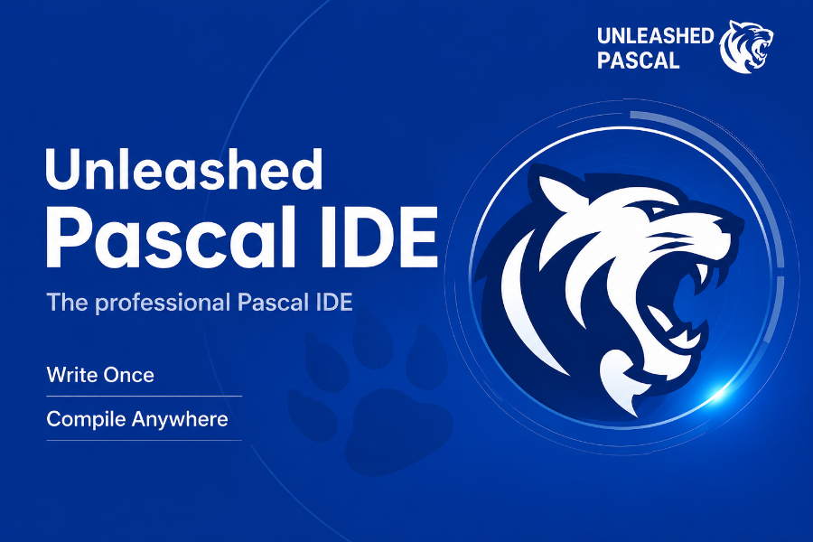

# Unleashed Pascal IDE

**Unleashed Pascal IDE** is a community-driven fork of **Lazarus IDE** built for the [Unleashed Pascal](https://github.com/unleashedpascal/compiler) compiler. Stock Lazarus has no idea about Unleashed mode: it underlines `match`, `defer`, contextual `step`, inline `var x := ...` and the rest as syntax errors, and code completion stops the moment you cross into anything the mode adds. This fork makes the IDE understand the language as it actually compiles.

On top of the language support it ships a themed, single-window IDE and a library of ninety-seven components for LCL applications, all documented in [unleashed/docs/](unleashed/docs/README.md).

## What is different from stock Lazarus

### The language

- **Syntax highlighting** for `match`, `defer`, `autofree`, `async` / `await`, `lock`, contextual `step`, the flexible array `count`, inline `var x := ...` declarations, `^T` pointers in inline declarations, interpolated and multiline strings, and the other Unleashed keywords and constructs.
- **Codetools** parse inline `var`, `autofree`, `with var` bindings, multiline strings, statement expressions, anonymous tuples, scoped cleanup and operators in a `match` subject. Code completion works on all of them.
- **New projects and units** start in `{$mode unleashed}`. A form unit inherits the mode from its package.

### The look

- **Themes** for the whole IDE: the stock look, the system light or dark setting, or one of six named looks (Frost, Paper, Ocean, Ember, Midnight, Dusk), switched from the View menu without a restart. Native controls, the designer, the Object Inspector and the icons follow; the icons are fitted to the surface color. Hover and active effects of the controls have their own switches.
- **Syntax highlight profiles** switched from the View menu. A creator with live preview rolls random profiles with a 100-step history, a theme change rolls a profile that matches the theme, and a manager window renames, deletes and applies the stored ones. A profile carries the divider and inspector colors along with the syntax colors.
- **Misc Look** window for the colors of the Messages window and the icon fitting; a theme change rolls the colors along with the profile.
- **gtk3** looks like win32: classic scroll bars, flat edges, control sizes like win32, a rule under the menu bar, the IDE follows the desktop theme.

### The layout

- **Panes**: a single-window layout with the tool windows docked as panes in columns and rows around the editor, in the main window, in extra editor windows and in designer windows. A tool window can be opened more than once; files open in the window in front; closing an editor window closes its files.
- **Minimap** of the unit next to the source, with a draggable band for the visible lines.
- **Form Placer**: a miniature desktop in the form designer for placing the designed window.
- **The form designer is always docked**: the docked form editor is part of the IDE, not an optional package.
- **Object Inspector** without the info box; the component list stays open inside a pane and its palette tree starts collapsed; tree views show scroll bars only when needed; styled tool bars in the Project Inspector.

### Defaults and workflow

- **FpDebug** is the debugger backend when none is configured.
- **Consolas** is the default editor font on Windows.
- `Ctrl+Shift+F9` runs Clean up and Build; the code formatter has no default shortcut.
- The IDE does not open the last project at start, and the options dialog opens at a default size and position.
- The build mode shows in the window title even with a single mode.
- Build Lazarus swaps in the built executable without a restart.
- A relocatable installation: the configuration lives in a `config_lazarus` directory beside the IDE, and a moved or copied installation is picked up on the next start.
- The release packages are the installer set; `lazbuild --add-release-packages` installs them.
- The splash, the About dialog and the window title say Unleashed Pascal IDE, so a stock Lazarus and this one can sit side by side without confusion.

## IDE packages

| Package | One-liner | Where |
|---|---|---|
| **Unleashed Themes** | the IDE in the stock look, light, dark, the system setting or one of six named looks, native controls and icons included, with a matching syntax highlight profile on request | View > Themes |
| **Unleashed Panes** | tool windows as panes in columns and rows around the source editor, one window for the whole IDE | Panes menu |
| **Unleashed Minimap** | a tiny picture of the whole unit beside the editor with a draggable band for the visible lines | View > Code Minimap |
| **Unleashed Form Placer** | a miniature desktop in the form designer; drag the form rectangle to pick where the window opens | the docked designer |
| **Unleashed Theme Engine** | the runtime under the themes: a palette on every window of an LCL process, used by the IDE and by applications | the packages above |

Details for each in [unleashed/docs/README.md](unleashed/docs/README.md).

## Components for applications

The `UnleashedComponents` package adds seven pages to the palette. Every component draws through the theme engine, so one `TAppTheme` on the main form puts a color theme on the whole application, native controls included, and the components follow. They are written for Windows and Linux alike, with no platform-specific code paths.

| Page | Components |
|---|---|
| **Input** | `TAppTheme`, `TSearchEdit`, `TSuggestEdit`, `TPasswordEdit`, `TNumberBox`, `THotKeyEdit`, `TDurationEdit`, `TDatePicker`, `TDateRangePicker`, `TTagEditor`, `TColorPicker`, `TFontComboBox`, `TRangeSlider`, `TToggleSwitch`, `TSegmentedControl`, `TKnob`, `TRating`, `TSplitButton`, `TDropZone`, `TColorSwatchButton`, `TCheckComboBox` |
| **Display** | `TBadge`, `TAvatar`, `TLed`, `TSevenSegment`, `TProgressRing`, `TBusyIndicator`, `TGauge`, `TSparkline`, `TStatCard`, `TClock`, `TRichLabel`, `TLinkLabel`, `TMarquee`, `TQRCode`, `TBarcode`, `TCountdown`, `TChartLite`, `TMarkdownLabel`, `TPlotCanvas`, `THeatmapCalendar` |
| **Views** | `TCalendarView`, `TImageViewer`, `TLogView`, `TTerminalView`, `TJsonTreeView`, `TTimelineView`, `TEmptyState`, `TDataTable`, `TPropertyGrid`, `TKanbanBoard`, `THexEditor`, `TDiffView`, `TImageCropper`, `TFolderTree`, `TFileList`, `TPaintCanvas`, `TGanttChart`, `TNodeEditor`, `TSchedulerView`, `TTreeGrid` |
| **Layout** | `TCardPanel`, `TExpanderPanel`, `TAccordion`, `TCheckGroupBox`, `TStackPanel`, `TGridPanel`, `TFormLayout`, `TSplitView`, `TDivider`, `TCarousel`, `TDockPanel` |
| **Navigation** | `TSideNav`, `TTabStrip`, `TCommandBar`, `TBreadcrumbBar`, `TWizardControl`, `TPageIndicator`, `TCommandPalette` |
| **Feedback** | `TToast`, `TInfoBar`, `TPopover`, `TOverlayPanel`, `TSplashScreen`, `TProgressDialog`, `TTourGuide`, `TNotificationCenter` |
| **System** | `TAnimator`, `TValidator`, `TDebouncer`, `TBackgroundTask`, `TUndoStack`, `TRecentFiles`, `TSingleInstance`, `TSerialPort`, `TSettingsStore`, `TShortcutMap` |

Each component has its own page with the properties, the events, the runtime methods, a usage example that compiles as written and a picture from the demo application: [unleashed/docs/components/README.md](unleashed/docs/components/README.md).

## Installation

Unleashed Pascal IDE only builds against the [Unleashed Pascal](https://github.com/unleashedpascal/compiler) compiler - install both together. The full procedure is in the [**Unleashed Pascal README**](https://github.com/unleashedpascal/compiler#installation).

## Links

- Project website: https://unleashedpascal.org/
- Compiler repository: https://github.com/unleashedpascal/compiler
