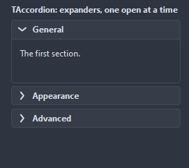
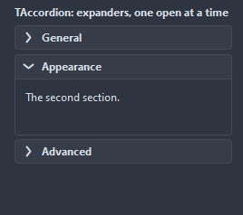

# TAccordion

Stacks the expander panels dropped on it and, unless MultiOpen is set, keeps one of them open: opening a panel folds the others.

- Palette page: Unleashed: Layout
- Unit: `accordion.pas`
- Ancestor: `TCustomControl`



## Usage

```pascal
procedure TForm1.FormCreate(Sender: TObject);
begin
  var stack := TAccordion.Create(Self);
  stack.Parent := Self;
  stack.SetBounds(8, 8, 300, 320);
  stack.MultiOpen := false; // one panel open at a time
  for var title in ['General', 'Editor', 'Colors'] do begin
    var panel := TExpanderPanel.Create(Self);
    panel.Caption := title;
    panel.Parent := stack; // the accordion lays its expanders out
  end;
  stack.OnPanelOpened := @stackOpened;
end;

procedure TForm1.stackOpened(Sender: TObject; panel: TExpanderPanel);
begin
  Caption := panel.Caption;
end;
```

## Properties

| Property | Type | Default | Notes |
|---|---|---|---|
| `Spacing` | `integer` | `4` | the gap between the parts |
| `Padding` | `integer` | `0` | the space between the border and the content |
| `MultiOpen` | `boolean` | `false` | several panels may be open at once |
| `FillWidth` | `boolean` | `true` | the panels take the full width |
| `StylePanels` | `boolean` | `true` | the panels take their look from the accordion: the header height, the corners, the animation, the borders, the chevron and the colors below |
| `Animated` | `boolean` | `true` | changes are animated |
| `ShowBorders` | `boolean` | `true` |  |
| `HeaderHeight` | `integer` | `0` | 0 takes it from the font |
| `CornerRadius` | `integer` | `4` | the rounding of the corners, in pixels |
| `AnimationTime` | `integer` | `150` | milliseconds of the animation |
| `ChevronSide` | `TChevronSide` | `csLeft` | the side the chevron sits on |
| `HeaderColor` | `TColor` | `clDefault` | clDefault takes the colors of the theme |
| `BorderColor` | `TColor` | `clDefault` | clDefault takes the color of the theme |
| `TitleColor` | `TColor` | `clDefault` | clDefault takes the color of the theme |

Also the standard properties of a control, re-published: `Align`, `Anchors`, `BorderSpacing`, `ClientHeight`, `ClientWidth`, `Color`, `Constraints`, `Enabled`, `Font`, `Hint`, `ParentColor`, `ParentFont`, `ParentShowHint`, `PopupMenu`, `ShowHint`, `TabOrder`, `TabStop`, `Visible`, `OnClick`, `OnContextPopup`, `OnDblClick`, `OnMouseDown`, `OnMouseEnter`, `OnMouseLeave`, `OnMouseMove`, `OnMouseUp`, `OnResize`.

## Events

| Event | Handler | Notes |
|---|---|---|
| `OnPanelOpened` | `procedure(Sender: TObject; panel: TExpanderPanel)` |  |
| `OnPanelClosed` | `procedure(Sender: TObject; panel: TExpanderPanel)` |  |
| `OnChange` | `procedure(Sender: TObject)` | a panel opened or closed |

## Runtime

Available in code, not in the Object Inspector.

| Method | Notes |
|---|---|
| `OpenPanel: TExpanderPanel` | the panel that is open; with MultiOpen the first one |
| `OpenAll` |  |
| `CloseAll` | closes all of them |

## In pictures

**The second panel open; the first folded by itself.**


