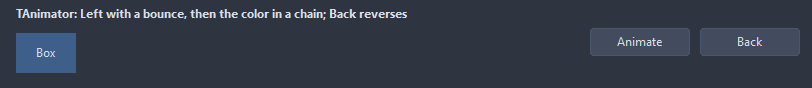

# TAnimator

Moves a published property of a component from one value to another over time: numbers, sizes, positions and colors glide, an enumeration or a boolean switches at the end. The property can sit deeper, as Font.Size. Next starts once this one ends, so animators chain.

- Palette page: Unleashed: System
- Unit: `animator.pas`
- Ancestor: `TComponent`



## Usage

```pascal
procedure TForm1.FormCreate(Sender: TObject);
begin
  var panel := TPanel.Create(Self);
  panel.Parent := Self;
  panel.SetBounds(0, 20, 120, 60);
  var slide := TAnimator.Create(Self);
  slide.Target := panel;
  slide.PropertyName := 'Left';
  slide.StartValue := '0';
  slide.EndValue := '300';
  slide.Duration := 600;
  slide.Easing := aeBounce;
  slide.OnFinish := @slideFinish;
  slide.Start;
end;

procedure TForm1.slideFinish(Sender: TObject);
begin
  Caption := 'arrived';
end;
```

## Properties

| Property | Type | Default | Notes |
|---|---|---|---|
| `Target` | `TComponent` |  | the control it works on |
| `PropertyName` | `string` |  | a published property of Target, or one deeper, as Font.Size |
| `StartValue` | `string` |  | empty starts from the value the property has |
| `EndValue` | `string` |  | a number with a `.` decimal point, a color as clRed or $00RRGGBB in BGR, or the name of an enumeration value |
| `Duration` | `integer` | `300` | milliseconds |
| `Delay` | `integer` | `0` | milliseconds |
| `Easing` | `TAnimationEasing` | `aeEaseInOut` |  |
| `Loop` | `TAnimationLoop` | `alNone` |  |
| `LoopCount` | `integer` | `0` | the runs of a loop; 0 runs on until Stop |
| `AutoStart` | `boolean` | `false` | starts once the form holding it has loaded |
| `Next` | `TAnimator` |  |  |

## Events

| Event | Handler | Notes |
|---|---|---|
| `OnStart` | `procedure(Sender: TObject)` | it started |
| `OnFinish` | `procedure(Sender: TObject)` | it finished |
| `OnStep` | `procedure(Sender: TObject; progress: double)` | every step |

## Runtime

Available in code, not in the Object Inspector.

| Property | Type | Notes |
|---|---|---|
| `Running` | `boolean` | it is running |
| `Paused` | `boolean` |  |
| `Progress` | `double` | the share of the time gone, 0 to 1 |

| Method | Notes |
|---|---|
| `Ease(easing: TAnimationEasing; t: double): double` | the eased share for a share of the time, both 0 to 1 |
| `Start` | starts it |
| `Stop(jumpToEnd: boolean = false)` | stops where it is, or puts the end value first |
| `Pause` | pauses it |
| `Resume` | goes on after Pause |
| `Reverse` | turns the run where it is; after a run ended, goes over its values the other way |

## Types

| Type | Values | Notes |
|---|---|---|
| `TAnimationEasing` | `aeLinear`, `aeEaseIn`, `aeEaseOut`, `aeEaseInOut`, `aeBack`, `aeElastic`, `aeBounce` |  |
| `TAnimationLoop` | `alNone`, `alRepeat`, `alPingPong` |  |
