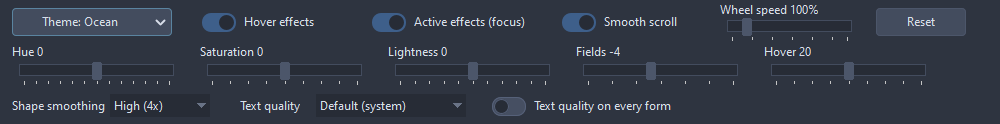

# TAppTheme

Puts a color theme on every window of the application, native controls included, and keeps it on the windows made later. One per application, a second one raises as it applies; dropped on the main form it takes effect as the form loads. At design time it changes nothing, the designed forms keep the stock look.

- Palette page: Unleashed: Input
- Unit: `apptheme.pas`
- Ancestor: `TComponent`

## Usage

```pascal
procedure TForm1.FormCreate(Sender: TObject);
begin
  // one per application, dropped on the main form or made here
  var theme := TAppTheme.Create(Self);
  theme.Preset := tpOcean;
  theme.Effects.Hover := true;
  theme.Shift.Lightness := -10;
  theme.OnChange := @themeChange;
end;

procedure TForm1.themeChange(Sender: TObject);
begin
  Caption := if TAppTheme.Instance.IsDark then 'dark' else 'light';
end;
```

## Properties

| Property | Type | Default | Notes |
|---|---|---|---|
| `Active` | `boolean` | `true` | false keeps the stock look whatever the preset says |
| `Preset` | `TThemePreset` | `tpSystem` | tpNone keeps the stock look of the widgetset; tpSystem picks the light or the dark look after the desktop setting; tpCustom grows the look from Custom |
| `Custom` | `TThemeColors` |  | the seed of the look; picking a preset fills it with the seed of that preset, so a custom look starts from the preset it is closest to |
| `IconFit` | `TIconFitting` |  |  |
| `Effects` | `TThemeEffectSettings` |  |  |
| `Shift` | `TThemeShift` |  |  |
| `Scrolling` | `TThemeScrolling` |  | the wheel settings hold whatever the preset, Active included |
| `Rendering` | `TThemeRendering` |  |  |

## Events

| Event | Handler | Notes |
|---|---|---|
| `OnChange` | `procedure(Sender: TObject)` | after the look on screen changed |

## Runtime

Available in code, not in the Object Inspector.

| Method | Notes |
|---|---|
| `Apply` | puts the current choice on screen; runs by itself after every change |
| `Palette: TPalette` | the palette the current choice resolves to; the system colors for tpNone |
| `IsDark: boolean` | the look on screen is dark |
| `Supported: boolean` | the widgetset has a theme engine; elsewhere only the icons are fitted |
| `Instance: TAppTheme` | the one instance of the application, nil before it is created |

## Companion classes

### `TThemeColors`

The seed of a custom look; a change switches the owner to tpCustom.

| Property | Type | Default | Notes |
|---|---|---|---|
| `Surface` | `TColor` |  | forms, panels, buttons and tool bars |
| `Text` | `TColor` |  | text on the surface and in windows |
| `Accent` | `TColor` |  | the selection |
| `Link` | `TColor` |  | links and the strip of the active tab |
| `Mark` | `TColor` |  | a changed or unsaved item |
| `FieldLightness` | `integer` |  | lightness of the fields (edits, lists, pages) against the surface in percent points: positive brighter, negative deeper |
| `HoverStrength` | `integer` |  | share of the text blended into the surface under the mouse, percent |

| Property | Type | Notes |
|---|---|---|
| `Seed` | `TThemeSeed` |  |

### `TIconFitting`

How the icons of the application are fitted to the surface they sit on.

| Property | Type | Default | Notes |
|---|---|---|---|
| `Enabled` | `boolean read FFit.Enabled` | `true` | disabled items are drawn gray and ignore the mouse |
| `Strength` | `integer` | `100` | share of the lightness remap applied on a dark surface |
| `MinContrast` | `integer` | `30` | the icons stay at least this far above a dark surface |
| `MaxLightness` | `integer` | `88` | the icons stay at most this light on a dark surface |
| `DisabledContrast` | `integer` | `45` | contrast a disabled icon keeps to the surface |
| `DisabledSaturation` | `integer` | `40` | color a disabled icon keeps |

| Property | Type | Notes |
|---|---|---|
| `Fit` | `TIconFit` |  |

### `TThemeEffectSettings`

The feedback the controls paint on top of the palette.

| Property | Type | Default | Notes |
|---|---|---|---|
| `Hover` | `boolean read FEffects.Hover` | `true` | the controls answer the mouse over them; off, only menus do |
| `Active` | `boolean read FEffects.Active` | `true` | the focused control shows the focus on its border; off, a control looks the same with and without the focus |

| Property | Type | Notes |
|---|---|---|
| `Effects` | `TThemeEffects` |  |

### `TThemeShift`

The whole look moved: turned on the hue wheel, more or less colorful, lighter or darker; works on the presets as well as on a custom look.

| Property | Type | Default | Notes |
|---|---|---|---|
| `Hue` | `integer` | `0` | degrees on the hue wheel |
| `Saturation` | `integer` | `0` | percent points |
| `Lightness` | `integer` | `0` | percent points; the text keeps its lightness |

### `TThemeScrolling`

How the mouse wheel moves the scroll boxes and the scrolling forms of the application.

| Property | Type | Default | Notes |
|---|---|---|---|
| `Speed` | `integer` | `100` | percent of the pace; at 100 a notch moves ten steps of the scroll bar |
| `Smooth` | `boolean` | `true` | the content glides to the new position instead of jumping |
| `GlideTime` | `integer` | `150` | milliseconds of the glide |

### `TThemeRendering`

How the controls of this package draw: the smoothing of their shapes and the quality of their text. The text quality can go onto every form of the application, so the native controls draw their text the same way.

| Property | Type | Default | Notes |
|---|---|---|---|
| `ShapeAntialiasing` | `TShapeAntialiasing` | `aaHigh` | the shapes painted at a multiple of their size and shrunk: off, 2x, 3x, 4x |
| `TextQuality` | `TFontQuality` | `fqDefault` | the text of the controls; fqDefault keeps the system setting |
| `TextQualityEverywhere` | `boolean` | `false` | the text quality goes onto the font of every form, the native controls included |

## Types

| Type | Values | Notes |
|---|---|---|
| `TThemePreset` | `tpNone`, `tpSystem`, `tpLight`, `tpDark`, `tpOcean`, `tpFrost`, `tpPaper`, `tpEmber`, `tpMidnight`, `tpDusk`, `tpCustom` | tpNone keeps the stock look of the widgetset; tpSystem picks the light or the dark look after the desktop setting; tpCustom grows the look from Custom |

## In pictures

**The bar of the demo application that drives its TAppTheme: the preset, the hover and focus ring effects, smooth wheel scrolling and its speed, the shift of hue, saturation and lightness, the lightness of the fields, the hover strength, the shape antialiasing and the text quality.**


