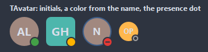
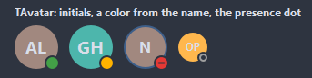
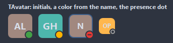
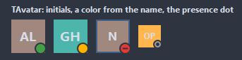
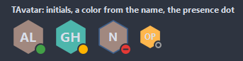
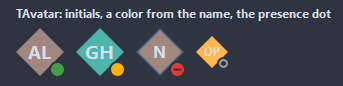
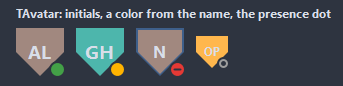

# TAvatar

A picture of a person cut to a circle or a rounded square, or the initials of the name on a color the name picks, with a dot for the presence.

- Palette page: Unleashed: Display
- Unit: `avatar.pas`
- Ancestor: `TGraphicControl`



## Usage

```pascal
procedure TForm1.FormCreate(Sender: TObject);
begin
  var who := TAvatar.Create(Self);
  who.Parent := Self;
  who.SetBounds(8, 8, 48, 48);
  who.UserName := 'Ada Lovelace'; // the initials and the color come from the name
  who.Status := stOnline;
  who.Shape := asRounded;
end;
```

## Properties

| Property | Type | Default | Notes |
|---|---|---|---|
| `UserName` | `string` |  |  |
| `Initials` | `string` |  | the letters instead of the ones the name gives |
| `Picture` | `TPicture` |  | fills the shape, cut to it; without one the initials show |
| `Shape` | `TAvatarShape` | `asCircle` | the outline of the picture: a circle, a square rounded by CornerRadius, a square, a hexagon, a diamond, a squircle, a shield |
| `Status` | `TAvatarStatus` | `stNone` |  |
| `CornerRadius` | `integer` | `8` | the rounding of the corners, in pixels |
| `BorderWidth` | `integer` | `0` | a ring around the avatar |
| `AvatarColor` | `TColor` | `clDefault` | clDefault takes the color the name picks, the contrasting text and the colors of the presence |
| `TextColor` | `TColor` | `clDefault` | clDefault takes the color of the theme |
| `BorderColor` | `TColor` | `clDefault` | clDefault takes the color of the theme |
| `StatusColor` | `TColor` | `clDefault` |  |
| `Antialiasing` | `TAntialiasSetting` | `asTheme` | asTheme follows the theme setting, asOn and asOff force it |

Also the standard properties of a control, re-published: `Align`, `Anchors`, `BorderSpacing`, `Color`, `Constraints`, `Cursor`, `Enabled`, `Font`, `Hint`, `ParentColor`, `ParentFont`, `ParentShowHint`, `PopupMenu`, `ShowHint`, `Visible`, `OnClick`, `OnContextPopup`, `OnDblClick`, `OnMouseDown`, `OnMouseEnter`, `OnMouseLeave`, `OnMouseMove`, `OnMouseUp`, `OnResize`.

## Events

| Event | Handler | Notes |
|---|---|---|
| `OnDraw` | `TCustomDrawEvent` | paints the whole avatar by itself, in the square it fills |

## Runtime

Available in code, not in the Object Inspector.

| Method | Notes |
|---|---|
| `ShownInitials: string` | the letters shown without a picture: Initials, or the first letters of the first and the last word of the name |
| `ColorOfName(const name: string): TColor` | the color a name picks from the palette; the same name, the same color |

## Types

| Type | Values | Notes |
|---|---|---|
| `TAvatarShape` | `asCircle`, `asRounded`, `asSquare`, `asHexagon`, `asDiamond`, `asSquircle`, `asShield` | the outline of the picture: a circle, a square rounded by CornerRadius, a square, a hexagon, a diamond, a squircle, a shield |
| `TAvatarStatus` | `stNone`, `stOnline`, `stAway`, `stBusy`, `stOffline` |  |

## Custom drawing

The component paints its parts by itself, through the shapes of `ControlPaint`. A handler on the event below takes over a part: it gets the canvas of the control, the rectangle of the part, which part it is and a `TDrawState` set telling what the part is in: `dsHover`, `dsActive`, `dsSelected`, `dsPressed`, `dsDisabled`, `dsFocused`, `dsChecked`.

- `OnDraw`: paints the whole avatar by itself, in the square it fills. Handler: `TCustomDrawEvent`.

A handler may paint with the plain canvas, or through `beginShapes()` from `ControlPaint` for the same smoothed shapes the components use: `paintRoundRect()`, `paintCircle()`, `paintCheck()`, `FillPolygon()` and the rest, then `Flush` once. Colors of the theme come from `pick()`, `blend()` and `contrastText()`.

## In pictures

### Every Shape

The demo group with each value of `Shape` in turn.

`Shape = asCircle`



`Shape = asRounded`



`Shape = asSquare`



`Shape = asHexagon`



`Shape = asDiamond`



`Shape = asSquircle`


`Shape = asShield`


