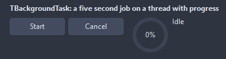

# TBackgroundTask

Runs a method on a thread and brings its progress, its end and its errors back to the main thread as events. The work checks Cancelled now and then and leaves when it is set.

- Palette page: Unleashed: System
- Unit: `backgroundtask.pas`
- Ancestor: `TComponent`



## Usage

```pascal
procedure TForm1.FormCreate(Sender: TObject);
begin
  var task := TBackgroundTask.Create(Self);
  task.OnProgress := @taskProgress;
  task.OnDone := @taskDone;
  task.Run(@countFiles);
end;

procedure TForm1.countFiles(task: TBackgroundTask);
begin
  // on the worker thread: no controls from here, Progress is safe
  for var i := 1 to 100 do begin
    if task.Cancelled then exit;
    Sleep(20);
    task.Progress(i, Format('%d of 100', [i]));
  end;
end;

procedure TForm1.taskProgress(Sender: TObject; percent: integer; const text: string);
begin
  Caption := text; // back on the main thread
end;

procedure TForm1.taskDone(Sender: TObject);
begin
  Caption := 'done';
end;
```

## Events

| Event | Handler | Notes |
|---|---|---|
| `OnWork` | `procedure(task: TBackgroundTask)` | the work itself; it runs on its own thread and reports through the task |
| `OnStart` | `procedure(Sender: TObject)` | it started |
| `OnProgress` | `procedure(Sender: TObject; percent: integer; const text: string)` |  |
| `OnDone` | `procedure(Sender: TObject)` | the work returned on its own |
| `OnCancelled` | `procedure(Sender: TObject)` | the work returned after Cancel |
| `OnError` | `procedure(Sender: TObject; const message: string)` | something failed; the message says what |

## Runtime

Available in code, not in the Object Inspector.

| Property | Type | Notes |
|---|---|---|
| `Running` | `boolean` | it is running |
| `Cancelled` | `boolean` | it was cancelled |
| `Failed` | `boolean` | the last run ended in an exception |
| `Percent` | `integer` |  |
| `StatusText` | `string` |  |
| `ErrorText` | `string` |  |

| Method | Notes |
|---|---|
| `Run(work: TTaskWork)` | starts the work; a second call while one runs is ignored |
| `Run` | runs OnWork |
| `Cancel` | asks the work to stop; OnCancelled follows once it has |
| `WaitFor` | blocks until the work is over |
| `Progress(percent: integer; const text: string = '')` | for the work: the state shown to the main thread |
