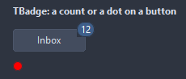
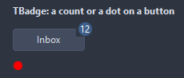
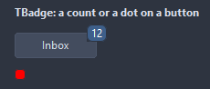
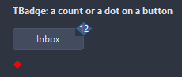

# TBadge

A small counter or dot pinned to a corner of another control: Value shows as a number up to Max, then as "Max+"; Dot shows a plain mark. AttachTo keeps the badge on the control as it moves. A window of its own, cut to its shape, so it sits on top of the native controls too.

- Palette page: Unleashed: Display
- Unit: `badge.pas`
- Ancestor: `TCustomControl`



## Usage

```pascal
procedure TForm1.FormCreate(Sender: TObject);
begin
  var inbox := TButton.Create(Self);
  inbox.Parent := Self;
  inbox.Caption := 'Inbox';
  var unread := TBadge.Create(Self);
  unread.Parent := Self;
  unread.AttachTo := inbox;
  unread.Position := bpTopRight;
  unread.Value := 12;
  unread.Max := 99; // 100 and above show as 99+
end;
```

## Properties

| Property | Type | Default | Notes |
|---|---|---|---|
| `AttachTo` | `TControl` |  | the control the badge sits on; nil leaves it where it is |
| `Position` | `TBadgePosition` | `bpTopRight` | the corner of the attached control the badge sits on |
| `Shape` | `TBadgeShape` | `bsPill` | the outline: a pill, a circle, a square with small rounding, a box rounded by a third of its height, a tag pointed on the left, a diamond |
| `Value` | `integer` | `0` | the value shown |
| `Max` | `integer` | `99` | values past this show as "Max+" |
| `OffsetX` | `integer` | `0` | moves the badge from its corner, in pixels |
| `OffsetY` | `integer` | `0` | a shift from the computed place |
| `MinSize` | `integer` | `18` | the height, and the width of a dot |
| `Padding` | `integer` | `5` | the space between the border and the content |
| `Text` | `string` |  | replaces the number |
| `Dot` | `boolean` | `false` | a plain mark without a number |
| `ShowZero` | `boolean` | `false` | a zero shows; off, the badge hides at zero |
| `BadgeColor` | `TColor` | `clDefault` | clDefault takes the colors of the theme |
| `TextColor` | `TColor` | `clDefault` | clDefault takes the color of the theme |
| `BorderColor` | `TColor` | `clDefault` | the outline, usually the color behind the badge; clNone for none |
| `Antialiasing` | `TAntialiasSetting` | `asTheme` | asTheme follows the theme setting, asOn and asOff force it |

Also the standard properties of a control, re-published: `Anchors`, `AutoSize`, `BorderSpacing`, `Color`, `Constraints`, `Enabled`, `Font`, `Hint`, `ParentColor`, `ParentFont`, `ParentShowHint`, `PopupMenu`, `ShowHint`, `Visible`, `OnClick`, `OnContextPopup`, `OnDblClick`, `OnMouseDown`, `OnMouseEnter`, `OnMouseLeave`, `OnMouseMove`, `OnMouseUp`.

## Events

| Event | Handler | Notes |
|---|---|---|
| `OnDraw` | `TCustomDrawEvent` | paints the badge by itself, text included |

## Runtime

Available in code, not in the Object Inspector.

| Method | Notes |
|---|---|
| `Reposition` | puts the badge back on its corner of the attached control |

## Types

| Type | Values | Notes |
|---|---|---|
| `TBadgePosition` | `bpTopRight`, `bpTopLeft`, `bpBottomRight`, `bpBottomLeft`, `bpRightCenter`, `bpLeftCenter` | the corner of the attached control the badge sits on |
| `TBadgeShape` | `bsPill`, `bsCircle`, `bsSquare`, `bsRounded`, `bsTag`, `bsDiamond` | the outline: a pill, a circle, a square with small rounding, a box rounded by a third of its height, a tag pointed on the left, a diamond |

## Custom drawing

The component paints its parts by itself, through the shapes of `ControlPaint`. A handler on the event below takes over a part: it gets the canvas of the control, the rectangle of the part, which part it is and a `TDrawState` set telling what the part is in: `dsHover`, `dsActive`, `dsSelected`, `dsPressed`, `dsDisabled`, `dsFocused`, `dsChecked`.

- `OnDraw`: paints the badge by itself, text included. Handler: `TCustomDrawEvent`.

A handler may paint with the plain canvas, or through `beginShapes()` from `ControlPaint` for the same smoothed shapes the components use: `paintRoundRect()`, `paintCircle()`, `paintCheck()`, `FillPolygon()` and the rest, then `Flush` once. Colors of the theme come from `pick()`, `blend()` and `contrastText()`.

## In pictures

### Every Shape

The demo group with each value of `Shape` in turn.

`Shape = bsPill`


`Shape = bsCircle`



`Shape = bsSquare`


`Shape = bsRounded`



`Shape = bsTag`


`Shape = bsDiamond`


