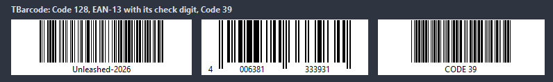

# TBarcode

A linear barcode of Text with the text under it. The bars fill the width in whole pixels per module where they fit, so scanners read them; ModuleWidth fixes the pixels instead.

- Palette page: Unleashed: Display
- Unit: `barcodes.pas`
- Ancestor: `TGraphicControl`



## Usage

```pascal
procedure TForm1.FormCreate(Sender: TObject);
begin
  var label1 := TBarcode.Create(Self);
  label1.Parent := Self;
  label1.SetBounds(8, 8, 240, 90);
  label1.Symbology := bsEAN13;
  label1.Text := '590123412345'; // the check digit is computed
  if not label1.Valid then Caption := 'bad number';
end;
```

## Properties

| Property | Type | Default | Notes |
|---|---|---|---|
| `Text` | `string` |  | the text |
| `Symbology` | `TBarcodeSymbology` | `bsCode128` | Code 128 switches between its three code sets by itself; EAN and UPC add the check digit to 12, 7 or 11 digits and verify a given one; ITF takes digits in pairs and puts a 0 in front of an odd count |
| `ShowText` | `boolean` | `true` | the text part is shown |
| `Checksum` | `boolean` | `false` | a check character for Code 39 (modulo 43) and ITF (modulo 10); the others always carry one |
| `TransparentLight` | `boolean` | `false` | the spaces show the parent; off, LightColor fills the control |
| `ModuleWidth` | `integer` | `0` | pixels per module; 0 fits the control |
| `BarHeight` | `integer` | `0` | the height of the bars; 0 fills the control |
| `QuietZone` | `integer` | `10` | the light modules on both sides, as the standards ask; EAN and UPC keep at least 11 for the digit printed outside |
| `WideRatio` | `integer` | `3` | a wide element of Code 39 and ITF in narrow ones, 2 or 3 |
| `TextSpacing` | `integer` | `2` | between the bars and the text |
| `DarkColor` | `TColor` | `clBlack` | the color of the bars or modules |
| `LightColor` | `TColor` | `clWhite` | the color of the background |
| `Antialiasing` | `TAntialiasSetting` | `asTheme` | smooths the bars when a module gets less than a pixel |

Also the standard properties of a control, re-published: `Align`, `Anchors`, `AutoSize`, `BorderSpacing`, `Color`, `Constraints`, `Enabled`, `Font`, `Hint`, `ParentColor`, `ParentFont`, `ParentShowHint`, `PopupMenu`, `ShowHint`, `Visible`, `OnClick`, `OnContextPopup`, `OnDblClick`, `OnMouseDown`, `OnMouseEnter`, `OnMouseLeave`, `OnMouseMove`, `OnMouseUp`, `OnResize`.

## Runtime

Available in code, not in the Object Inspector.

| Method | Notes |
|---|---|
| `Valid: boolean` | the text fits the symbology |
| `Modules: string` | the modules from the first bar to the last, as encodeBarcode gives them |
| `ShownText: string` | the text under the bars, with the check digits |
| `SaveToBitmap(bitmap: TBitmap; module, height: integer)` | the code into a bitmap, `module` pixels per module and bars `height` pixels high, the quiet zone and the text included |
| `SaveToFile(const fileName: string; module, height: integer)` | writes the content to a file |

## Types

| Type | Values | Notes |
|---|---|---|
| `TBarcodeSymbology` | `bsCode128`, `bsEAN13`, `bsEAN8`, `bsUPCA`, `bsCode39`, `bsITF` | Code 128 switches between its three code sets by itself; EAN and UPC add the check digit to 12, 7 or 11 digits and verify a given one; ITF takes digits in pairs and puts a 0 in front of an odd count |
