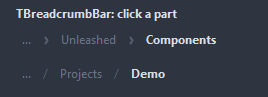
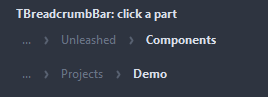
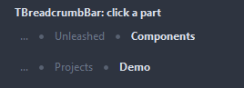

# TBreadcrumbBar

The path to the current place as a row of clickable parts. What does not fit folds into a menu behind an ellipsis at the start.

- Palette page: Unleashed: Navigation
- Unit: `breadcrumbbar.pas`
- Ancestor: `TCustomControl`



## Usage

```pascal
procedure TForm1.FormCreate(Sender: TObject);
begin
  var crumbs := TBreadcrumbBar.Create(Self);
  crumbs.Parent := Self;
  crumbs.Align := alTop;
  crumbs.Path := 'Projects/Editor/Source'; // or Items.AddItem one by one
  crumbs.Separator := bsChevron;
  crumbs.OnItemClick := @crumbsClick;
end;

procedure TForm1.crumbsClick(Sender: TObject; index: integer);
begin
  TBreadcrumbBar(Sender).TruncateTo(index); // back up the path
end;
```

## Properties

| Property | Type | Default | Notes |
|---|---|---|---|
| `Items` | `TBreadcrumbItems` |  | the entries |
| `Images` | `TCustomImageList` |  | the image list the pictures come from |
| `Path` | `string` |  | the parts joined with the delimiter; set, it replaces the items |
| `Separator` | `TBreadcrumbSeparator` | `bsChevron` | what sits between the parts: a chevron, a slash, a backslash, a greater-than sign, two chevrons, a dot, a pipe |
| `Spacing` | `integer` | `6` | around the separator |
| `Padding` | `integer` | `6` | inside a part, around its caption |
| `CornerRadius` | `integer` | `4` | the rounding of the corners, in pixels |
| `TextColor` | `TColor` | `clDefault` | clDefault takes the colors of the theme |
| `LastColor` | `TColor` | `clDefault` | the last part, the place itself |
| `SeparatorColor` | `TColor` | `clDefault` |  |
| `Antialiasing` | `TAntialiasSetting` | `asTheme` | asTheme follows the theme setting, asOn and asOff force it |

Also the standard properties of a control, re-published: `Align`, `Anchors`, `AutoSize`, `BorderSpacing`, `Color`, `Constraints`, `Enabled`, `Font`, `Hint`, `ParentColor`, `ParentFont`, `ParentShowHint`, `PopupMenu`, `ShowHint`, `Visible`, `OnClick`, `OnContextPopup`, `OnDblClick`, `OnMouseDown`, `OnMouseEnter`, `OnMouseLeave`, `OnMouseMove`, `OnMouseUp`, `OnResize`.

## Events

| Event | Handler | Notes |
|---|---|---|
| `OnDrawItem` | `TCustomDrawEvent` | paints over the stock part: dsSelected for the last one, dsHover under the mouse; `handled` true leaves the caption out |
| `OnItemClick` | `procedure(Sender: TObject; index: integer)` | a click on an entry |

## Runtime

Available in code, not in the Object Inspector.

| Method | Notes |
|---|---|
| `TruncateTo(index: integer)` | drops every part after `index` |

## Companion classes

### `TBreadcrumbItem`

| Property | Type | Default | Notes |
|---|---|---|---|
| `Caption` | `string` |  | the text shown |
| `Hint` | `string` |  | the tooltip |
| `ImageIndex` | `TImageIndex` | `-1` | the picture in the image list, -1 for none |
| `Tag` | `PtrInt` | `0` | free for the application |

### `TBreadcrumbItems`

| Method | Notes |
|---|---|
| `Add: TBreadcrumbItem` | a new entry at the end |
| `AddItem(const caption: string; tag: PtrInt = 0): TBreadcrumbItem` | a new entry with these values |

## Types

| Type | Values | Notes |
|---|---|---|
| `TBreadcrumbSeparator` | `bsChevron`, `bsSlash`, `bsBackslash`, `bsArrow`, `bsDoubleChevron`, `bsDot`, `bsPipe` | what sits between the parts: a chevron, a slash, a backslash, a greater-than sign, two chevrons, a dot, a pipe |

## Custom drawing

The component paints its parts by itself, through the shapes of `ControlPaint`. A handler on the event below takes over a part: it gets the canvas of the control, the rectangle of the part, which part it is and a `TDrawState` set telling what the part is in: `dsHover`, `dsActive`, `dsSelected`, `dsPressed`, `dsDisabled`, `dsFocused`, `dsChecked`.

- `OnDrawItem`: paints over the stock part: dsSelected for the last one, dsHover under the mouse; `handled` true leaves the caption out. Handler: `TCustomDrawEvent`.

A handler may paint with the plain canvas, or through `beginShapes()` from `ControlPaint` for the same smoothed shapes the components use: `paintRoundRect()`, `paintCircle()`, `paintCheck()`, `FillPolygon()` and the rest, then `Flush` once. Colors of the theme come from `pick()`, `blend()` and `contrastText()`.

## In pictures

### Every Separator

The demo group with each value of `Separator` in turn.

`Separator = bsChevron`



`Separator = bsSlash`


`Separator = bsBackslash`


`Separator = bsArrow`


`Separator = bsDoubleChevron`


`Separator = bsDot`



`Separator = bsPipe`


