# TBusyIndicator

An activity marker for a wait of unknown length. Active runs the animation; off, the control shows nothing or stays as a static glyph.

- Palette page: Unleashed: Display
- Unit: `busyindicator.pas`
- Ancestor: `TGraphicControl`

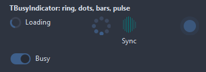

## Usage

```pascal
procedure TForm1.FormCreate(Sender: TObject);
begin
  var busy := TBusyIndicator.Create(Self);
  busy.Parent := Self;
  busy.Style := biOrbit;
  busy.Caption := 'Loading';
  busy.CaptionPosition := bcRight;
  busy.Active := true; // off again once the work is done
end;
```

## Properties

| Property | Type | Default | Notes |
|---|---|---|---|
| `Active` | `boolean` | `false` | on; off stops it |
| `Style` | `TBusyStyle` | `biRing` | biRing: an arc running around a track; biDots: dots lighting up in turn; biBars: bars pulsing in turn; biPulse: a disc breathing; biDualRing: two arcs chasing each other; biChase: a comet of dots; biOrbit: a dot circling a core; biGrid: nine dots lit by a wave; biRipple: rings growing out of the center; biEllipsis: three dots bouncing; biSegments: a ring of segments lit in turn; biClock: hands turning; biFlip: a tile flipping over; biBounce: a ball on a floor |
| `FrameInterval` | `integer` | `40` | milliseconds between two frames |
| `Speed` | `integer` | `24` | steps of a full turn; fewer steps turn faster |
| `Thickness` | `integer` | `3` | the ring and the bars |
| `DotCount` | `integer` | `8` |  |
| `GlyphSize` | `integer` | `0` | the glyph; 0 takes it from the font |
| `Spacing` | `integer` | `6` | between the glyph and the caption |
| `HideWhenInactive` | `boolean` | `true` | nothing shows while inactive; off, the glyph stands still |
| `CaptionPosition` | `TBusyCaptionPosition` | `bcRight` | where the caption sits |
| `GlyphColor` | `TColor` | `clDefault` | clDefault takes the colors of the theme |
| `TrackColor` | `TColor` | `clDefault` | the unfilled part; clDefault takes the color of the theme |
| `Antialiasing` | `TAntialiasSetting` | `asTheme` | the smoothing of the shapes: after the theme, or its own choice |

Also the standard properties of a control, re-published: `Caption`, `Align`, `Anchors`, `AutoSize`, `BorderSpacing`, `Color`, `Constraints`, `Enabled`, `Font`, `Hint`, `ParentColor`, `ParentFont`, `ParentShowHint`, `PopupMenu`, `ShowHint`, `Visible`, `OnClick`, `OnContextPopup`, `OnDblClick`, `OnMouseDown`, `OnMouseEnter`, `OnMouseLeave`, `OnMouseMove`, `OnMouseUp`, `OnResize`.

## Types

| Type | Values | Notes |
|---|---|---|
| `TBusyStyle` | `biRing`, `biDots`, `biBars`, `biPulse`, `biDualRing`, `biChase`, `biOrbit`, `biGrid`, `biRipple`, `biEllipsis`, `biSegments`, `biClock`, `biFlip`, `biBounce` | biRing: an arc running around a track; biDots: dots lighting up in turn; biBars: bars pulsing in turn; biPulse: a disc breathing; biDualRing: two arcs chasing each other; biChase: a comet of dots; biOrbit: a dot circling a core; biGrid: nine dots lit by a wave; biRipple: rings growing out of the center; biEllipsis: three dots bouncing; biSegments: a ring of segments lit in turn; biClock: hands turning; biFlip: a tile flipping over; biBounce: a ball on a floor |
| `TBusyCaptionPosition` | `bcBelow`, `bcRight`, `bcNone` |  |

## In pictures

**Ten more styles (dual ring, chase, orbit, grid, ripple, ellipsis, segments, clock, flip, bounce).**

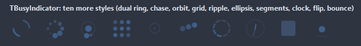

### Every Style

The demo group with each value of `Style` in turn.

`Style = biRing`

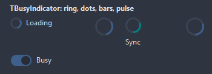

`Style = biDots`

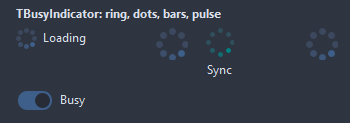

`Style = biBars`

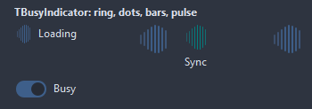

`Style = biPulse`

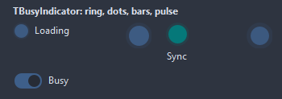

`Style = biDualRing`


`Style = biChase`

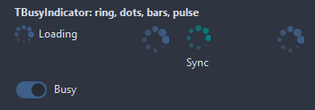

`Style = biOrbit`

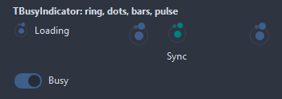

`Style = biGrid`

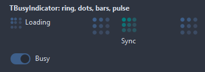

`Style = biRipple`

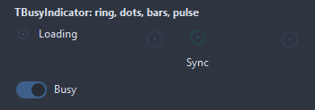

`Style = biEllipsis`

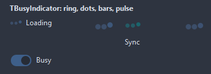

`Style = biSegments`


`Style = biClock`

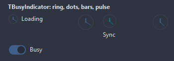

`Style = biFlip`

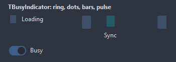

`Style = biBounce`


