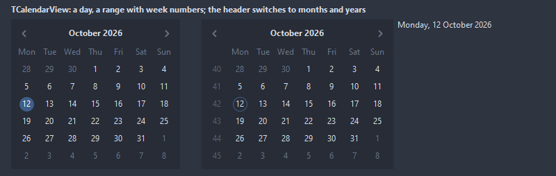
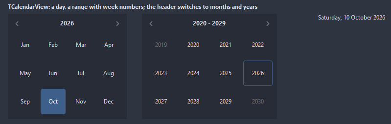
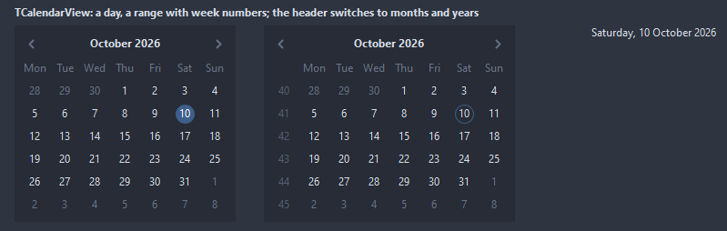
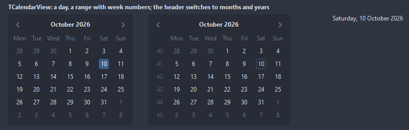
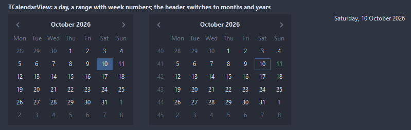
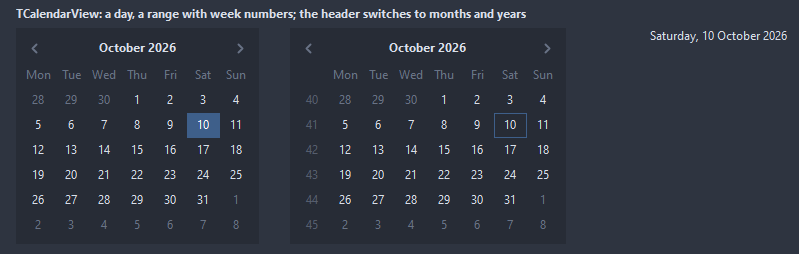
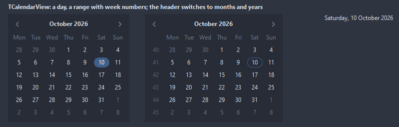
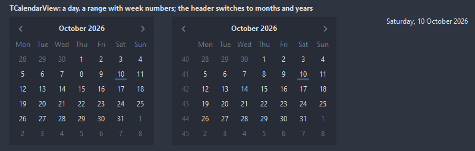

# TCalendarView

A calendar drawn in the colors of the theme. A click on the title goes up to the months of the year and the years of the decade, a click on a month or a year comes back down. The arrows, the wheel and the keys move through it; Enter and Space pick the day under the cursor.

- Palette page: Unleashed: Views
- Unit: `calendarview.pas`
- Ancestor: `TCustomControl`



## Usage

```pascal
procedure TForm1.FormCreate(Sender: TObject);
begin
  var cal := TCalendarView.Create(Self);
  cal.Parent := Self;
  cal.SetBounds(8, 8, 280, 260);
  cal.SelectionMode := selRange;
  cal.ShowWeekNumbers := true;
  cal.HighlightWeekends := true;
  cal.Mark(Date + 3);
  cal.OnChange := @calChange;
end;

procedure TForm1.calChange(Sender: TObject);
begin
  with TCalendarView(Sender) do
    Caption := FormatDateTime('yyyy-mm-dd', RangeStart) + ' to ' + FormatDateTime('yyyy-mm-dd', RangeEnd);
end;
```

## Properties

| Property | Type | Default | Notes |
|---|---|---|---|
| `Date` | `TDateTime` |  | the picked day with selSingle; 0 for none |
| `RangeStart` | `TDateTime` |  | the start of the range |
| `RangeEnd` | `TDateTime` |  | the end of the range |
| `MinDate` | `TDateTime` |  | 0 for no limit |
| `MaxDate` | `TDateTime` |  | the latest date allowed |
| `SelectionMode` | `TCalendarSelection` | `selSingle` | one day, a range from a start to an end, or any set of days |
| `ViewMode` | `TCalendarViewMode` | `cvMonth` | what the grid shows: the days of a month, the months of a year, the years of a decade |
| `FirstDayOfWeek` | `TCalendarFirstDay` | `fdMonday` | the first column of the week |
| `CellShape` | `TCalendarCellShape` | `ccCircle` | the mark of a picked day: a circle, a rounded square, the square cell, the whole cell, a pill across the cell, a bar under the number |
| `ShowWeekNumbers` | `boolean` | `false` | the ISO week numbers in a column on the left |
| `ShowToday` | `boolean` | `true` | a ring around the day of today |
| `ShowOtherMonths` | `boolean` | `true` | the days of the months around, dimmed |
| `ShowHeader` | `boolean` | `true` | the header row is shown |
| `ShowNavigation` | `boolean` | `true` | the arrows in the header |
| `AllowViewChange` | `boolean` | `true` | a click on the title goes up to months and years |
| `HighlightWeekends` | `boolean` | `false` | Saturday and Sunday in WeekendColor |
| `MarkedDates` | `TStrings` |  | the days with a dot, one ISO date per line: 2026-10-31 |
| `AccentColor` | `TColor` | `clDefault` | clDefault takes the colors of the theme |
| `TodayColor` | `TColor` | `clDefault` | clDefault takes the color of the theme |
| `MarkColor` | `TColor` | `clDefault` |  |
| `WeekendColor` | `TColor` | `clDefault` | clDefault takes the color of the theme |
| `HeaderColor` | `TColor` | `clDefault` | clDefault takes the color of the theme |
| `Antialiasing` | `TAntialiasSetting` | `asTheme` | asTheme follows the theme setting, asOn and asOff force it |
| `Language` | `TFormatLanguage` | `flSystem` | the names and separators of dates, times and numbers: those of the locale of the system, or English |

Also the standard properties of a control, re-published: `Align`, `Anchors`, `AutoSize`, `BorderSpacing`, `Color`, `Constraints`, `Enabled`, `Font`, `Hint`, `ParentColor`, `ParentFont`, `ParentShowHint`, `PopupMenu`, `ShowHint`, `TabOrder`, `TabStop`, `Visible`, `OnClick`, `OnContextPopup`, `OnDblClick`, `OnEnter`, `OnExit`, `OnKeyDown`, `OnKeyPress`, `OnKeyUp`, `OnMouseDown`, `OnMouseEnter`, `OnMouseLeave`, `OnMouseMove`, `OnMouseUp`, `OnResize`.

## Events

| Event | Handler | Notes |
|---|---|---|
| `OnChange` | `procedure(Sender: TObject)` | the selection changed |
| `OnDayClick` | `procedure(Sender: TObject; day: TDateTime)` |  |
| `OnViewChange` | `procedure(Sender: TObject)` | another month, year or decade, or another view |
| `OnGetDayInfo` | `procedure(Sender: TObject; day: TDateTime; var marked, enabled: boolean; var textColor: TColor)` | a day about to be painted: marked shows a dot, enabled false makes it unpickable, a color other than clDefault paints its number |
| `OnDrawDay` | `TCustomDrawEvent` | paints over a cell of the month: index is the cell, 0 at the top left; dsSelected for a picked day, dsHover under the mouse, dsActive for today, dsDisabled for a day outside the limits; `handled` true leaves the number out |

## Runtime

Available in code, not in the Object Inspector.

| Property | Type | Notes |
|---|---|---|
| `Month` | `TDateTime` | the first day of the month on show |
| `SelectedDates[index: integer]` | `TDateTime` | the days picked with selMultiple, in order |
| `CursorDate` | `TDateTime` | the day the keyboard is on |
| `KeyboardCursor` | `boolean` | the ring of the key cursor shows without the focus too, for a calendar another control drives through HandleKey |

| Method | Notes |
|---|---|
| `HandleKey(var Key: Word; Shift: TShiftState): boolean` | the keys a calendar takes, also when they reach another control first, like the field of a date picker; true when the key was used |
| `DateAt(x, y: integer): TDateTime` | the day under a point of the control, 0 for none |
| `GoToToday` |  |
| `Mark(day: TDateTime)` |  |
| `Unmark(day: TDateTime)` |  |
| `ClearMarks` |  |
| `IsMarked(day: TDateTime): boolean` |  |
| `IsSelected(day: TDateTime): boolean` |  |
| `ClearSelection` | selects nothing |
| `SelectedCount: integer` | how many are selected |

## Types

| Type | Values | Notes |
|---|---|---|
| `TCalendarViewMode` | `cvMonth`, `cvYear`, `cvDecade` | what the grid shows: the days of a month, the months of a year, the years of a decade |
| `TCalendarSelection` | `selSingle`, `selRange`, `selMultiple` | one day, a range from a start to an end, or any set of days |
| `TCalendarFirstDay` | `fdMonday`, `fdTuesday`, `fdWednesday`, `fdThursday`, `fdFriday`, `fdSaturday`, `fdSunday` |  |
| `TCalendarCellShape` | `ccCircle`, `ccRounded`, `ccSquare`, `ccFill`, `ccPill`, `ccUnderline` | the mark of a picked day: a circle, a rounded square, the square cell, the whole cell, a pill across the cell, a bar under the number |

## Custom drawing

The component paints its parts by itself, through the shapes of `ControlPaint`. A handler on the event below takes over a part: it gets the canvas of the control, the rectangle of the part, which part it is and a `TDrawState` set telling what the part is in: `dsHover`, `dsActive`, `dsSelected`, `dsPressed`, `dsDisabled`, `dsFocused`, `dsChecked`.

- `OnDrawDay`: paints over a cell of the month: index is the cell, 0 at the top left; dsSelected for a picked day, dsHover under the mouse, dsActive for today, dsDisabled for a day outside the limits; `handled` true leaves the number out. Handler: `TCustomDrawEvent`.

A handler may paint with the plain canvas, or through `beginShapes()` from `ControlPaint` for the same smoothed shapes the components use: `paintRoundRect()`, `paintCircle()`, `paintCheck()`, `FillPolygon()` and the rest, then `Flush` once. Colors of the theme come from `pick()`, `blend()` and `contrastText()`.

## In pictures

**The year view on the left, the decade view on the right.**



### Every CellShape

The demo group with each value of `CellShape` in turn.

`CellShape = ccCircle`



`CellShape = ccRounded`



`CellShape = ccSquare`



`CellShape = ccFill`



`CellShape = ccPill`



`CellShape = ccUnderline`


