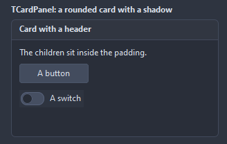
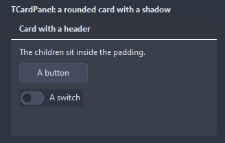
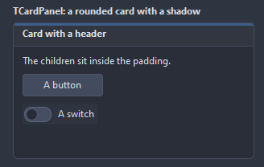

# TCardPanel

A container drawn as a card: rounded, framed, with a soft shadow and a header strip carrying the caption. The children sit inside the padding.

- Palette page: Unleashed: Layout
- Unit: `cardpanel.pas`
- Ancestor: `TCustomControl`


## Usage

```pascal
procedure TForm1.FormCreate(Sender: TObject);
begin
  var card := TCardPanel.Create(Self);
  card.Parent := Self;
  card.SetBounds(8, 8, 280, 180);
  card.Caption := 'Summary'; // the header; ShowHeader false hides it
  card.CornerRadius := 10;
  card.Shadow := true;
  var text := TLabel.Create(Self);
  text.Parent := card; // children go inside the padding
  text.Caption := 'Three tasks open, one overdue.';
end;
```

## Properties

| Property | Type | Default | Notes |
|---|---|---|---|
| `ShowHeader` | `boolean` | `true` | the header row is shown |
| `Shadow` | `boolean` | `true` | a soft shadow under the card |
| `HeaderHeight` | `integer` | `0` | 0 takes it from the font |
| `CornerRadius` | `integer` | `6` | the rounding of the corners, in pixels |
| `Padding` | `integer` | `8` | between the frame and the children |
| `ShadowSize` | `integer` | `4` | the reach of the shadow, in pixels |
| `BorderWidth` | `integer` | `1` | the border, 0 for none |
| `HeaderAlignment` | `TAlignment` | `taLeftJustify` |  |
| `CardColor` | `TColor` | `clDefault` | clDefault takes the colors of the theme |
| `HeaderColor` | `TColor` | `clDefault` | clDefault takes the color of the theme |
| `BorderColor` | `TColor` | `clDefault` | clDefault takes the color of the theme |
| `TitleColor` | `TColor` | `clDefault` | clDefault takes the color of the theme |
| `Antialiasing` | `TAntialiasSetting` | `asTheme` | asTheme follows the theme setting, asOn and asOff force it |
| `Style` | `TCardStyle` | `cpCard` | the look of the card: with a shadow, a frame only, a flat tint without a frame, or a frame with an accent strip along the top |

Also the standard properties of a control, re-published: `Caption`, `Align`, `Anchors`, `AutoSize`, `BorderSpacing`, `ChildSizing`, `ClientHeight`, `ClientWidth`, `Color`, `Constraints`, `DockSite`, `DragCursor`, `DragKind`, `DragMode`, `Enabled`, `Font`, `Hint`, `ParentColor`, `ParentFont`, `ParentShowHint`, `PopupMenu`, `ShowHint`, `TabOrder`, `TabStop`, `Visible`, `OnClick`, `OnContextPopup`, `OnDblClick`, `OnDockDrop`, `OnDockOver`, `OnEnter`, `OnExit`, `OnMouseDown`, `OnMouseEnter`, `OnMouseLeave`, `OnMouseMove`, `OnMouseUp`, `OnResize`, `OnUnDock`.

## Types

| Type | Values | Notes |
|---|---|---|
| `TCardStyle` | `cpCard`, `cpOutline`, `cpFlat`, `cpAccent` | the look of the card: with a shadow, a frame only, a flat tint without a frame, or a frame with an accent strip along the top |

## In pictures

### Every Style

The demo group with each value of `Style` in turn.

`Style = cpCard`


`Style = cpOutline`



`Style = cpFlat`



`Style = cpAccent`


