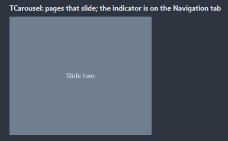
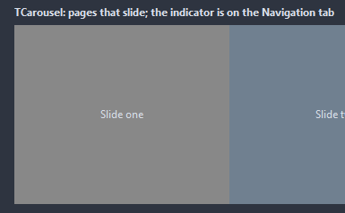

# TCarousel

Shows one of its children at a time, as a page: the pages slide sideways on their way in and out, the arrows and the dots move between them, AutoPlay moves on its own. The pages are the children in the order they were added.

- Palette page: Unleashed: Layout
- Unit: `carousel.pas`
- Ancestor: `TCustomControl`



## Usage

```pascal
procedure TForm1.FormCreate(Sender: TObject);
begin
  var slides := TCarousel.Create(Self);
  slides.Parent := Self;
  slides.SetBounds(8, 8, 400, 240);
  for var i := 1 to 3 do begin
    var page := TPanel.Create(Self);
    page.Caption := Format('Slide %d', [i]);
    page.Parent := slides; // each child is a page
  end;
  slides.AutoPlay := true;
  slides.Interval := 3000;
  slides.OnPageChange := @slidesChange;
end;

procedure TForm1.slidesChange(Sender: TObject);
begin
  Caption := Format('page %d of %d', [TCarousel(Sender).PageIndex + 1, TCarousel(Sender).PageCount]);
end;
```

## Properties

| Property | Type | Default | Notes |
|---|---|---|---|
| `PageIndex` | `integer` | `0` | the current page, from 0 |
| `AutoPlay` | `boolean` | `false` |  |
| `Loop` | `boolean` | `true` | past the last page comes the first |
| `Animated` | `boolean` | `true` | changes are animated |
| `ShowArrows` | `boolean` | `true` |  |
| `ShowDots` | `boolean` | `true` | dots are shown |
| `WheelMoves` | `boolean` | `true` |  |
| `Interval` | `integer` | `4000` | milliseconds a page stays with AutoPlay |
| `AnimationTime` | `integer` | `250` | milliseconds of the animation |
| `ArrowSize` | `integer` | `32` | the size of the arrow, in pixels |
| `DotSize` | `integer` | `8` | the diameter of a dot, in pixels |
| `Padding` | `integer` | `0` | around the pages |
| `ArrowColor` | `TColor` | `clDefault` | clDefault takes the colors of the theme |
| `DotColor` | `TColor` | `clDefault` | clDefault takes the color of the theme |
| `ActiveDotColor` | `TColor` | `clDefault` |  |
| `Antialiasing` | `TAntialiasSetting` | `asTheme` | asTheme follows the theme setting, asOn and asOff force it |

Also the standard properties of a control, re-published: `Align`, `Anchors`, `BorderSpacing`, `ClientHeight`, `ClientWidth`, `Color`, `Constraints`, `Enabled`, `Font`, `Hint`, `ParentColor`, `ParentFont`, `ParentShowHint`, `PopupMenu`, `ShowHint`, `TabOrder`, `TabStop`, `Visible`, `OnClick`, `OnContextPopup`, `OnEnter`, `OnExit`, `OnKeyDown`, `OnKeyPress`, `OnKeyUp`, `OnMouseDown`, `OnMouseEnter`, `OnMouseLeave`, `OnMouseMove`, `OnMouseUp`, `OnMouseWheel`, `OnResize`.

## Events

| Event | Handler | Notes |
|---|---|---|
| `OnPageChange` | `procedure(Sender: TObject)` | the page changed |

## Runtime

Available in code, not in the Object Inspector.

| Method | Notes |
|---|---|
| `PageCount: integer` |  |
| `CurrentPage: TControl` |  |
| `NextPage` |  |
| `PreviousPage` |  |

## In pictures

**The second page.**


