# TChartLite

Bars, lines, areas and pies from a few series of numbers: no axes objects, no transformations, a chart in a minute. Categories name the points, a legend names the series, the mouse picks out a point.

- Palette page: Unleashed: Display
- Unit: `chartlite.pas`
- Ancestor: `TGraphicControl`

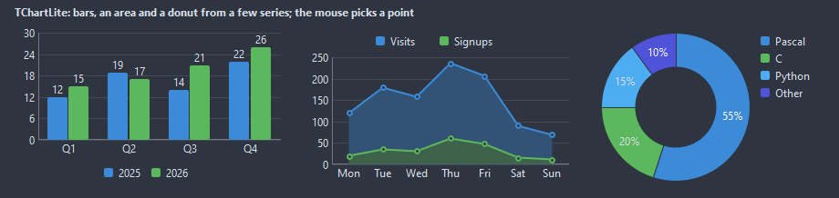

## Usage

```pascal
procedure TForm1.FormCreate(Sender: TObject);
begin
  var chart := TChartLite.Create(Self);
  chart.Parent := Self;
  chart.SetBounds(8, 8, 360, 200);
  chart.Kind := ckBars;
  chart.Legend := lgBottom;
  chart.Categories.AddStrings(['Q1', 'Q2', 'Q3', 'Q4']);
  chart.AddSeries('2025', [12, 15, 14, 18]);
  chart.AddSeries('2026', [14, 17, 19, 22]);
  chart.OnPointClick := @chartClick;
end;

procedure TForm1.chartClick(Sender: TObject; series, index: integer);
begin
  Caption := Format('series %d, point %d', [series, index]);
end;
```

## Properties

| Property | Type | Default | Notes |
|---|---|---|---|
| `Series` | `TChartSeriesList` |  |  |
| `Categories` | `TStrings` |  | the names of the points along the bottom, or of the slices |
| `Kind` | `TChartKind` | `ckBars` | bars side by side, bars stacked, lines, filled areas, a pie, a donut, areas stacked, dots alone, stepped lines, a radar of polygons on spokes |
| `Legend` | `TChartLegend` | `lgNone` |  |
| `Title` | `string` |  | the heading |
| `ShowGrid` | `boolean` | `true` | a grid behind the content |
| `ShowValues` | `boolean` | `false` | the number over every bar or point |
| `ShowAxes` | `boolean` | `true` | the axes are drawn |
| `ShowDots` | `boolean` | `true` | dots are shown |
| `ShowCategories` | `boolean` | `true` | the category names are shown |
| `AutoRange` | `boolean` | `true` | the range follows the values; off, MinValue and MaxValue hold it |
| `ShowPercent` | `boolean` | `true` | pie slices show their share instead of the value |
| `MinValue` | `double` |  | the lower limit |
| `MaxValue` | `double` |  | the upper limit |
| `Padding` | `integer` | `8` | the space between the border and the content |
| `BarGap` | `integer` | `30` | the share of a bar slot left empty, in percent |
| `LineWidth` | `integer` | `2` | the width of the line, in pixels |
| `GridLines` | `integer` | `5` |  |
| `CornerRadius` | `integer` | `2` | the rounding of the corners, in pixels |
| `DotSize` | `integer` | `6` | the diameter of a dot, in pixels |
| `ValueFormat` | `string` |  | a Format pattern for one number |
| `GridColor` | `TColor` | `clDefault` | clDefault takes the colors of the theme |
| `AxisColor` | `TColor` | `clDefault` | clDefault takes the color of the theme |
| `TextColor` | `TColor` | `clDefault` | clDefault takes the color of the theme |
| `BackColor` | `TColor` | `clDefault` | clDefault takes the color of the theme |
| `Antialiasing` | `TAntialiasSetting` | `asTheme` | asTheme follows the theme setting, asOn and asOff force it |

Also the standard properties of a control, re-published: `Align`, `Anchors`, `BorderSpacing`, `Color`, `Constraints`, `Enabled`, `Font`, `Hint`, `ParentColor`, `ParentFont`, `ParentShowHint`, `PopupMenu`, `ShowHint`, `Visible`, `OnClick`, `OnDblClick`, `OnMouseDown`, `OnMouseEnter`, `OnMouseLeave`, `OnMouseMove`, `OnMouseUp`, `OnResize`.

## Events

| Event | Handler | Notes |
|---|---|---|
| `OnPointClick` | `procedure(Sender: TObject; series, index: integer)` | a click on a point |
| `OnPointHover` | `procedure(Sender: TObject; series, index: integer)` | the mouse came over a point; series -1 once it left |
| `OnValueText` | `procedure(Sender: TObject; series, index: integer; value: double; var text: string)` | the text of a value label; text comes in formatted and may change |

## Runtime

Available in code, not in the Object Inspector.

| Property | Type | Notes |
|---|---|---|
| `HotSeries` | `integer` | the point under the mouse, -1 for none |

| Method | Notes |
|---|---|
| `PointText(series, index: integer): string` | the text of the hint over a point: the series or the slice, the category and the value |
| `AddSeries(const title: string; const values: array of double; color: TColor = clDefault): TChartSeries` | a series with a title and values in one call |
| `Clear` | removes everything |

## Companion classes

### `TChartSeries`

| Property | Type | Default | Notes |
|---|---|---|---|
| `Title` | `string` |  | the heading |
| `Color` | `TColor` | `clDefault` | clDefault takes a color from the palette of the chart |
| `Values` | `TStrings` |  | one number per line |
| `Visible` | `boolean` | `true` | hidden items take no room |
| `Tag` | `PtrInt` | `0` | free for the application |

| Property | Type | Notes |
|---|---|---|
| `Count` | `integer` | the number of entries |

| Method | Notes |
|---|---|
| `Add(value: double)` | a new entry at the end |
| `Clear` | removes everything |

### `TChartSeriesList`

| Method | Notes |
|---|---|
| `Add: TChartSeries` | a new entry at the end |

## Types

| Type | Values | Notes |
|---|---|---|
| `TChartKind` | `ckBars`, `ckStackedBars`, `ckLines`, `ckArea`, `ckPie`, `ckDonut`, `ckStackedArea`, `ckDots`, `ckSteps`, `ckRadar` | bars side by side, bars stacked, lines, filled areas, a pie, a donut, areas stacked, dots alone, stepped lines, a radar of polygons on spokes |
| `TChartLegend` | `lgNone`, `lgRight`, `lgBottom`, `lgTop` |  |

## In pictures

### Every Kind

The demo group with each value of `Kind` in turn.

`Kind = ckBars`

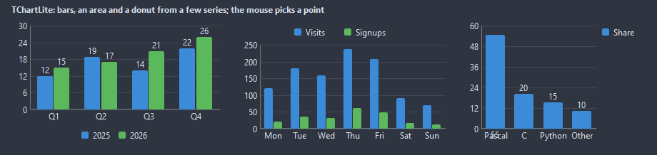

`Kind = ckStackedBars`

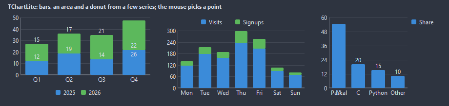

`Kind = ckLines`

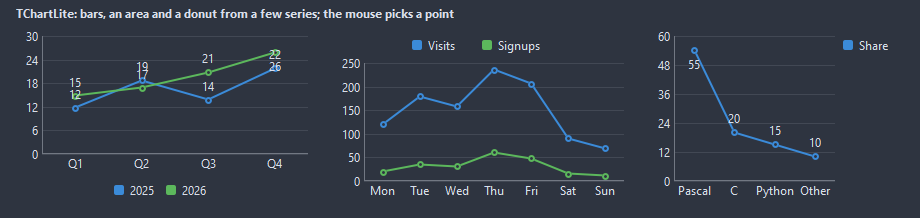

`Kind = ckArea`

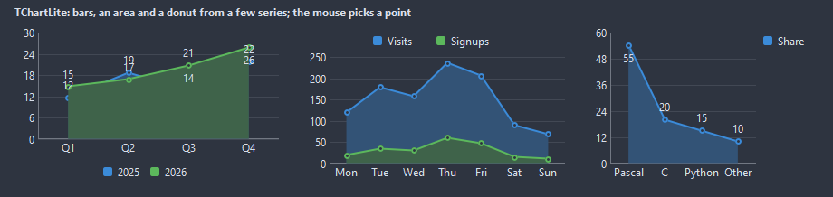

`Kind = ckPie`

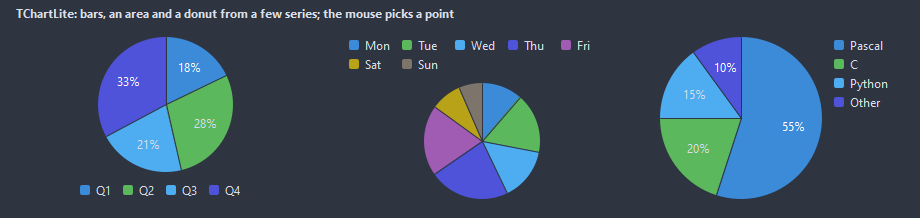

`Kind = ckDonut`

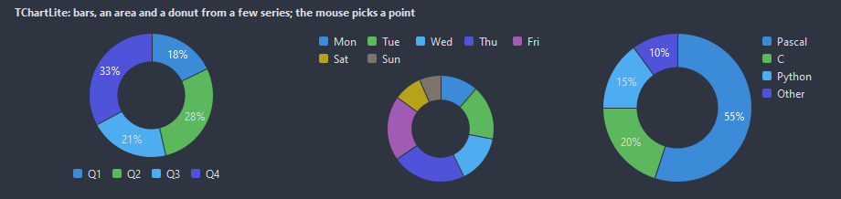

`Kind = ckStackedArea`

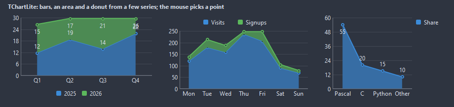

`Kind = ckDots`

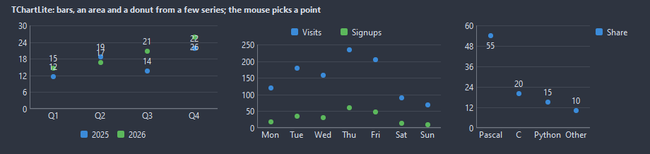

`Kind = ckSteps`

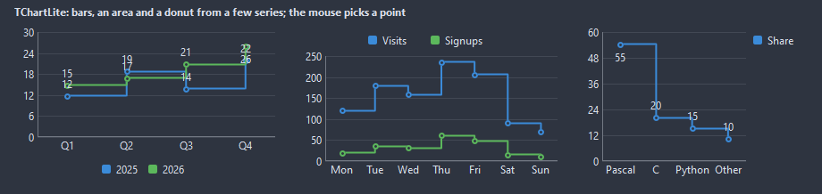

`Kind = ckRadar`

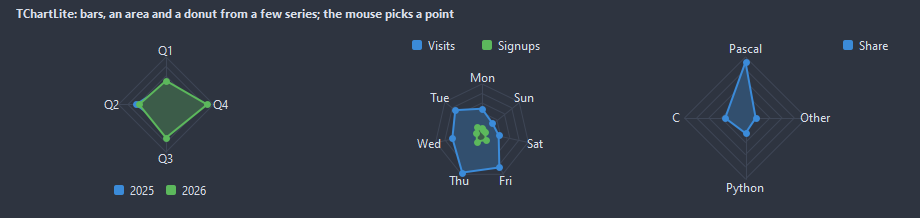
