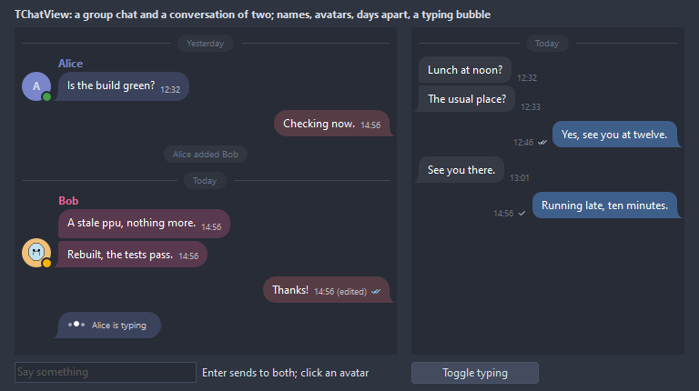

# TChatView

A conversation as bubbles under each other: the own ones on one side, the others on the other with a name, an avatar and a time, days apart by a separator, with a typing bubble at the end. A conversation of two paints two colors; a group gives every participant the color of their name, which the Participants override.

- Palette page: Unleashed: Views
- Unit: `chatview.pas`
- Ancestor: `TScrollingWinControl`



## Usage

```pascal
procedure TForm1.FormCreate(Sender: TObject);
begin
  var chat := TChatView.Create(Self);
  chat.Parent := Self;
  chat.SetBounds(8, 8, 420, 360);
  chat.Mode := cmGroup; // everyone in the color of their name
  chat.OwnName := 'me'; // the messages of this sender go to the right
  chat.Participants.AddParticipant('Alice').Status := stOnline;
  chat.Participants.AddParticipant('Bob').Color := clTeal; // the color of a participant, set by hand
  chat.AddSystem('Alice added Bob');
  chat.Add('Alice', 'Is the build green?');
  chat.Add('me', 'Checking now.').Status := msRead;
  chat.Typing := 'Bob'; // a bubble of moving dots until it is set to ''
end;
```

## Properties

| Property | Type | Default | Notes |
|---|---|---|---|
| `Mode` | `TChatMode` | `cmDirect` | a conversation of two, or a group where everyone has a color |
| `OwnName` | `string` |  | the sender whose messages are the own ones when no participant has IsSelf |
| `OwnSide` | `TChatSide` | `sdAuto` | the side of the own messages; sdAuto is the right |
| `Participants` | `TChatParticipants` |  | the entries of the senders, see below |
| `Messages` | `TChatMessages` |  | the conversation, see below |
| `Bubbles` | `TChatBubbles` |  | the shape and the spacing of the bubbles, see below |
| `Avatars` | `TChatAvatars` |  | when and how the avatars show, see below |
| `Labels` | `TChatLabels` |  | the names, times, marks and separators, see below |
| `Colors` | `TChatColors` |  | the colors, see below |
| `Typing` | `string` |  | the name of the one typing; a bubble of moving dots shows at the end while it is not empty |
| `AutoScroll` | `boolean` | `true` | the view follows a new message |
| `MaxMessages` | `integer` | `0` | the oldest messages go when there are more, 0 for no limit |
| `Padding` | `integer` | `8` | around the whole conversation |
| `SelectedIndex` | `integer` | `-1` | the message with the outline, -1 for none |
| `Language` | `TFormatLanguage` | `flSystem` | the names and separators of dates and times: those of the locale of the system, or English |
| `Antialiasing` | `TAntialiasSetting` | `asTheme` | asTheme follows the theme setting, asOn and asOff force it |

Also the standard properties of a scrolling control, re-published: `Align`, `Anchors`, `BorderSpacing`, `BorderStyle`, `Color`, `Constraints`, `Enabled`, `Font`, `Hint`, `ParentFont`, `ParentShowHint`, `PopupMenu`, `ShowHint`, `TabOrder`, `TabStop`, `Visible`, `OnClick`, `OnContextPopup`, `OnDblClick`, `OnEnter`, `OnExit`, `OnKeyDown`, `OnKeyPress`, `OnKeyUp`, `OnMouseDown`, `OnMouseEnter`, `OnMouseLeave`, `OnMouseMove`, `OnMouseUp`, `OnMouseWheel`, `OnResize`.

## Events

| Event | Handler | Notes |
|---|---|---|
| `OnMessageClick` | `procedure(Sender: TObject; msg: TChatMessage)` | a click on a bubble |
| `OnMessageDblClick` | `procedure(Sender: TObject; msg: TChatMessage)` |  |
| `OnMessageAdded` | `procedure(Sender: TObject; msg: TChatMessage)` | after Add, AddAt or AddSystem |
| `OnSelectionChange` | `procedure(Sender: TObject; msg: TChatMessage)` | the selected message, nil when none |
| `OnAvatarClick` | `procedure(Sender: TObject; participant: TChatParticipant)` | a click on an avatar; the participant is made for a sender without one |
| `OnDrawBubble` | `TCustomDrawEvent` | paints over the bubble of a message, text included, in its rectangle: index is the message, dsSelected and dsHover tell its state |
| `OnDrawAvatar` | `TCustomDrawEvent` | paints over the avatar of a message, in its square |

## Runtime

Available in code, not in the Object Inspector.

| Method | Notes |
|---|---|
| `Add(const sender, text: string): TChatMessage` | a message from a sender, now |
| `AddAt(const sender, text: string; time: TDateTime): TChatMessage` | a message with its own time |
| `AddSystem(const text: string): TChatMessage` | a line of the system in the middle, like "Alice joined" |
| `Clear` | removes every message |
| `ParticipantOf(const name: string): TChatParticipant` | the entry of a sender, nil without one |
| `EnsureParticipant(const name: string): TChatParticipant` | the entry of a sender, made when there is none |
| `IsSelf(const name: string): boolean` | the sender is the own side: its participant has IsSelf, or it is OwnName |
| `NameColorOf(const name: string): TColor` | the color of a participant: their own, or the one their name picks |
| `BubbleColorOf(msg: TChatMessage): TColor` | the fill of the bubbles of a message |
| `TextColorOf(msg: TChatMessage): TColor` | the text in the bubble of a message |
| `MessageAt(x, y: integer): TChatMessage` | the message under a point of the client area, nil between them |
| `SelectedMessage: TChatMessage` | the message with the outline, nil when none |
| `ScrollToEnd` | scrolls to the newest message |
| `ScrollToMessage(index: integer)` | scrolls until the message is in view |
| `AsText: string` | the conversation as lines of time, name and text |
| `CopyToClipboard` | puts the selected message, or the whole conversation, on the clipboard |

The keyboard: Up and Down move the selection, Home and End take it to the first and the last message, Page Up and Page Down scroll a page, Escape clears the selection, Ctrl+C copies.

## How the colors are picked

A conversation of two (`Mode = cmDirect`) paints the own bubbles in `Colors.OwnBubble` and the others in `Colors.OtherBubble`; with clDefault those are the accent of the theme and a light shade of the window. `Colors.Auto` switches it to the colors of the names instead.

A group (`Mode = cmGroup`) keeps `Colors.Auto` on: every participant gets the color their name picks from the palette of `TAvatar`, the same name always the same color, and the other side of a conversation of two never shares the own color. The fill of a bubble is that color blended into the background by `Colors.AutoStrength` percent; the name above the bubble and the generated avatar take the full color. The Object Inspector shows `Colors.Auto` read-only while the mode is a group.

Whatever the mode, a color set by hand wins: `TChatParticipant.Color` for every bubble of that participant, `TChatMessage.Color` for one bubble.

## Companion classes

### `TChatParticipant`

Somebody in the conversation: the name the messages carry as their sender, what to show for it, the color and the picture of their bubbles and avatar. A sender without an entry gets everything from the name.

| Property | Type | Default | Notes |
|---|---|---|---|
| `Name` | `string` |  | the key the messages name as their sender; case does not matter |
| `Caption` | `string` |  | shown instead of Name |
| `Initials` | `string` |  | the letters of a generated avatar; empty takes the first letters of the first and the last word of the name |
| `Color` | `TColor` | `clDefault` | the color of the participant: their name, their generated avatar and the tint of their bubbles; clDefault picks one from the name |
| `TextColor` | `TColor` | `clDefault` | the text in their bubbles; clDefault contrasts with the bubble |
| `Picture` | `TPicture` |  | the avatar |
| `IsSelf` | `boolean` | `false` | the messages of this participant are the own ones |
| `Side` | `TChatSide` | `sdAuto` | sdAuto puts the own ones on the side of OwnSide and everyone else on the other |
| `Status` | `TAvatarStatus` | `stNone` | the presence dot on the avatar |
| `Tag` | `PtrInt` | `0` | free for the application |

| Method | Notes |
|---|---|
| `ShownName: string` | the name shown: Caption, or Name |
| `HasPicture: boolean` |  |

### `TChatParticipants`

| Method | Notes |
|---|---|
| `Add: TChatParticipant` | a new entry at the end |
| `AddParticipant(const name: string; isSelf: boolean = false): TChatParticipant` | a new entry with the name |
| `Find(const name: string): TChatParticipant` | the entry of a name, nil without one |

### `TChatMessage`

| Property | Type | Default | Notes |
|---|---|---|---|
| `Sender` | `string` |  | the name of the participant who wrote it |
| `Text` | `string` |  | the text, wrapped to the bubble; line breaks are kept |
| `Time` | `TDateTime` |  | now when made |
| `Kind` | `TChatMessageKind` | `mkMessage` | a message in a bubble, or a line of the system in the middle |
| `Status` | `TChatMessageStatus` | `msNone` | the mark after the time of an own message |
| `Edited` | `boolean` | `false` | shows the edited caption after the time |
| `Color` | `TColor` | `clDefault` | the bubble of this one message; clDefault takes the participant's |
| `TextColor` | `TColor` | `clDefault` | clDefault contrasts with the bubble |
| `Picture` | `TPicture` |  | an image in the bubble, above the text |
| `Tag` | `PtrInt` | `0` | free for the application |

| Method | Notes |
|---|---|
| `HasPicture: boolean` |  |
| `Bubble: TRect` | the rectangle of the bubble in the content, after a layout |

### `TChatMessages`

| Method | Notes |
|---|---|
| `Add: TChatMessage` | a new entry at the end |

### `TChatBubbles`

| Property | Type | Default | Notes |
|---|---|---|---|
| `Shape` | `TChatBubbleShape` | `shTailed` | rounded corners, rounded with a tail toward the speaker on the last of their messages in a row, square, a pill |
| `CornerRadius` | `integer` | `14` | the rounding of the corners, in pixels |
| `Padding` | `integer` | `10` | between the edge of a bubble and its text |
| `Spacing` | `integer` | `10` | between the messages of different senders |
| `GroupSpacing` | `integer` | `3` | between the messages of one sender in a row |
| `MaxWidth` | `integer` | `70` | percent of the room a bubble may take |
| `MinWidth` | `integer` | `0` |  |
| `BorderWidth` | `integer` | `0` | the border, 0 for none |
| `TailSize` | `integer` | `7` |  |
| `GroupInterval` | `integer` | `5` | minutes between two messages of one sender that still make a row |
| `LineSpacing` | `integer` | `0` |  |
| `MaxPictureHeight` | `integer` | `200` | a picture in a message is scaled down to this height |
| `GroupMessages` | `boolean` | `true` | messages of one sender in a row share the name and the avatar and sit closer, with smaller corners between them |

### `TChatAvatars`

| Property | Type | Default | Notes |
|---|---|---|---|
| `Visibility` | `TChatVisibility` | `vsAuto` | vsAuto shows the avatars for the other participants of a group chat and hides them in a conversation of two |
| `ShowForSelf` | `boolean` | `false` | the own messages get an avatar too |
| `ShowStatus` | `boolean` | `false` | the presence dot of the participant on the avatar |
| `Source` | `TChatAvatarSource` | `avPictureOrGenerated` | the picture of the participant, the initials on their color, or the picture when there is one and the initials otherwise |
| `Shape` | `TAvatarShape` | `asCircle` | the outline, as for `TAvatar` |
| `Placement` | `TChatAvatarPlacement` | `apBottom` | the avatar sits at the first or at the last bubble of a row |
| `Size` | `integer` | `32` |  |
| `Spacing` | `integer` | `8` | between the avatar and the bubble |
| `BorderWidth` | `integer` | `0` | a ring in the color of the participant |

### `TChatLabels`

| Property | Type | Default | Notes |
|---|---|---|---|
| `Names` | `TChatVisibility` | `vsAuto` | vsAuto shows the names of the other participants of a group chat |
| `NamePlacement` | `TChatNamePlacement` | `npAbove` | the name above the bubble or on its first line |
| `ShowTime` | `boolean` | `true` |  |
| `ShowStatus` | `boolean` | `true` | the mark of the status after the time of an own message |
| `ShowEdited` | `boolean` | `true` |  |
| `DateSeparators` | `boolean` | `true` | a line with the day between the messages of different days |
| `SeparatorLines` | `boolean` | `true` | the separator runs a line to each edge |
| `TimeHints` | `boolean` | `true` | the hint over a bubble names the sender and the full time |
| `TimePlacement` | `TChatTimePlacement` | `tmInside` | the time inside the bubble after the last line, beside the bubble at its bottom, or under it |
| `TimeFormat` | `string` | `hh:nn` | a FormatDateTime pattern |
| `DateFormat` | `string` | `dddd, mmmm d` | a FormatDateTime pattern for the separators |
| `EditedCaption` | `string` | `(edited)` |  |
| `TodayCaption` | `string` | `Today` | the separator of today; empty shows the date |
| `YesterdayCaption` | `string` | `Yesterday` | the separator of yesterday; empty shows the date |
| `EmptyText` | `string` | `No messages yet` | shown in the middle of an empty chat |
| `TypingCaption` | `string` |  | beside the dots of the typing bubble, %s is the name |

### `TChatColors`

clDefault takes the colors of the theme.

| Property | Type | Default | Notes |
|---|---|---|---|
| `Auto` | `boolean` | `false` | every participant gets the color their name picks; a group chat always does this, a conversation of two uses OwnBubble and OtherBubble without it |
| `AutoStrength` | `integer` | `25` | percent of the color of a participant in the fill of their bubbles, 100 for the full color |
| `OwnBubble` | `TColor` | `clDefault` | the accent of the theme |
| `OtherBubble` | `TColor` | `clDefault` | a light shade of the window |
| `OwnText` | `TColor` | `clDefault` | contrasts with the bubble |
| `OtherText` | `TColor` | `clDefault` | contrasts with the bubble |
| `Names` | `TColor` | `clDefault` | the names above the bubbles; clDefault takes the color of each participant |
| `Time` | `TColor` | `clDefault` |  |
| `Border` | `TColor` | `clDefault` |  |
| `System` | `TColor` | `clDefault` | the pill of a system message |
| `SystemText` | `TColor` | `clDefault` |  |
| `Separator` | `TColor` | `clDefault` | the pill of a date separator |
| `SeparatorText` | `TColor` | `clDefault` |  |
| `Selection` | `TColor` | `clDefault` | the outline of the selected bubble |

## Types

| Type | Values | Notes |
|---|---|---|
| `TChatMode` | `cmDirect`, `cmGroup` | a conversation of two, or a group where everyone has a color |
| `TChatSide` | `sdAuto`, `sdLeft`, `sdRight` | where the bubbles of a participant go |
| `TChatMessageKind` | `mkMessage`, `mkSystem` | a message in a bubble, or a line of the system in the middle |
| `TChatMessageStatus` | `msNone`, `msSending`, `msSent`, `msDelivered`, `msRead`, `msFailed` | the mark after the time of an own message: a clock, a check, two checks, two checks in the accent, a failure mark |
| `TChatBubbleShape` | `shRounded`, `shTailed`, `shSquare`, `shPill` | the shape of a bubble |
| `TChatVisibility` | `vsAuto`, `vsAlways`, `vsNever` | vsAuto shows the part for the other participants of a group chat and hides it in a conversation of two |
| `TChatAvatarSource` | `avPicture`, `avGenerated`, `avPictureOrGenerated` | what an avatar shows |
| `TChatAvatarPlacement` | `apTop`, `apBottom` | the avatar sits at the first or at the last bubble of a row |
| `TChatTimePlacement` | `tmInside`, `tmBeside`, `tmBelow` | where the time goes |
| `TChatNamePlacement` | `npAbove`, `npInside` | where the name goes |

## Custom drawing

The component paints its parts by itself, through the shapes of `ControlPaint`. A handler on the events below paints over a part after the component has painted it: it gets the canvas of the control, the rectangle of the part, the index of the message and a `TDrawState` set telling what the part is in: `dsHover`, `dsSelected`, `dsDisabled`.

- `OnDrawBubble`: paints over the bubble of a message, text included, in its rectangle. Handler: `TCustomDrawEvent`.
- `OnDrawAvatar`: paints over the avatar of a message, in its square. Handler: `TCustomDrawEvent`.

A handler may paint with the plain canvas, or through `beginShapes()` from `ControlPaint` for the same smoothed shapes the components use: `paintRoundRect()`, `paintCircle()`, `paintCheck()`, `FillPolygon()` and the rest, then `Flush` once. Colors of the theme come from `pick()`, `blend()` and `contrastText()`.
