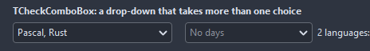
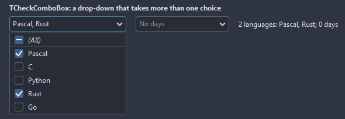

# TCheckComboBox

A combo box that takes more than one choice: the drop-down lists the items with a check box each, the box shows the chosen ones as a list, a count or a caption of its own.

- Palette page: Unleashed: Input
- Unit: `checkcombobox.pas`
- Ancestor: `TCustomControl`



## Usage

```pascal
procedure TForm1.FormCreate(Sender: TObject);
begin
  var days := TCheckComboBox.Create(Self);
  days.Parent := Self;
  days.Width := 220;
  days.Items.AddStrings(['Monday', 'Tuesday', 'Wednesday', 'Thursday', 'Friday']);
  days.Checked[0] := true;
  days.Checked[4] := true;
  days.Summary := csCount;
  days.CountFormat := '%d days';
  days.OnChange := @daysChange;
end;

procedure TForm1.daysChange(Sender: TObject);
begin
  Caption := Format('%d checked', [TCheckComboBox(Sender).CheckedCount]);
end;
```

## Properties

| Property | Type | Default | Notes |
|---|---|---|---|
| `Items` | `TStrings` |  | the entries |
| `CheckedText` | `string` |  | the checked items by name, separated by the delimiter; streams with the form |
| `Summary` | `TCheckSummary` | `csList` |  |
| `Delimiter` | `string` |  | between the names in the box and in CheckedText |
| `EmptyText` | `string` |  | the box with nothing checked |
| `CountFormat` | `string` |  | a Format pattern with the count, for csCount |
| `ShowSelectAll` | `boolean` | `true` | a first row that checks or clears every item |
| `ReadOnly` | `boolean` | `false` | the mouse and the keyboard change nothing |
| `CornerRadius` | `integer` | `4` | the rounding of the corners, in pixels |
| `BorderWidth` | `integer` | `1` | the border, 0 for none |
| `MaxDropRows` | `integer` | `10` | the drop-down scrolls past this many rows |
| `BorderColor` | `TColor` | `clDefault` | clDefault takes the colors of the theme |
| `TextColor` | `TColor` | `clDefault` | clDefault takes the color of the theme |
| `BackColor` | `TColor` | `clDefault` | clDefault takes the color of the theme |
| `Antialiasing` | `TAntialiasSetting` | `asTheme` | asTheme follows the theme setting, asOn and asOff force it |

Also the standard properties of a control, re-published: `Caption`, `Align`, `Anchors`, `AutoSize`, `BorderSpacing`, `Constraints`, `Enabled`, `Font`, `Hint`, `ParentFont`, `ParentShowHint`, `PopupMenu`, `ShowHint`, `TabOrder`, `TabStop`, `Visible`, `OnClick`, `OnContextPopup`, `OnEnter`, `OnExit`, `OnKeyDown`, `OnKeyPress`, `OnKeyUp`, `OnMouseDown`, `OnMouseEnter`, `OnMouseLeave`, `OnMouseMove`, `OnMouseUp`, `OnResize`.

## Events

| Event | Handler | Notes |
|---|---|---|
| `OnChange` | `procedure(Sender: TObject)` | after the value changed |
| `OnItemCheck` | `procedure(Sender: TObject; index: integer; checked: boolean)` |  |
| `OnDropDown` | `procedure(Sender: TObject)` | the drop-down opens |
| `OnCloseUp` | `procedure(Sender: TObject)` | the drop-down closes |

## Runtime

Available in code, not in the Object Inspector.

| Property | Type | Notes |
|---|---|---|
| `Checked[index: integer]` | `boolean` | on or off |

| Method | Notes |
|---|---|
| `DropDown` | opens the drop-down |
| `CloseUp` | closes the drop-down |
| `DroppedDown: boolean` | the drop-down is open |
| `CheckAll(value: boolean)` |  |
| `CheckedCount: integer` |  |
| `GetChecked(list: TList)` | the indices of the checked items |

## Types

| Type | Values | Notes |
|---|---|---|
| `TCheckSummary` | `csList`, `csCount`, `csCaption` |  |

## In pictures

**Open: a check box per entry, the (All) box on top.**


