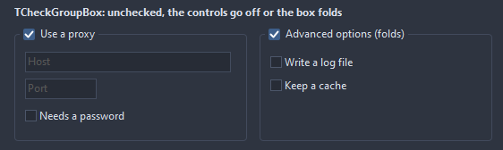
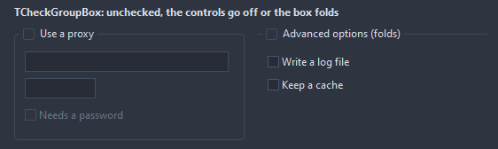

# TCheckGroupBox

A group box with a check box in its caption: unchecked, the controls in it turn off, or the box folds down to its caption line. A click on the check box or the caption, or Space, flips it.

- Palette page: Unleashed: Layout
- Unit: `checkgroupbox.pas`
- Ancestor: `TCustomControl`



## Usage

```pascal
procedure TForm1.FormCreate(Sender: TObject);
begin
  var proxy := TCheckGroupBox.Create(Self);
  proxy.Parent := Self;
  proxy.SetBounds(8, 8, 300, 120);
  proxy.Caption := 'Use a proxy';
  proxy.UncheckedAction := uaDisable; // or uaCollapse
  var host := TEdit.Create(Self);
  host.Parent := proxy;
  host.Text := 'proxy.local:8080';
  proxy.Checked := false; // the edit goes gray
end;
```

## Properties

| Property | Type | Default | Notes |
|---|---|---|---|
| `Checked` | `boolean` | `true` | on or off |
| `UncheckedAction` | `TUncheckedAction` | `uaDisable` | what an unchecked box does with what it holds |
| `ExpandedHeight` | `integer` | `140` | the height while checked; the box keeps it up to date itself |
| `CornerRadius` | `integer` | `4` | the rounding of the corners, in pixels |
| `InnerPadding` | `integer` | `6` | between the frame and the controls in it |
| `BorderColor` | `TColor` | `clDefault` | clDefault takes the colors of the theme |
| `CaptionColor` | `TColor` | `clDefault` | clDefault takes the color of the theme |
| `CheckColor` | `TColor` | `clDefault` |  |
| `Antialiasing` | `TAntialiasSetting` | `asTheme` | asTheme follows the theme setting, asOn and asOff force it |

Also the standard properties of a control, re-published: `Caption`, `Align`, `Anchors`, `BorderSpacing`, `ChildSizing`, `ClientHeight`, `ClientWidth`, `Color`, `Constraints`, `Enabled`, `Font`, `Hint`, `ParentColor`, `ParentFont`, `ParentShowHint`, `PopupMenu`, `ShowHint`, `TabOrder`, `TabStop`, `Visible`, `OnClick`, `OnContextPopup`, `OnDblClick`, `OnEnter`, `OnExit`, `OnKeyDown`, `OnKeyPress`, `OnKeyUp`, `OnMouseDown`, `OnMouseEnter`, `OnMouseLeave`, `OnMouseMove`, `OnMouseUp`, `OnResize`.

## Events

| Event | Handler | Notes |
|---|---|---|
| `OnChange` | `procedure(Sender: TObject)` | after Checked changed and the box did what it does |

## Runtime

Available in code, not in the Object Inspector.

| Method | Notes |
|---|---|
| `Toggle` | flips the state |

## Types

| Type | Values | Notes |
|---|---|---|
| `TUncheckedAction` | `uaDisable`, `uaCollapse`, `uaNothing` | what an unchecked box does with what it holds |

## In pictures

**Both unchecked: the first disables its controls, the second folds.**


