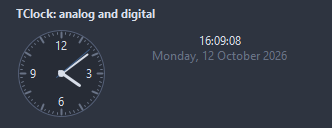
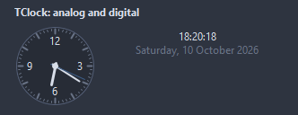
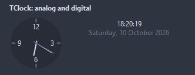
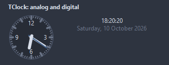
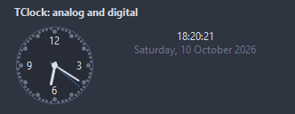

# TClock

A clock face or a digital readout. Live follows the system time, with an offset in minutes for another zone; off, it shows Time.

- Palette page: Unleashed: Display
- Unit: `clock.pas`
- Ancestor: `TGraphicControl`



## Usage

```pascal
procedure TForm1.FormCreate(Sender: TObject);
begin
  var wall := TClock.Create(Self);
  wall.Parent := Self;
  wall.SetBounds(8, 8, 120, 120);
  wall.Numerals := cnAll;
  wall.SmoothSeconds := true;
  var digital := TClock.Create(Self);
  digital.Parent := Self;
  digital.SetBounds(140, 8, 160, 40);
  digital.Mode := cmDigital;
  digital.ShowDate := true;
  digital.OffsetMinutes := 60; // another time zone
end;
```

## Properties

| Property | Type | Default | Notes |
|---|---|---|---|
| `Mode` | `TClockMode` | `cmAnalog` |  |
| `Time` | `TDateTime` |  | the time shown while not Live |
| `Live` | `boolean` | `true` |  |
| `ShowSeconds` | `boolean` | `true` |  |
| `ShowDate` | `boolean` | `false` | the date under the digital readout |
| `ShowTicks` | `boolean` | `true` | tick marks are shown |
| `SmoothSeconds` | `boolean` | `false` | the second hand sweeps instead of stepping |
| `TwentyFourHours` | `boolean` | `true` |  |
| `OffsetMinutes` | `integer` | `0` | minutes added to the system time when Live |
| `Numerals` | `TClockNumerals` | `cnQuarters` |  |
| `DigitalFormat` | `string` |  | FormatDateTime patterns; empty takes hh:nn:ss and the long date |
| `DateFormat` | `string` |  | a FormatDateTime pattern for the date |
| `FaceColor` | `TColor` | `clDefault` | clDefault takes the colors of the theme |
| `BorderColor` | `TColor` | `clDefault` | clDefault takes the color of the theme |
| `HourColor` | `TColor` | `clDefault` |  |
| `MinuteColor` | `TColor` | `clDefault` |  |
| `SecondColor` | `TColor` | `clDefault` |  |
| `TickColor` | `TColor` | `clDefault` | clDefault takes the color of the theme |
| `Antialiasing` | `TAntialiasSetting` | `asTheme` | asTheme follows the theme setting, asOn and asOff force it |
| `Style` | `TClockStyle` | `csClassic` | the face: classic ticks and hands, a bare minimal face, bold hands and ticks, or dots for the ticks |
| `Language` | `TFormatLanguage` | `flSystem` | the names and separators of dates, times and numbers: those of the locale of the system, or English |

Also the standard properties of a control, re-published: `Align`, `Anchors`, `BorderSpacing`, `Color`, `Constraints`, `Enabled`, `Font`, `Hint`, `ParentColor`, `ParentFont`, `ParentShowHint`, `PopupMenu`, `ShowHint`, `Visible`, `OnClick`, `OnContextPopup`, `OnDblClick`, `OnMouseDown`, `OnMouseEnter`, `OnMouseLeave`, `OnMouseMove`, `OnMouseUp`, `OnResize`.

## Events

| Event | Handler | Notes |
|---|---|---|
| `OnTick` | `procedure(Sender: TObject)` | every second while Live |

## Runtime

Available in code, not in the Object Inspector.

| Method | Notes |
|---|---|
| `Shown: TDateTime` | the time on the face: the system time with the offset when Live |

## Types

| Type | Values | Notes |
|---|---|---|
| `TClockMode` | `cmAnalog`, `cmDigital` |  |
| `TClockNumerals` | `cnNone`, `cnQuarters`, `cnAll` |  |
| `TClockStyle` | `csClassic`, `csMinimal`, `csBold`, `csDotted` | the face: classic ticks and hands, a bare minimal face, bold hands and ticks, or dots for the ticks |

## In pictures

### Every Style

The demo group with each value of `Style` in turn.

`Style = csClassic`



`Style = csMinimal`



`Style = csBold`



`Style = csDotted`


