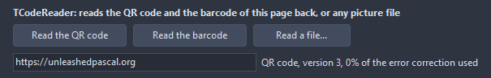

# TCodeReader

Reads a QR code or a linear barcode out of a picture: a file, a graphic or a bitmap, as the camera or a scanner saved it, turned any way. The text, the raw bytes and the format come out, a QR code tells how much of its error correction the read spent.

- Palette page: Unleashed: Display
- Unit: `codereader.pas`
- Ancestor: `TComponent`



## Usage

```pascal
procedure TForm1.FormCreate(Sender: TObject);
begin
  var reader := TCodeReader.Create(Self);
  if reader.ReadFile('ticket.png') then begin
    Caption := reader.Text; // the content, UTF-8
    if reader.Format = cfQR then
      Caption := Caption+Format(' (QR version %d, %d%% of the error correction used)', [reader.Version, reader.ErrorCorrectionUsed]);
  end else Caption := 'no code in the picture';
end;
```

## Properties

| Property | Type | Default | Notes |
|---|---|---|---|
| `Formats` | `TCodeFormats` | `[cfQR, cfEAN13, cfEAN8, cfUPCA, cfCode39, cfCode128, cfITF]` | the formats looked for |

## Events

| Event | Handler | Notes |
|---|---|---|
| `OnDecoded` | `TNotifyEvent` | after a read, found or not |

## Runtime

Available in code, not in the Object Inspector.

| Method | Notes |
|---|---|
| `ReadFile(const fileName: string): boolean` | reads a picture file; true when it held a code |
| `ReadGraphic(graphic: TGraphic): boolean` | reads a loaded graphic |
| `ReadBitmap(bitmap: TRasterImage): boolean` | reads a bitmap, like the one `TQRCode.SaveToBitmap()` writes |
| `Clear` | forgets the last read |
| `Found: boolean` | the last read found a code |
| `Format: TCodeFormat` | what the picture held |
| `Text: string` | the content; bytes outside UTF-8 come as Latin-1 |
| `Bytes: TBytes` | the content as the code carries it, byte for byte |
| `Version: integer` | of a QR code: its version 1..40 |
| `ErrorLevel: TQRErrorLevel` | of a QR code: its error correction level |
| `Mask: integer` | of a QR code: its mask pattern 0..7 |
| `CorrectedCodewords: integer` | of a QR code: the codewords the error correction had to repair |
| `ErrorCorrectionUsed: integer` | of a QR code: percent of the correction capacity the repair took; 0 for a clean code, 100 for one just on the edge of being unreadable |
| `Area: TRect` | where the code sits in the picture |

## What it reads

A QR code of any version, level and mask, in numeric, alphanumeric, byte and kanji mode; the code may be scaled, turned by any angle and photographed at a slight slant, and may miss or carry dirt on as many modules as its error correction level allows. The picture is read against one threshold first and, failing that, pixel by pixel against its surroundings, which copes with uneven light.

A linear barcode of the symbologies `TBarcode` writes: EAN-13, EAN-8, UPC-A, Code 39, Code 128 and interleaved 2 of 5, read along rows from the middle of the picture outward, left to right and upside down. EAN, UPC and Code 128 are checked by their check digits; a Code 39 check character, when the writer added one, comes out as part of the text.

A QR code that holds one message in several segments, such as digits followed by text, comes out as one string. A code that holds a structured record, like a driving license, comes out as the bytes the record is made of; the application parses them.

## Types

| Type | Values | Notes |
|---|---|---|
| `TCodeFormat` | `cfNone`, `cfQR`, `cfEAN13`, `cfEAN8`, `cfUPCA`, `cfCode39`, `cfCode128`, `cfITF` | what the picture held: a QR code, or a linear barcode of one of the symbologies TBarcode writes |
| `TCodeFormats` | set of `TCodeFormat` |  |
