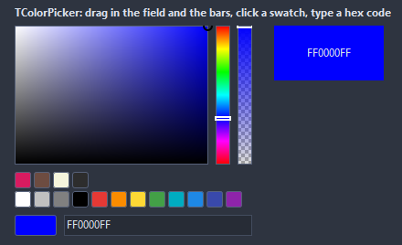

# TColorPicker

A color picked in place: a saturation and value field under a hue bar, an alpha bar when wanted, a row of swatches and the hex code of the result. Every part drags with the mouse; the arrows nudge the field.

- Palette page: Unleashed: Input
- Unit: `colorpicker.pas`
- Ancestor: `TCustomControl`



## Usage

```pascal
procedure TForm1.FormCreate(Sender: TObject);
begin
  var picker := TColorPicker.Create(Self);
  picker.Parent := Self;
  picker.SetBounds(8, 8, 260, 200);
  picker.ShowAlpha := true;
  picker.SelectedColor := $0080FF; // a TColor, BGR
  picker.OnChange := @pickerChange;
end;

procedure TForm1.pickerChange(Sender: TObject);
begin
  Caption := TColorPicker(Sender).HexCode;
end;
```

## Properties

| Property | Type | Default | Notes |
|---|---|---|---|
| `SelectedColor` | `TColor` | `clRed` | clDefault takes the color of the theme |
| `Alpha` | `byte` | `255` | the opacity, 0 to 255 |
| `Hue` | `integer` | `0` |  |
| `Saturation` | `integer` | `100` |  |
| `Value` | `integer` | `100` | the value shown |
| `ShowAlpha` | `boolean` | `false` | the alpha bar is shown |
| `ShowSwatches` | `boolean` | `true` | the swatches are shown |
| `ShowHex` | `boolean` | `true` |  |
| `ShowPreview` | `boolean` | `true` |  |
| `BarSide` | `TPickerBarSide` | `bsRight` | where the hue bar lies against the field |
| `BarSize` | `integer` | `16` | the hue and alpha bars |
| `Spacing` | `integer` | `8` | the gap between the parts |
| `SwatchSize` | `integer` | `18` | the size of a swatch, in pixels |
| `MarkerSize` | `integer` | `10` |  |
| `Swatches` | `TStrings` |  | hex codes, one per line |
| `Antialiasing` | `TAntialiasSetting` | `asTheme` | the smoothing of the shapes: after the theme, or its own choice |

Also the standard properties of a control, re-published: `Align`, `Anchors`, `BorderSpacing`, `Color`, `Constraints`, `Enabled`, `Font`, `Hint`, `ParentFont`, `ParentShowHint`, `PopupMenu`, `ShowHint`, `TabOrder`, `TabStop`, `Visible`, `OnClick`, `OnContextPopup`, `OnEnter`, `OnExit`, `OnKeyDown`, `OnKeyPress`, `OnKeyUp`, `OnMouseDown`, `OnMouseEnter`, `OnMouseLeave`, `OnMouseMove`, `OnMouseUp`, `OnResize`.

## Events

| Event | Handler | Notes |
|---|---|---|
| `OnChange` | `procedure(Sender: TObject)` | after the color settled |
| `OnChanging` | `procedure(Sender: TObject)` | on every move while a part drags |

## Runtime

Available in code, not in the Object Inspector.

| Method | Notes |
|---|---|
| `ColorWithAlpha: cardinal` | the color with the alpha in the high byte, $AABBGGRR |
| `HexCode: string` | the hex code: RRGGBB, with the alpha AARRGGBB |
| `SetHexCode(const code: string): boolean` | reads RRGGBB or AARRGGBB, with or without a leading # or $ |
| `RememberColor(color: TColor)` | puts the color on the swatch row, dropping the oldest past the end |

## Types

| Type | Values | Notes |
|---|---|---|
| `TPickerBarSide` | `bsRight`, `bsBottom` | where the hue bar lies against the field |
