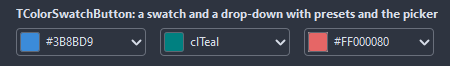
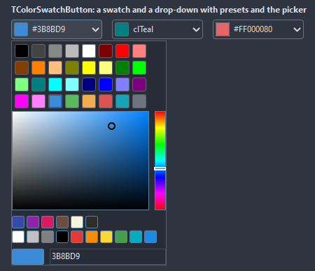

# TColorSwatchButton

A button that shows a color and drops a palette of swatches, a picker or both to change it. The color shows as a hex code, a name or a caption of its own next to the swatch.

- Palette page: Unleashed: Input
- Unit: `colorswatchbutton.pas`
- Ancestor: `TCustomControl`



## Usage

```pascal
procedure TForm1.FormCreate(Sender: TObject);
begin
  var ink := TColorSwatchButton.Create(Self);
  ink.Parent := Self;
  ink.Width := 120;
  ink.Color := clNavy;
  ink.TextMode := stName;
  ink.Swatches.AddStrings(['clRed', 'clGreen', 'clBlue', '#FF8800']);
  ink.OnChange := @inkChange;
end;

procedure TForm1.inkChange(Sender: TObject);
begin
  Font.Color := TColorSwatchButton(Sender).Color;
end;
```

## Properties

| Property | Type | Default | Notes |
|---|---|---|---|
| `Color` | `TColor` | `clBlack` | the color shown; clDefault is not a color here and shows as black |
| `Alpha` | `byte` | `255` | the opacity, 0 to 255 |
| `Swatches` | `TStrings` |  | the preset colors, one per line, as names or hex like $RRGGBB or #RRGGBB |
| `ShowPicker` | `boolean` | `true` |  |
| `ShowSwatches` | `boolean` | `true` | the swatches are shown |
| `ShowAlpha` | `boolean` | `false` | the alpha bar is shown |
| `TextMode` | `TSwatchTextMode` | `stHex` | what the text shows |
| `Columns` | `integer` | `8` | the columns |
| `SwatchSize` | `integer` | `20` | the size of a swatch, in pixels |
| `CornerRadius` | `integer` | `4` | the rounding of the corners, in pixels |
| `BorderWidth` | `integer` | `1` | the border, 0 for none |
| `BorderColor` | `TColor` | `clDefault` | clDefault takes the colors of the theme |
| `TextColor` | `TColor` | `clDefault` | clDefault takes the color of the theme |
| `BackColor` | `TColor` | `clDefault` | clDefault takes the color of the theme |
| `Antialiasing` | `TAntialiasSetting` | `asTheme` | asTheme follows the theme setting, asOn and asOff force it |

Also the standard properties of a control, re-published: `Align`, `Anchors`, `AutoSize`, `BorderSpacing`, `Caption`, `Constraints`, `Enabled`, `Font`, `Hint`, `ParentFont`, `ParentShowHint`, `PopupMenu`, `ShowHint`, `TabOrder`, `TabStop`, `Visible`, `OnClick`, `OnContextPopup`, `OnEnter`, `OnExit`, `OnKeyDown`, `OnKeyPress`, `OnKeyUp`, `OnMouseDown`, `OnMouseEnter`, `OnMouseLeave`, `OnMouseMove`, `OnMouseUp`, `OnResize`.

## Events

| Event | Handler | Notes |
|---|---|---|
| `OnChange` | `procedure(Sender: TObject)` | after the value changed |
| `OnDropDown` | `procedure(Sender: TObject)` | the drop-down opens |
| `OnCloseUp` | `procedure(Sender: TObject)` | the drop-down closes |

## Runtime

Available in code, not in the Object Inspector.

| Method | Notes |
|---|---|
| `DropDown` | opens the drop-down |
| `CloseUp` | closes the drop-down |
| `DroppedDown: boolean` | the drop-down is open |
| `ColorWithAlpha: cardinal` | the color with the alpha in the top byte, for painters that take it |

## Types

| Type | Values | Notes |
|---|---|---|
| `TSwatchTextMode` | `stNone`, `stHex`, `stName`, `stCaption` |  |

## In pictures

**Dropped down: the swatches, the picker and the hex code.**


