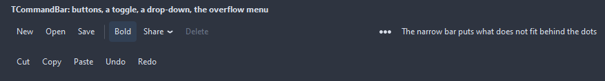

# TCommandBar

A row of commands with icons and captions: buttons, toggles that stay pressed, drop-downs that open a menu and separators between groups. What does not fit, and every Secondary command, goes to the menu of the button with the three dots at the end.

- Palette page: Unleashed: Navigation
- Unit: `commandbar.pas`
- Ancestor: `TCustomControl`



## Usage

```pascal
procedure TForm1.FormCreate(Sender: TObject);
begin
  var bar := TCommandBar.Create(Self);
  bar.Parent := Self;
  bar.Align := alTop;
  bar.Items.AddCommand('New', -1, @newClick);
  bar.Items.AddCommand('Open', -1, @openClick);
  bar.Items.AddSeparator;
  bar.Items.AddCommand('Wrap').Kind := ckToggle;
  bar.Captions := ccRight; // what does not fit goes to the overflow menu
end;

procedure TForm1.newClick(Sender: TObject);
begin
  Caption := 'new';
end;

procedure TForm1.openClick(Sender: TObject);
begin
  Caption := 'open';
end;
```

## Properties

| Property | Type | Default | Notes |
|---|---|---|---|
| `Items` | `TCommandItems` |  | the entries |
| `Images` | `TCustomImageList` |  | the image list the pictures come from |
| `ImagesWidth` | `integer` | `0` | the width of the picture to pick from a multi-resolution list, 0 for the first |
| `Captions` | `TCommandCaptions` | `ccRight` |  |
| `ButtonPadding` | `integer` | `8` |  |
| `Spacing` | `integer` | `2` | the gap between the parts |
| `CornerRadius` | `integer` | `4` | the rounding of the corners, in pixels |
| `AccentColor` | `TColor` | `clDefault` | clDefault takes the colors of the theme |
| `TextColor` | `TColor` | `clDefault` | clDefault takes the color of the theme |
| `Antialiasing` | `TAntialiasSetting` | `asTheme` | asTheme follows the theme setting, asOn and asOff force it |

Also the standard properties of a control, re-published: `Align`, `Anchors`, `AutoSize`, `BorderSpacing`, `Color`, `Constraints`, `Enabled`, `Font`, `Hint`, `ParentColor`, `ParentFont`, `ParentShowHint`, `PopupMenu`, `ShowHint`, `TabOrder`, `TabStop`, `Visible`, `OnContextPopup`, `OnEnter`, `OnExit`, `OnKeyDown`, `OnKeyPress`, `OnKeyUp`, `OnMouseDown`, `OnMouseEnter`, `OnMouseLeave`, `OnMouseMove`, `OnMouseUp`, `OnResize`.

## Events

| Event | Handler | Notes |
|---|---|---|
| `OnItemClick` | `procedure(Sender: TObject; index: integer)` | after any command, with its index, after its own OnClick |
| `OnDrawItem` | `TCustomDrawEvent` | paints over the stock button: dsChecked for a toggle that is on, dsHover, dsPressed; `handled` true leaves the caption and the icon out |

## Runtime

Available in code, not in the Object Inspector.

| Method | Notes |
|---|---|
| `itemsChanged` |  |
| `Execute(index: integer)` | what a click on a command does |
| `OverflowCount: integer` | the commands in the overflow menu right now |

## Companion classes

### `TCommandItem`

| Property | Type | Default | Notes |
|---|---|---|---|
| `Caption` | `string` |  | the text shown |
| `Hint` | `string` |  | the tooltip |
| `ImageIndex` | `TImageIndex` | `-1` | the picture in the image list, -1 for none |
| `Kind` | `TCommandKind` | `ckButton` | a push button, a toggle, a button dropping a menu, a separator |
| `Enabled` | `boolean` | `true` | disabled items are drawn gray and ignore the mouse |
| `Visible` | `boolean` | `true` | hidden items take no room |
| `Checked` | `boolean` | `false` | a toggle shows pressed while checked |
| `Secondary` | `boolean` | `false` | the command sits in the overflow menu from the start |
| `ShowCaption` | `boolean` | `true` | the caption next to the icon; off, the icon alone with the caption as hint |
| `DropDownMenu` | `TPopupMenu` |  | what a drop-down command opens |
| `Tag` | `PtrInt` | `0` | free for the application |

| Event | Handler | Notes |
|---|---|---|
| `OnClick` | `procedure(Sender: TObject)` | a click |

### `TCommandItems`

| Method | Notes |
|---|---|
| `Add: TCommandItem` | a new entry at the end |
| `AddCommand(const caption: string; imageIndex: TImageIndex = -1; onClick: TNotifyEvent = nil): TCommandItem` |  |
| `AddSeparator: TCommandItem` | a separator entry |

## Types

| Type | Values | Notes |
|---|---|---|
| `TCommandKind` | `ckButton`, `ckToggle`, `ckDropDown`, `ckSeparator` | a push button, a toggle, a button dropping a menu, a separator |
| `TCommandCaptions` | `ccRight`, `ccBelow`, `ccNone` |  |

## Custom drawing

The component paints its parts by itself, through the shapes of `ControlPaint`. A handler on the event below takes over a part: it gets the canvas of the control, the rectangle of the part, which part it is and a `TDrawState` set telling what the part is in: `dsHover`, `dsActive`, `dsSelected`, `dsPressed`, `dsDisabled`, `dsFocused`, `dsChecked`.

- `OnDrawItem`: paints over the stock button: dsChecked for a toggle that is on, dsHover, dsPressed; `handled` true leaves the caption and the icon out. Handler: `TCustomDrawEvent`.

A handler may paint with the plain canvas, or through `beginShapes()` from `ControlPaint` for the same smoothed shapes the components use: `paintRoundRect()`, `paintCircle()`, `paintCheck()`, `FillPolygon()` and the rest, then `Flush` once. Colors of the theme come from `pick()`, `blend()` and `contrastText()`.
