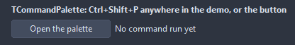
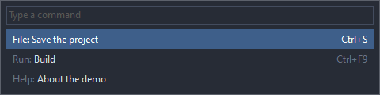

# TCommandPalette

A popup with a search box over the actions of an action list and the commands added by hand: the shortcut opens it, typing filters, Enter runs the command under the bar.

- Palette page: Unleashed: Navigation
- Unit: `commandpalette.pas`
- Ancestor: `TComponent`



## Usage

```pascal
procedure TForm1.FormCreate(Sender: TObject);
begin
  var palette := TCommandPalette.Create(Self);
  palette.ShortCut := ShortCut(VK_P, [ssCtrl, ssShift]);
  palette.Placeholder := 'Type a command';
  palette.AddCommand('Build project', 1);
  palette.AddCommand('Run without debugging', 2);
  palette.OnExecute := @paletteExecute;
end;

procedure TForm1.paletteExecute(Sender: TObject; const name: string; tag: PtrInt);
begin
  Caption := name;
end;
```

## Properties

| Property | Type | Default | Notes |
|---|---|---|---|
| `ActionList` | `TCustomActionList` |  |  |
| `ShortCut` | `TShortCut` | `0` | opens the palette from any window of the application |
| `Width` | `integer` | `480` | the width in pixels |
| `MaxVisible` | `integer` | `10` | how many are visible at once |
| `Placeholder` | `string` |  |  |
| `ShowShortcuts` | `boolean` | `true` |  |
| `ShowCategories` | `boolean` | `true` | the category names are shown |

## Events

| Event | Handler | Notes |
|---|---|---|
| `OnExecute` | `procedure(Sender: TObject; index: integer)` | a command picked; the actions run themselves before this |
| `OnCollect` | `procedure(Sender: TObject; names: TStrings)` | more names to offer, collected every time the palette opens |

## Runtime

Available in code, not in the Object Inspector.

| Method | Notes |
|---|---|
| `Show` | shows it |
| `Hide` | hides it |
| `AddCommand(const name: string; tag: PtrInt = 0)` | a command without an action; OnExecute gets its name and tag |
| `ClearCommands` |  |
| `Visible: boolean` | hidden items take no room |

## In pictures

**The palette open: the search box and the commands with their shortcuts.**


