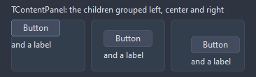

# TContentPanel

A plain container with the few knobs a panel lacks: the children that are not aligned or anchored move as one group to the left, the center or the right and to the top, the middle or the bottom of the free area, a padding keeps them off the edges, and the box can have rounded corners, a frame, or no background of its own.

- Palette page: Unleashed: Layout
- Unit: `contentpanel.pas`
- Ancestor: `TCustomControl`



## Usage

```pascal
procedure TForm1.FormCreate(Sender: TObject);
begin
  var box := TContentPanel.Create(Self);
  box.Parent := Self;
  box.Align := alTop;
  box.Height := 48;
  // whatever sits in the box without Align or Anchors moves to the middle
  box.HorizontalAlign := chCenter;
  box.VerticalAlign := cvCenter;
  var button := TButton.Create(Self);
  button.Parent := box;
  button.Caption := 'Centered';
end;
```

## Properties

| Property | Type | Default | Notes |
|---|---|---|---|
| `HorizontalAlign` | `TContentHorizontalAlign` | `chLeft` | where the group of free children sits across the box; chLeft leaves them where they were placed and brings them back there after another choice |
| `VerticalAlign` | `TContentVerticalAlign` | `cvTop` | where the group sits down the box; cvTop leaves them where they were placed and brings them back there after another choice |
| `Padding` | `integer` | `0` | between the edge and the aligned children or the placed group |
| `CornerRadius` | `integer` | `0` | the rounding of the corners, in pixels |
| `BorderWidth` | `integer` | `0` | a frame around the box; 0 draws none |
| `BorderColor` | `TColor` | `clDefault` | clDefault takes the color of the theme |
| `Transparent` | `boolean` | `false` | the box paints no background of its own, the parent shows through |
| `Antialiasing` | `TAntialiasSetting` | `asTheme` | the smoothing of the shapes: after the theme, or its own choice |
| `Caption` | `string` |  | shown in the middle when there is one |

The group is every child without `Align` and with the default `Anchors`; the children keep their places to each other and move together. A box with `AutoSize` leaves them where they are, since the LCL packs the children of such a box against its top left corner. Aligned children (`alTop`, `alClient`, ...) and anchored ones are placed by the LCL as in any container, inside the padding.

Also the standard properties of a container, re-published: `Align`, `Anchors`, `AutoSize`, `BorderSpacing`, `ChildSizing`, `ClientHeight`, `ClientWidth`, `Color`, `Constraints`, `DockSite`, `DragCursor`, `DragKind`, `DragMode`, `Enabled`, `Font`, `Hint`, `ParentColor`, `ParentFont`, `ParentShowHint`, `PopupMenu`, `ShowHint`, `TabOrder`, `TabStop`, `Visible`, `OnClick`, `OnContextPopup`, `OnDblClick`, `OnDockDrop`, `OnDockOver`, `OnEnter`, `OnExit`, `OnMouseDown`, `OnMouseEnter`, `OnMouseLeave`, `OnMouseMove`, `OnMouseUp`, `OnMouseWheel`, `OnPaint`, `OnResize`, `OnUnDock`.

## Types

| Type | Values | Notes |
|---|---|---|
| `TContentHorizontalAlign` | `chLeft`, `chCenter`, `chRight` |  |
| `TContentVerticalAlign` | `cvTop`, `cvCenter`, `cvBottom` |  |
