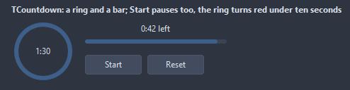
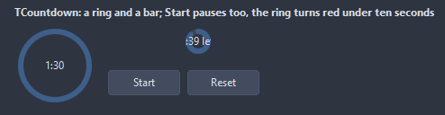
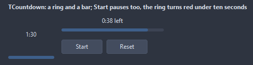
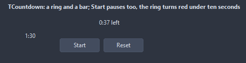
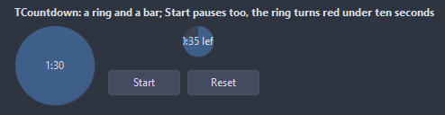
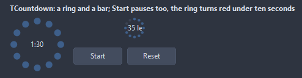
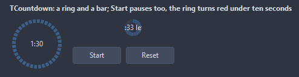

# TCountdown

Counts down from Duration: a ring or a bar runs out, the time left shows as text, OnFinish fires at zero. Start, Pause and Reset drive it; the clock is the wall clock, so a busy main loop does not slow it down.

- Palette page: Unleashed: Display
- Unit: `countdown.pas`
- Ancestor: `TGraphicControl`



## Usage

```pascal
procedure TForm1.FormCreate(Sender: TObject);
begin
  var timer := TCountdown.Create(Self);
  timer.Parent := Self;
  timer.SetBounds(8, 8, 100, 100);
  timer.Duration := 5 * 60 * 1000; // five minutes
  timer.WarnAt := 30 * 1000;
  timer.OnFinish := @timerFinish;
  timer.Start;
end;

procedure TForm1.timerFinish(Sender: TObject);
begin
  Caption := 'time is up';
end;
```

## Properties

| Property | Type | Default | Notes |
|---|---|---|---|
| `Duration` | `int64` | `60000` | milliseconds |
| `WarnAt` | `int64` | `0` | OnWarn fires once the time left falls to this; 0 for never |
| `Style` | `TCountdownStyle` | `cdRing` | how the time left shows: a ring running out, a bar, the text alone, a disc eaten like a pie, twelve dots going out, a ring of segments |
| `TextMode` | `TCountdownTextMode` | `ctRemaining` | what the text shows |
| `ShowMilliseconds` | `boolean` | `false` |  |
| `AutoStart` | `boolean` | `false` |  |
| `Loop` | `boolean` | `false` | at zero the count starts over |
| `Thickness` | `integer` | `6` | the ring and the bar |
| `Interval` | `integer` | `100` | milliseconds between two repaints |
| `TextFormat` | `string` |  | a Format pattern around the time text, like "%s left" |
| `RingColor` | `TColor` | `clDefault` | clDefault takes the colors of the theme |
| `TrackColor` | `TColor` | `clDefault` | the unfilled part; clDefault takes the color of the theme |
| `TextColor` | `TColor` | `clDefault` | clDefault takes the color of the theme |
| `WarnColor` | `TColor` | `clDefault` | the ring past WarnAt |
| `Antialiasing` | `TAntialiasSetting` | `asTheme` | asTheme follows the theme setting, asOn and asOff force it |

Also the standard properties of a control, re-published: `Align`, `Anchors`, `BorderSpacing`, `Color`, `Constraints`, `Enabled`, `Font`, `Hint`, `ParentColor`, `ParentFont`, `ParentShowHint`, `PopupMenu`, `ShowHint`, `Visible`, `OnClick`, `OnDblClick`, `OnMouseDown`, `OnMouseEnter`, `OnMouseLeave`, `OnMouseMove`, `OnMouseUp`, `OnResize`.

## Events

| Event | Handler | Notes |
|---|---|---|
| `OnFinish` | `procedure(Sender: TObject)` | it finished |
| `OnStart` | `procedure(Sender: TObject)` | it started |
| `OnPause` | `procedure(Sender: TObject)` | it paused |
| `OnTick` | `procedure(Sender: TObject; remainingMs: int64)` | every repaint while it runs |
| `OnWarn` | `procedure(Sender: TObject; remainingMs: int64)` | the warning point was reached |

## Runtime

Available in code, not in the Object Inspector.

| Property | Type | Notes |
|---|---|---|
| `Remaining` | `int64` | milliseconds left |

| Method | Notes |
|---|---|
| `Start` | starts it |
| `Pause` | pauses it |
| `Reset` | back to the full duration, stopped |
| `Running: boolean` | it is running |
| `Progress: double` | the share of the duration gone by, 0 to 1 |

## Types

| Type | Values | Notes |
|---|---|---|
| `TCountdownStyle` | `cdRing`, `cdBar`, `cdText`, `cdPie`, `cdDots`, `cdSegments` | how the time left shows: a ring running out, a bar, the text alone, a disc eaten like a pie, twelve dots going out, a ring of segments |
| `TCountdownTextMode` | `ctRemaining`, `ctElapsed`, `ctPercent`, `ctNone` |  |

## In pictures

### Every Style

The demo group with each value of `Style` in turn.

`Style = cdRing`



`Style = cdBar`



`Style = cdText`



`Style = cdPie`



`Style = cdDots`



`Style = cdSegments`


