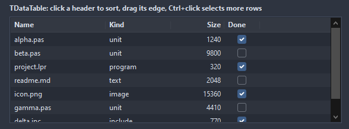
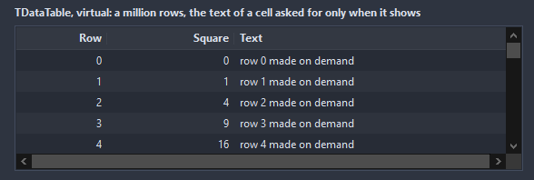

# TDataTable

A table of text cells with a header: a click on a header sorts, a text filters the rows, the rows select, scroll and answer the keyboard. The cells are strings; a number column sorts and aligns as numbers.

- Palette page: Unleashed: Views
- Unit: `datatable.pas`
- Ancestor: `TScrollingWinControl`



## Usage

```pascal
procedure TForm1.FormCreate(Sender: TObject);
begin
  var table := TDataTable.Create(Self);
  table.Parent := Self;
  table.SetBounds(8, 8, 480, 200);
  table.Columns.AddColumn('Name', 160);
  table.Columns.AddColumn('Size', 80, ckNumber).Format := '%d KB';
  table.Columns.AddColumn('Done', 60, ckCheck);
  table.AddRow(['alpha.pas', '1240', '1']);
  table.AddRow(['beta.pas', '9800', '0']);
  table.SortColumn := 1;
  table.Selection := dsMulti;
  table.OnCellDblClick := @tableOpen;
end;

procedure TForm1.tableOpen(Sender: TObject; row, column: integer);
begin
  Caption := TDataTable(Sender).Cells[0, row];
end;
```

## Properties

| Property | Type | Default | Notes |
|---|---|---|---|
| `Columns` | `TDataColumns` |  | the columns |
| `Selection` | `TDataSelection` | `dsSingle` |  |
| `VirtualRowCount` | `integer` | `0` | above zero the table is virtual: this many rows, the text of each cell from OnGetCell when it shows; sorting and filtering are then the job of the application, a header click reports through OnHeaderClick |
| `Filter` | `string` |  | the rows holding the text stay; empty shows all |
| `FilterColumn` | `integer` | `-1` | the column the filter looks at; -1 for every column |
| `SortColumn` | `integer` | `-1` | the column the rows are sorted by, -1 for the stored order |
| `SortDescending` | `boolean` | `false` | the sort order of SortColumn |
| `ShowHeader` | `boolean` | `true` | the header row is shown |
| `AlternateRows` | `boolean` | `true` | every other row in AlternateColor |
| `ShowGridLines` | `boolean` | `false` | lines between the cells |
| `ShowRowNumbers` | `boolean` | `false` | a column with the number of each row |
| `AutoSort` | `boolean` | `true` | a change of a cell keeps the rows sorted |
| `RowHeight` | `integer` | `0` | 0 takes it from the font |
| `HeaderHeight` | `integer` | `0` | 0 takes it from the font |
| `Padding` | `integer` | `6` | the space between the border and the content |
| `HeaderColor` | `TColor` | `clDefault` | clDefault takes the colors of the theme |
| `HeaderTextColor` | `TColor` | `clDefault` | clDefault takes the color of the theme |
| `BackColor` | `TColor` | `clDefault` | clDefault takes the color of the theme |
| `TextColor` | `TColor` | `clDefault` | clDefault takes the color of the theme |
| `AlternateColor` | `TColor` | `clDefault` | clDefault takes the color of the theme |
| `GridColor` | `TColor` | `clDefault` | clDefault takes the color of the theme |
| `SelectedColor` | `TColor` | `clDefault` | clDefault takes the color of the theme |
| `SelectedTextColor` | `TColor` | `clDefault` | clDefault takes the color of the theme |
| `Antialiasing` | `TAntialiasSetting` | `asTheme` | asTheme follows the theme setting, asOn and asOff force it |

Also the standard properties of a scrolling control, re-published: `Align`, `Anchors`, `BorderSpacing`, `BorderStyle`, `Color`, `Constraints`, `Enabled`, `Font`, `Hint`, `ParentFont`, `ParentShowHint`, `PopupMenu`, `ShowHint`, `TabOrder`, `TabStop`, `Visible`, `OnClick`, `OnContextPopup`, `OnDblClick`, `OnEnter`, `OnExit`, `OnKeyDown`, `OnKeyPress`, `OnKeyUp`, `OnMouseDown`, `OnMouseEnter`, `OnMouseLeave`, `OnMouseMove`, `OnMouseUp`, `OnMouseWheel`, `OnResize`.

## Events

| Event | Handler | Notes |
|---|---|---|
| `OnSelect` | `procedure(Sender: TObject; row, column: integer)` | the selection changed |
| `OnCellClick` | `procedure(Sender: TObject; row, column: integer)` | a click on a cell |
| `OnCellDblClick` | `procedure(Sender: TObject; row, column: integer)` | a double click on a cell |
| `OnHeaderClick` | `procedure(Sender: TObject; row, column: integer)` | a click on a column header |
| `OnGetCellColors` | `procedure(Sender: TObject; row, column: integer; var back, text: TColor)` | the colors of a cell before it is painted |
| `OnCompare` | `procedure(Sender: TObject; column, rowA, rowB: integer; var result: integer)` | the order of two stored rows for a column; result < 0 puts rowA first |
| `OnSort` | `procedure(Sender: TObject)` | after the rows were sorted |
| `OnGetCell` | `procedure(Sender: TObject; row, column: integer; var text: string)` | the text of a cell of a virtual table |
| `OnDrawCell` | `procedure(Sender: TObject; canvas: TCanvas; const r: TRect; row, column: integer; state: TDrawState; var handled: boolean)` | paints over a cell; see TDataDrawCellEvent |

## Runtime

Available in code, not in the Object Inspector.

| Property | Type | Notes |
|---|---|---|
| `Cells[column, row: integer]` | `string` | the text of a cell |
| `RowTags[row: integer]` | `PtrInt` | the tag of a stored row |
| `RowCount` | `integer` | the stored rows |
| `FocusedIndex` | `integer` | the shown index of the keyboard row, -1 for none; ShownRow turns it into a row |
| `Selected[row: integer]` | `boolean` | the entry is selected |

| Method | Notes |
|---|---|
| `AddRow(const cells: array of string; tag: PtrInt = 0): integer` | a row from its cells, in the order of the columns; the index of the stored row |
| `DeleteRow(row: integer)` | removes a stored row |
| `Clear` | removes everything |
| `ClearRows` | removes the rows, keeps the columns |
| `LoadFromStrings(lines: TStrings; delimiter: char = #9; firstLineIsHeader: boolean = false)` | the rows in their stored order, cells separated by the delimiter |
| `SaveToStrings(lines: TStrings; delimiter: char = #9; withHeader: boolean = true)` | writes the content as lines of text |
| `SelectAll` | selects everything |
| `ClearSelection` | selects nothing |
| `SelectedCount: integer` | how many are selected |
| `ShownRow(index: integer): integer` | the stored row shown at a position of the view, after sort and filter |
| `ShownCount: integer` | how many rows the view shows after the filter |
| `FocusedRow: integer` | the stored index of the focused row, -1 for none |
| `FocusRow(row: integer)` | moves the keyboard row to a stored row |

## Companion classes

### `TDataColumn`

| Property | Type | Default | Notes |
|---|---|---|---|
| `Caption` | `string` |  | the text shown |
| `Width` | `integer` | `100` | the width in pixels |
| `MinWidth` | `integer` | `30` | the narrowest the user can drag it |
| `Alignment` | `TAlignment` | `taLeftJustify` | where the text sits |
| `Kind` | `TDataColumnKind` | `ckText` | ckNumber sorts and aligns as a number, ckCheck shows a check mark for 1, true, yes |
| `Sortable` | `boolean` | `true` | a click on the header sorts by this column |
| `Visible` | `boolean` | `true` | hidden items take no room |
| `AutoWidth` | `boolean` | `false` | the column takes what the others leave |
| `Format` | `string` |  | a Format pattern for a number, like "%.2f" or "%d items" |
| `Tag` | `PtrInt` | `0` | free for the application |

### `TDataColumns`

| Method | Notes |
|---|---|
| `Add: TDataColumn` | a new entry at the end |
| `AddColumn(const caption: string; width: integer = 100; kind: TDataColumnKind = ckText): TDataColumn` | a new column |

## Types

| Type | Values | Notes |
|---|---|---|
| `TDataColumnKind` | `ckText`, `ckNumber`, `ckCheck` |  |
| `TDataSelection` | `dsNone`, `dsSingle`, `dsMulti` |  |

## Custom drawing

The component paints its parts by itself, through the shapes of `ControlPaint`. A handler on the event below takes over a part: it gets the canvas of the control, the rectangle of the part, which part it is and a `TDrawState` set telling what the part is in: `dsHover`, `dsActive`, `dsSelected`, `dsPressed`, `dsDisabled`, `dsFocused`, `dsChecked`.

- `OnDrawCell`: paints over a cell; see TDataDrawCellEvent. Handler: `procedure(Sender: TObject; canvas: TCanvas; const r: TRect; row, column: integer; state: TDrawState; var handled: boolean)`.

A handler may paint with the plain canvas, or through `beginShapes()` from `ControlPaint` for the same smoothed shapes the components use: `paintRoundRect()`, `paintCircle()`, `paintCheck()`, `FillPolygon()` and the rest, then `Flush` once. Colors of the theme come from `pick()`, `blend()` and `contrastText()`.

## In pictures

**Virtual: a million rows, the text of a cell asked for only when it shows.**


