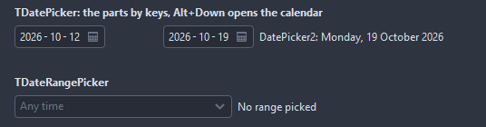
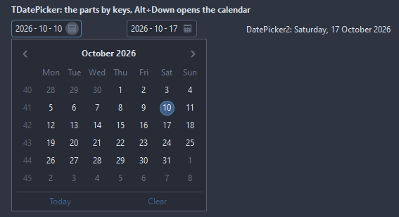

# TDatePicker

A date typed part by part, or picked on the calendar it drops: digits fill the active part, Left and Right move between the parts, Up, Down and the wheel step it, Alt+Down and F4 open the calendar. While the calendar is open the arrows walk its days and Enter takes one.

- Palette page: Unleashed: Input
- Unit: `datepicker.pas`
- Ancestor: `TCustomControl`



## Usage

```pascal
procedure TForm1.FormCreate(Sender: TObject);
begin
  var due := TDatePicker.Create(Self);
  due.Parent := Self;
  due.Width := 160;
  due.DateOrder := doYMD;
  due.MinDate := Date;
  due.Date := Date + 7;
  due.ShowWeekNumbers := true;
  due.OnChange := @dueChange;
end;

procedure TForm1.dueChange(Sender: TObject);
begin
  Caption := FormatDateTime('yyyy-mm-dd', TDatePicker(Sender).Date);
end;
```

## Properties

| Property | Type | Default | Notes |
|---|---|---|---|
| `Date` | `TDateTime` |  | 0 for none |
| `MinDate` | `TDateTime` |  | 0 for no limit |
| `MaxDate` | `TDateTime` |  | the latest date allowed |
| `DateOrder` | `TDateOrder` | `doLocale` | the order of the day, the month and the year in the field; doLocale follows the short date format of the format settings |
| `Separator` | `string` |  | between the parts; empty takes the date separator of the format settings |
| `EmptyText` | `string` |  | the gray text of an empty field |
| `TodayCaption` | `string` |  |  |
| `ClearCaption` | `string` |  | the caption of the clear entry |
| `AllowEmpty` | `boolean` | `true` | the field may hold no value |
| `ReadOnly` | `boolean` | `false` | the mouse and the keyboard change nothing |
| `ShowButton` | `boolean` | `true` | the calendar button at the right end |
| `ShowTodayButton` | `boolean` | `true` | the row with Today and Clear under the calendar |
| `ShowWeekNumbers` | `boolean` | `false` |  |
| `FirstDayOfWeek` | `TCalendarFirstDay` | `fdMonday` | the first column of the week |
| `CornerRadius` | `integer` | `4` | the rounding of the corners, in pixels |
| `Padding` | `integer` | `6` | the space between the border and the content |
| `BorderColor` | `TColor` | `clDefault` | clDefault takes the colors of the theme |
| `FocusBorderColor` | `TColor` | `clDefault` | the border while focused; clDefault takes the accent of the theme |
| `FieldColor` | `TColor` | `clDefault` | the fill of the field; clDefault takes the color of the theme |
| `ActiveFieldColor` | `TColor` | `clDefault` | the field part with the focus; clDefault takes the color of the theme |
| `Antialiasing` | `TAntialiasSetting` | `asTheme` | asTheme follows the theme setting, asOn and asOff force it |
| `Language` | `TFormatLanguage` | `flSystem` | the names and separators of dates, times and numbers: those of the locale of the system, or English |

Also the standard properties of a control, re-published: `Align`, `Anchors`, `AutoSize`, `BorderSpacing`, `Color`, `Constraints`, `Enabled`, `Font`, `Hint`, `ParentColor`, `ParentFont`, `ParentShowHint`, `PopupMenu`, `ShowHint`, `TabOrder`, `TabStop`, `Visible`, `OnClick`, `OnContextPopup`, `OnEnter`, `OnExit`, `OnKeyDown`, `OnKeyPress`, `OnKeyUp`, `OnMouseDown`, `OnMouseEnter`, `OnMouseLeave`, `OnMouseMove`, `OnMouseUp`, `OnResize`.

## Events

| Event | Handler | Notes |
|---|---|---|
| `OnChange` | `procedure(Sender: TObject)` | after the value changed |
| `OnDropDown` | `procedure(Sender: TObject)` | the drop-down opens |
| `OnCloseUp` | `procedure(Sender: TObject)` | the drop-down closes |

## Runtime

Available in code, not in the Object Inspector.

| Property | Type | Notes |
|---|---|---|
| `Calendar` | `TCalendarView` | the calendar of the drop down, there to be set up further |

| Method | Notes |
|---|---|
| `DropDown` | opens the drop-down |
| `CloseUp` | closes the drop-down |
| `DroppedDown: boolean` | the drop-down is open |
| `Clear` | empties the field when AllowEmpty |
| `SelectToday` |  |
| `Text: string` | the date as the field shows it, '' for none |
| `SetText(const value: string): boolean` | reads a date written in the order of the field; false leaves the date |

## Types

| Type | Values | Notes |
|---|---|---|
| `TDateOrder` | `doLocale`, `doDMY`, `doMDY`, `doYMD` | the order of the day, the month and the year in the field; doLocale follows the short date format of the format settings |

## In pictures

**Dropped down with Alt+Down or the button: the calendar with Today and Clear under it.**


