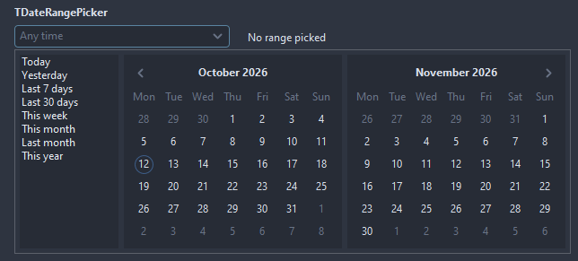

# TDateRangePicker

A field holding a range of dates: a drop down shows two calendars and a list of presets; the first click picks the start, the second the end. An empty range shows EmptyText.

- Palette page: Unleashed: Input
- Unit: `daterangepicker.pas`
- Ancestor: `TCustomControl`

## Usage

```pascal
procedure TForm1.FormCreate(Sender: TObject);
begin
  var stay := TDateRangePicker.Create(Self);
  stay.Parent := Self;
  stay.Width := 240;
  stay.SetRange(Date, Date + 3);
  stay.OnChange := @stayChange;
end;

procedure TForm1.stayChange(Sender: TObject; startDate, endDate: TDateTime);
begin
  Caption := Format('%d nights', [TDateRangePicker(Sender).Days]);
end;
```

## Properties

| Property | Type | Default | Notes |
|---|---|---|---|
| `StartDate` | `TDateTime` |  | the first date |
| `EndDate` | `TDateTime` |  | the last date |
| `MinDate` | `TDateTime` |  | 0 for no limit |
| `MaxDate` | `TDateTime` |  | the latest date allowed |
| `DisplayFormat` | `string` |  | a FormatDateTime pattern; empty takes the short date of the locale |
| `Separator` | `string` |  | what separates the parts |
| `EmptyText` | `string` |  | the text shown while there is nothing |
| `AllowEmpty` | `boolean` | `true` | the field may hold no value |
| `ShowPresets` | `boolean` | `true` | the list of presets beside the calendars |
| `ShowClearButton` | `boolean` | `true` |  |
| `CornerRadius` | `integer` | `4` | the rounding of the corners, in pixels |
| `Padding` | `integer` | `6` | the space between the border and the content |
| `BorderColor` | `TColor` | `clDefault` | clDefault takes the colors of the theme |
| `FocusBorderColor` | `TColor` | `clDefault` | the border while focused; clDefault takes the accent of the theme |
| `FieldColor` | `TColor` | `clDefault` | the fill of the field; clDefault takes the color of the theme |
| `Antialiasing` | `TAntialiasSetting` | `asTheme` | asTheme follows the theme setting, asOn and asOff force it |
| `Language` | `TFormatLanguage` | `flSystem` | the names and separators of dates, times and numbers: those of the locale of the system, or English |

Also the standard properties of a control, re-published: `Align`, `Anchors`, `AutoSize`, `BorderSpacing`, `Color`, `Constraints`, `Enabled`, `Font`, `Hint`, `ParentColor`, `ParentFont`, `ParentShowHint`, `PopupMenu`, `ShowHint`, `TabOrder`, `TabStop`, `Visible`, `OnClick`, `OnContextPopup`, `OnEnter`, `OnExit`, `OnKeyDown`, `OnKeyPress`, `OnKeyUp`, `OnMouseEnter`, `OnMouseLeave`, `OnResize`.

## Events

| Event | Handler | Notes |
|---|---|---|
| `OnChange` | `procedure(Sender: TObject; startDate, endDate: TDateTime)` | after the value changed |

## Runtime

Available in code, not in the Object Inspector.

| Method | Notes |
|---|---|
| `DropDown` | opens the drop-down |
| `CloseUp` | closes the drop-down |
| `Clear` | removes everything |
| `SetRange(a, b: TDateTime)` | both dates at once, ordered |
| `Text: string` | the range as the field shows it |
| `Days: integer` | days in the range, both ends counted; 0 for none |
| `PopupVisible: boolean` | the popup is open |

## In pictures

**Dropped down: two months side by side, the presets on the left.**


