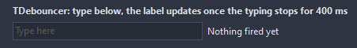

# TDebouncer

Turns a burst of triggers into a single OnFire: typing in a search box, resize messages, a sensor sending too often. The last trigger's data and tag are there for the handler.

- Palette page: Unleashed: System
- Unit: `debouncer.pas`
- Ancestor: `TComponent`



## Usage

```pascal
procedure TForm1.FormCreate(Sender: TObject);
begin
  var typing := TDebouncer.Create(Self);
  typing.Name := 'typing';
  typing.Delay := 400;
  typing.OnFire := @typingFire;
  var box := TEdit.Create(Self);
  box.Parent := Self;
  box.OnChange := @boxChange;
end;

procedure TForm1.boxChange(Sender: TObject);
begin
  TDebouncer(FindComponent('typing')).Trigger(TEdit(Sender).Text);
end;

procedure TForm1.typingFire(Sender: TObject);
begin
  Caption := 'searching for ' + TDebouncer(Sender).LastData;
end;
```

## Properties

| Property | Type | Default | Notes |
|---|---|---|---|
| `Delay` | `integer` | `300` | milliseconds |
| `Mode` | `TDebounceMode` | `dmTrailing` | dmTrailing: fires once the triggers stop for Delay; dmLeading: fires on the first trigger and ignores the rest for Delay; dmThrottle: fires at once and then at most once per Delay while the triggers keep coming |
| `Enabled` | `boolean` | `true` | off, a trigger fires at once |

## Events

| Event | Handler | Notes |
|---|---|---|
| `OnFire` | `procedure(Sender: TObject)` | the moment the burst settles |

## Runtime

Available in code, not in the Object Inspector.

| Property | Type | Notes |
|---|---|---|
| `Pending` | `boolean` | a trigger is waiting for its moment |
| `LastData` | `string` | the data of the last trigger |
| `LastTag` | `PtrInt` | the tag of the last trigger |
| `Count` | `integer` | the number of entries |

| Method | Notes |
|---|---|
| `Trigger(const data: string = ''; tag: PtrInt = 0)` | one more trigger; what it carries reaches OnFire through LastData and LastTag |
| `Cancel` | drops what is pending without firing |
| `Flush` | fires what is pending right now |

## Types

| Type | Values | Notes |
|---|---|---|
| `TDebounceMode` | `dmTrailing`, `dmLeading`, `dmThrottle` | dmTrailing: fires once the triggers stop for Delay; dmLeading: fires on the first trigger and ignores the rest for Delay; dmThrottle: fires at once and then at most once per Delay while the triggers keep coming |
