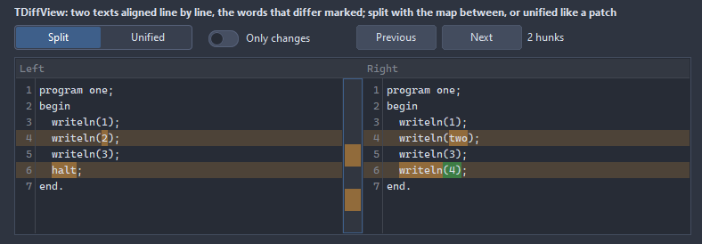
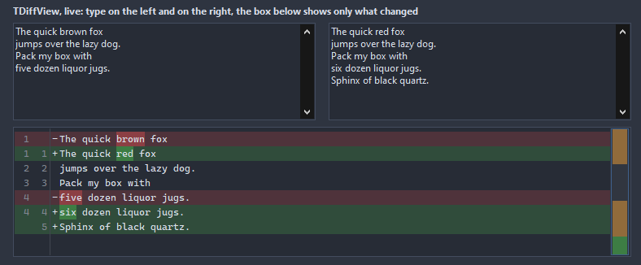

# TDiffView

Two texts compared line by line, the lines aligned by patience and Myers, the words that differ inside a changed pair marked on their own: side by side with the change map between the panes, or as one unified listing with the map at the edge. The unchanged lines can fold away to a few of context, a hunk is a run of differences.

- Palette page: Unleashed: Views
- Unit: `diffview.pas`
- Ancestor: `TScrollingWinControl`



## Usage

```pascal
procedure TForm1.FormCreate(Sender: TObject);
begin
  var diff := TDiffView.Create(Self);
  diff.Parent := Self;
  diff.SetBounds(8, 8, 700, 300);
  diff.LoadFromFiles('before.pas', 'after.pas');
  diff.Layout := dlSideBySide; // or dlUnified, like a patch
  diff.IgnoreWhitespace := true;
  diff.OnRowClick := @diffRow;
  Caption := Format('%d hunks', [diff.HunkCount]);
end;

procedure TForm1.diffRow(Sender: TObject; row: integer; kind: TDiffKind);
begin
  if kind <> dkSame then Caption := Format('hunk %d', [TDiffView(Sender).CurrentHunk + 1]);
end;
```

## Properties

| Property | Type | Default | Notes |
|---|---|---|---|
| `LeftText` | `TStrings` |  |  |
| `RightText` | `TStrings` |  |  |
| `Layout` | `TDiffLayout` | `dlSideBySide` | two panes with the change map between them, or one pane the way a patch reads with the map on the right |
| `ShowLineNumbers` | `boolean` | `true` |  |
| `IgnoreWhitespace` | `boolean` | `false` |  |
| `IgnoreCase` | `boolean` | `false` |  |
| `WordDiff` | `boolean` | `true` | the words that differ inside a changed pair get their own mark |
| `ShowGutter` | `boolean` | `false` | the strip on the left with a mark per kind |
| `HideSame` | `boolean` | `false` | unchanged lines beyond the context of a hunk fold away |
| `ShowChangeMap` | `boolean` | `true` | the change map: between the panes, or at the edge of the single pane |
| `ShowHeader` | `boolean` | `true` | the header row is shown |
| `ContextLines` | `integer` | `3` |  |
| `Padding` | `integer` | `4` | the space between the border and the content |
| `TabWidth` | `integer` | `4` |  |
| `MapWidth` | `integer` | `24` |  |
| `AddedColor` | `TColor` | `clDefault` | clDefault takes the colors of the theme |
| `RemovedColor` | `TColor` | `clDefault` |  |
| `ChangedColor` | `TColor` | `clDefault` |  |
| `BackColor` | `TColor` | `clDefault` | clDefault takes the color of the theme |
| `TextColor` | `TColor` | `clDefault` | clDefault takes the color of the theme |
| `NumberColor` | `TColor` | `clDefault` |  |
| `MarkColor` | `TColor` | `clDefault` | the words that differ, when MarkColor is set; clDefault takes a stronger tone of the kind |
| `GutterColor` | `TColor` | `clDefault` |  |
| `HeaderColor` | `TColor` | `clDefault` | clDefault takes the color of the theme |
| `FoldColor` | `TColor` | `clDefault` |  |
| `Antialiasing` | `TAntialiasSetting` | `asTheme` | asTheme follows the theme setting, asOn and asOff force it |

Also the standard properties of a scrolling control, re-published: `Align`, `Anchors`, `BorderSpacing`, `BorderStyle`, `Color`, `Constraints`, `Enabled`, `Font`, `Hint`, `ParentFont`, `ParentShowHint`, `PopupMenu`, `ShowHint`, `TabOrder`, `TabStop`, `Visible`, `OnClick`, `OnContextPopup`, `OnDblClick`, `OnEnter`, `OnExit`, `OnKeyDown`, `OnKeyPress`, `OnKeyUp`, `OnMouseDown`, `OnMouseEnter`, `OnMouseLeave`, `OnMouseMove`, `OnMouseUp`, `OnMouseWheel`, `OnResize`.

## Events

| Event | Handler | Notes |
|---|---|---|
| `OnRowClick` | `procedure(Sender: TObject; row: integer; kind: TDiffKind)` |  |
| `OnChange` | `procedure(Sender: TObject)` | the texts changed and the comparison ran again |

## Runtime

Available in code, not in the Object Inspector.

| Property | Type | Notes |
|---|---|---|
| `CurrentHunk` | `integer` |  |

| Method | Notes |
|---|---|
| `SetTexts(const leftText, rightText: string)` |  |
| `LoadFromFiles(const leftFile, rightFile: string)` |  |
| `RowCount: integer` | the aligned rows, the hunks and the rows of each kind |
| `HunkCount: integer` |  |
| `CountOf(kind: TDiffKind): integer` |  |
| `RowInfo(row: integer; out kind: TDiffKind; out leftLine, rightLine: integer)` | the kind and the lines of an aligned row; -1 for a side without a line |
| `NextHunk` |  |
| `PreviousHunk` |  |
| `GoToHunk(index: integer)` |  |
| `SaveToStrings(lines: TStrings; context: integer = 3)` | the diff as a patch |
| `SpansOf(row: integer; leftSide: boolean): TDiffSpans` | the words that differ in a changed row, for either side |

## Types

| Type | Values | Notes |
|---|---|---|
| `TDiffKind` | `dkSame`, `dkAdded`, `dkRemoved`, `dkChanged` |  |
| `TDiffLayout` | `dlSideBySide`, `dlUnified` | two panes with the change map between them, or one pane the way a patch reads with the map on the right |

## In pictures

**Live: type on the left and on the right, the box below shows only what changed.**


