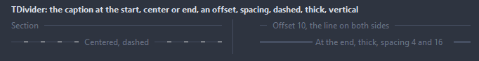
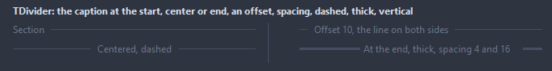
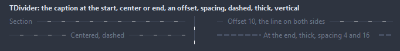
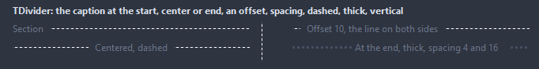
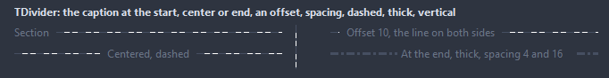
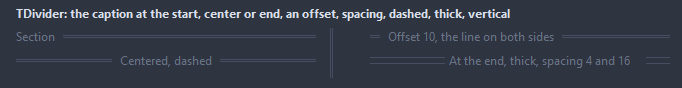
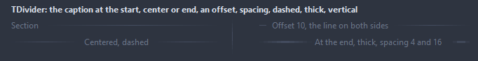

# TDivider

A line separating two parts of a form, with an optional caption set into it.

- Palette page: Unleashed: Layout
- Unit: `divider.pas`
- Ancestor: `TGraphicControl`



## Usage

```pascal
procedure TForm1.FormCreate(Sender: TObject);
begin
  var rule := TDivider.Create(Self);
  rule.Parent := Self;
  rule.SetBounds(8, 60, 360, 20);
  rule.Caption := 'Advanced';
  rule.CaptionPosition := dpCenter;
  rule.LineStyle := dlDashed;
end;
```

## Properties

| Property | Type | Default | Notes |
|---|---|---|---|
| `Orientation` | `TDividerOrientation` | `doHorizontal` | horizontal or vertical |
| `CaptionPosition` | `TDividerCaptionPosition` | `dpStart` | where the caption sits on the line; for a vertical line start is the top |
| `LineStyle` | `TDividerLineStyle` | `dlSolid` | the line: solid, dashed, dotted, dash-dot, two thin lines, fading out at both ends |
| `LineWidth` | `integer` | `1` | the thickness of the line |
| `SpacingBefore` | `integer` | `8` | between the line and the caption, before it (left, or above on a vertical line) and after it |
| `SpacingAfter` | `integer` | `8` |  |
| `Margin` | `integer` | `0` | from the edges of the control to the start of the line |
| `CaptionOffset` | `integer` | `0` | the line before a caption at the start, or after one at the end; 0 starts the caption right at the margin |
| `LineColor` | `TColor` | `clDefault` | clDefault takes the colors of the theme |
| `TextColor` | `TColor` | `clDefault` | clDefault takes the color of the theme |
| `Transparent` | `boolean` | `true` | the background of the parent shows through |

Also the standard properties of a control, re-published: `Caption`, `Align`, `Anchors`, `AutoSize`, `BorderSpacing`, `Color`, `Constraints`, `Enabled`, `Font`, `Hint`, `ParentColor`, `ParentFont`, `ParentShowHint`, `PopupMenu`, `ShowHint`, `Visible`, `OnClick`, `OnContextPopup`, `OnDblClick`, `OnMouseDown`, `OnMouseEnter`, `OnMouseLeave`, `OnMouseMove`, `OnMouseUp`, `OnResize`.

## Types

| Type | Values | Notes |
|---|---|---|
| `TDividerOrientation` | `doHorizontal`, `doVertical` |  |
| `TDividerCaptionPosition` | `dpStart`, `dpCenter`, `dpEnd` | where the caption sits on the line; for a vertical line start is the top |
| `TDividerLineStyle` | `dlSolid`, `dlDashed`, `dlDotted`, `dlDashDot`, `dlDouble`, `dlGradient` | the line: solid, dashed, dotted, dash-dot, two thin lines, fading out at both ends |

## In pictures

### Every LineStyle

The demo group with each value of `LineStyle` in turn.

`LineStyle = dlSolid`



`LineStyle = dlDashed`



`LineStyle = dlDotted`



`LineStyle = dlDashDot`



`LineStyle = dlDouble`



`LineStyle = dlGradient`


