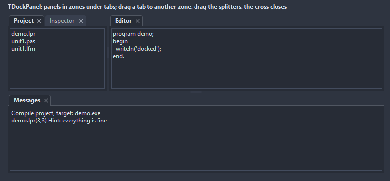

# TDockPanel

Five zones around a center, each a stack of tabbed panels: a tab brings its panel up, a drag of a tab moves it to another zone, the splitters between the zones resize them, a cross closes. The layout saves to a string and loads back, so it survives a restart.

- Palette page: Unleashed: Layout
- Unit: `dockpanel.pas`
- Ancestor: `TCustomControl`



## Usage

```pascal
procedure TForm1.FormCreate(Sender: TObject);
begin
  var dock := TDockPanel.Create(Self);
  dock.Parent := Self;
  dock.Align := alClient;
  dock.DockControl(TMemo.Create(Self), 'Editor', dzCenter);
  dock.DockControl(TListBox.Create(Self), 'Project', dzLeft);
  dock.DockControl(TMemo.Create(Self), 'Messages', dzBottom);
  dock.BottomHeight := 120;
  dock.OnClose := @dockClose;
end;

procedure TForm1.dockClose(Sender: TObject; item: TDockItem; var allow: boolean);
begin
  allow := item.Caption <> 'Editor'; // the editor stays
end;

procedure TForm1.FormDestroy(Sender: TObject);
begin
  // the layout as text, for the settings file
  var layout := TDockPanel(Controls[0]).SaveLayout;
end;
```

## Properties

| Property | Type | Default | Notes |
|---|---|---|---|
| `Items` | `TDockItems` |  | the entries |
| `LeftWidth` | `integer` | `200` |  |
| `RightWidth` | `integer` | `200` |  |
| `TopHeight` | `integer` | `120` |  |
| `BottomHeight` | `integer` | `160` |  |
| `TabHeight` | `integer` | `0` | 0 takes it from the font |
| `SplitterWidth` | `integer` | `5` | the width of the splitter, in pixels |
| `MinZoneSize` | `integer` | `60` |  |
| `CornerRadius` | `integer` | `4` | the rounding of the corners, in pixels |
| `Padding` | `integer` | `4` | the space between the border and the content |
| `ShowSingleTab` | `boolean` | `true` | a tab bar even when a zone holds one item |
| `AllowDrag` | `boolean` | `true` | the mouse can drag |
| `AllowClose` | `boolean` | `true` |  |
| `AllowResize` | `boolean` | `true` | the mouse can resize |
| `TabColor` | `TColor` | `clDefault` | clDefault takes the colors of the theme |
| `ActiveTabColor` | `TColor` | `clDefault` | clDefault takes the color of the theme |
| `TabTextColor` | `TColor` | `clDefault` |  |
| `BorderColor` | `TColor` | `clDefault` | clDefault takes the color of the theme |
| `SplitterColor` | `TColor` | `clDefault` |  |
| `BackColor` | `TColor` | `clDefault` | clDefault takes the color of the theme |
| `Antialiasing` | `TAntialiasSetting` | `asTheme` | asTheme follows the theme setting, asOn and asOff force it |

Also the standard properties of a control, re-published: `Align`, `Anchors`, `BorderSpacing`, `ClientHeight`, `ClientWidth`, `Constraints`, `Enabled`, `Font`, `Hint`, `ParentFont`, `ParentShowHint`, `PopupMenu`, `ShowHint`, `TabOrder`, `Visible`, `OnClick`, `OnContextPopup`, `OnMouseDown`, `OnMouseEnter`, `OnMouseLeave`, `OnMouseMove`, `OnMouseUp`, `OnResize`.

## Events

| Event | Handler | Notes |
|---|---|---|
| `OnActivate` | `procedure(Sender: TObject; item: TDockItem)` | it became active |
| `OnDocked` | `procedure(Sender: TObject; item: TDockItem)` | an item landed in a zone, by a drag or by MoveTo |
| `OnClose` | `procedure(Sender: TObject; item: TDockItem; var allow: boolean)` | before it closes |
| `OnClosed` | `procedure(Sender: TObject; item: TDockItem)` |  |
| `OnLayoutChange` | `procedure(Sender: TObject)` | a zone was resized or an item moved |

## Runtime

Available in code, not in the Object Inspector.

| Property | Type | Notes |
|---|---|---|
| `ActiveItem[zone: TDockZone]` | `TDockItem` |  |
| `ZoneSize[zone: TDockZone]` | `integer` |  |

| Method | Notes |
|---|---|
| `DockControl(control: TControl; const caption: string; zone: TDockZone = dzCenter): TDockItem` | docks a control: it becomes a child and shows under a tab in the zone |
| `ItemOf(control: TControl): TDockItem` | the item of a control, nil when it is not docked |
| `Activate(item: TDockItem)` |  |
| `Close(item: TDockItem): boolean` | closes an item the way its cross does, with the events |
| `MoveTo(item: TDockItem; zone: TDockZone; index: integer = -1)` |  |
| `SaveLayout: string` | the layout as text: zone, order and sizes, by the names of the controls |
| `LoadLayout(const layout: string)` |  |

## Companion classes

### `TDockItem`

A control docked in a zone, under a tab with a caption.

| Property | Type | Default | Notes |
|---|---|---|---|
| `Control` | `TControl` |  | the control shown under the tab; it becomes a child of the panel |
| `Caption` | `string` |  | the text shown |
| `Zone` | `TDockZone` | `dzCenter` |  |
| `Closable` | `boolean` | `true` | a cross on the tab |
| `Visible` | `boolean` | `true` | a hidden item keeps its place but shows no tab |
| `Tag` | `PtrInt` | `0` | free for the application |

| Method | Notes |
|---|---|
| `Activate` | brings the item to the front of its zone |

### `TDockItems`

| Method | Notes |
|---|---|
| `Add: TDockItem` | a new entry at the end |

## Types

| Type | Values | Notes |
|---|---|---|
| `TDockZone` | `dzCenter`, `dzLeft`, `dzRight`, `dzTop`, `dzBottom` |  |
