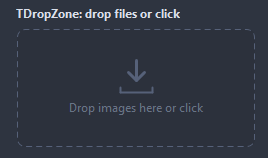

# TDropZone

A target for files dragged from the desktop: a dashed frame with a hint, lit while a drop is possible. A click opens a file dialog instead. The files arrive in OnFilesDropped, filtered by Extensions.

- Palette page: Unleashed: Input
- Unit: `dropzone.pas`
- Ancestor: `TCustomControl`



## Usage

```pascal
procedure TForm1.FormCreate(Sender: TObject);
begin
  var zone := TDropZone.Create(Self);
  zone.Parent := Self;
  zone.SetBounds(8, 8, 300, 140);
  zone.Caption := 'Drop images here or click to browse';
  zone.Extensions := 'png;jpg;jpeg';
  zone.OnFilesDropped := @zoneFiles;
end;

procedure TForm1.zoneFiles(Sender: TObject; files: TStrings);
begin
  Caption := Format('%d files', [files.Count]);
end;
```

## Properties

| Property | Type | Default | Notes |
|---|---|---|---|
| `Extensions` | `string` |  | extensions taken, like '.png;.jpg'; empty takes everything |
| `Multiple` | `boolean` | `true` |  |
| `ClickToBrowse` | `boolean` | `true` |  |
| `ShowIcon` | `boolean` | `true` | the icon is shown |
| `Folders` | `boolean` | `false` | folders dropped are taken too; without it they are rejected |
| `ShowFiles` | `boolean` | `false` | the names of the files taken last, under the hint |
| `DialogTitle` | `string` |  |  |
| `DialogFilter` | `string` |  | the filter of the dialog; empty derives one from Extensions |
| `CornerRadius` | `integer` | `8` | the rounding of the corners, in pixels |
| `DashLength` | `integer` | `6` |  |
| `IconSize` | `integer` | `32` | the size of the icon, 0 takes it from the font |
| `FrameColor` | `TColor` | `clDefault` | clDefault takes the colors of the theme |
| `HoverFrameColor` | `TColor` | `clDefault` |  |
| `FillColor` | `TColor` | `clDefault` | clDefault takes the color of the theme |
| `TextColor` | `TColor` | `clDefault` | clDefault takes the color of the theme |
| `Antialiasing` | `TAntialiasSetting` | `asTheme` | asTheme follows the theme setting, asOn and asOff force it |

Also the standard properties of a control, re-published: `Caption`, `Align`, `Anchors`, `BorderSpacing`, `Color`, `Constraints`, `Enabled`, `Font`, `Hint`, `ParentColor`, `ParentFont`, `ParentShowHint`, `PopupMenu`, `ShowHint`, `TabOrder`, `TabStop`, `Visible`, `OnClick`, `OnContextPopup`, `OnDblClick`, `OnMouseDown`, `OnMouseEnter`, `OnMouseLeave`, `OnMouseMove`, `OnMouseUp`, `OnResize`.

## Events

| Event | Handler | Notes |
|---|---|---|
| `OnFilesDropped` | `procedure(Sender: TObject; files: TStrings)` |  |
| `OnFileRejected` | `procedure(Sender: TObject; files: TStrings)` | files whose extension was not in Extensions |

## Runtime

Available in code, not in the Object Inspector.

| Method | Notes |
|---|---|
| `Browse` | opens the file dialog, as a click does |
| `Clear` | forgets the files taken last |
| `Files: TStrings` | the files taken last, by a drop or the dialog |
