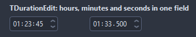

# TDurationEdit

A duration typed field by field: digits fill the active field, Left and Right move between fields, Up, Down and the wheel step the active one. The value counts milliseconds.

- Palette page: Unleashed: Input
- Unit: `durationedit.pas`
- Ancestor: `TCustomControl`



## Usage

```pascal
procedure TForm1.FormCreate(Sender: TObject);
begin
  var length := TDurationEdit.Create(Self);
  length.Parent := Self;
  length.Width := 140;
  length.Format := dfHMSms;
  length.Value := 90 * 1000 + 250; // milliseconds
  length.OnChange := @lengthChange;
end;

procedure TForm1.lengthChange(Sender: TObject);
begin
  Caption := TDurationEdit(Sender).Text;
end;
```

## Properties

| Property | Type | Default | Notes |
|---|---|---|---|
| `Value` | `int64` | `0` | milliseconds |
| `MinValue` | `int64` | `0` | the lower limit |
| `MaxValue` | `int64` | `0` | 0 for no ceiling |
| `Format` | `TDurationFormat` | `dfHMS` | the fields on show: hours, minutes and seconds, with or without the milliseconds, or minutes and seconds only |
| `ReadOnly` | `boolean` | `false` | the mouse and the keyboard change nothing |
| `ShowSpinButtons` | `boolean` | `true` |  |
| `CornerRadius` | `integer` | `4` | the rounding of the corners, in pixels |
| `Padding` | `integer` | `6` | the space between the border and the content |
| `BorderColor` | `TColor` | `clDefault` | clDefault takes the colors of the theme |
| `FocusBorderColor` | `TColor` | `clDefault` | the border while focused; clDefault takes the accent of the theme |
| `FieldColor` | `TColor` | `clDefault` | the fill of the field; clDefault takes the color of the theme |
| `ActiveFieldColor` | `TColor` | `clDefault` | the field part with the focus; clDefault takes the color of the theme |
| `Antialiasing` | `TAntialiasSetting` | `asTheme` | asTheme follows the theme setting, asOn and asOff force it |

Also the standard properties of a control, re-published: `Align`, `Anchors`, `AutoSize`, `BorderSpacing`, `Color`, `Constraints`, `Enabled`, `Font`, `Hint`, `ParentColor`, `ParentFont`, `ParentShowHint`, `PopupMenu`, `ShowHint`, `TabOrder`, `TabStop`, `Visible`, `OnClick`, `OnContextPopup`, `OnEnter`, `OnExit`, `OnKeyDown`, `OnKeyPress`, `OnKeyUp`, `OnMouseDown`, `OnMouseEnter`, `OnMouseLeave`, `OnMouseMove`, `OnMouseUp`, `OnMouseWheel`, `OnResize`.

## Events

| Event | Handler | Notes |
|---|---|---|
| `OnChange` | `procedure(Sender: TObject)` | after the value changed |

## Runtime

Available in code, not in the Object Inspector.

| Method | Notes |
|---|---|
| `Text: string` | the duration as text, like the field shows it |
| `SetText(const text: string): boolean` | reads h:m:s, m:s, with an optional .ms part; false leaves the value |
| `AsDateTime: TDateTime` | the value as a time of day fraction |

## Types

| Type | Values | Notes |
|---|---|---|
| `TDurationFormat` | `dfHMS`, `dfHMSms`, `dfMS`, `dfMSms`, `dfHM` | the fields on show: hours, minutes and seconds, with or without the milliseconds, or minutes and seconds only |
