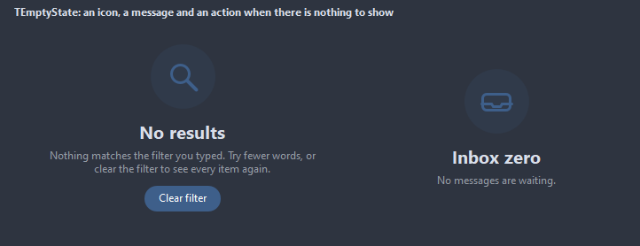

# TEmptyState

What a list or a view shows while it has nothing: a picture in a soft circle, a title, a line or two of text and a button that does something about it. Everything sits in the middle of the control.

- Palette page: Unleashed: Views
- Unit: `emptystate.pas`
- Ancestor: `TCustomControl`



## Usage

```pascal
procedure TForm1.FormCreate(Sender: TObject);
begin
  var empty := TEmptyState.Create(Self);
  empty.Parent := Self;
  empty.Align := alClient;
  empty.Glyph := egSearch;
  empty.Title := 'No results';
  empty.Description := 'Nothing matches the filter. Try fewer words.';
  empty.ActionCaption := 'Clear filter';
  empty.OnAction := @emptyAction;
end;

procedure TForm1.emptyAction(Sender: TObject);
begin
  Caption := 'filter cleared';
end;
```

## Properties

| Property | Type | Default | Notes |
|---|---|---|---|
| `Title` | `string` |  | the heading |
| `Description` | `string` |  | wraps at MaxTextWidth; line breaks in it stay |
| `ActionCaption` | `string` |  | the button; empty shows none |
| `Glyph` | `TEmptyStateGlyph` | `egInbox` |  |
| `Images` | `TCustomImageList` |  | a picture of the list instead of the glyph |
| `ImageIndex` | `TImageIndex` | `-1` | the picture in the image list, -1 for none |
| `ImagesWidth` | `integer` | `0` | the width of the picture to pick from a multi-resolution list, 0 for the first |
| `GlyphSize` | `integer` | `72` | the circle around the glyph |
| `Spacing` | `integer` | `12` | the gap between the parts |
| `MaxTextWidth` | `integer` | `320` |  |
| `Padding` | `integer` | `16` | the space between the border and the content |
| `TitleColor` | `TColor` | `clDefault` | clDefault takes the colors of the theme |
| `TextColor` | `TColor` | `clDefault` | clDefault takes the color of the theme |
| `GlyphColor` | `TColor` | `clDefault` | clDefault takes the color of the theme |
| `ButtonColor` | `TColor` | `clDefault` |  |
| `Antialiasing` | `TAntialiasSetting` | `asTheme` | asTheme follows the theme setting, asOn and asOff force it |

Also the standard properties of a control, re-published: `Align`, `Anchors`, `AutoSize`, `BorderSpacing`, `Color`, `Constraints`, `Enabled`, `Font`, `Hint`, `ParentColor`, `ParentFont`, `ParentShowHint`, `PopupMenu`, `ShowHint`, `TabOrder`, `TabStop`, `Visible`, `OnClick`, `OnContextPopup`, `OnDblClick`, `OnEnter`, `OnExit`, `OnMouseDown`, `OnMouseEnter`, `OnMouseLeave`, `OnMouseMove`, `OnMouseUp`, `OnResize`.

## Events

| Event | Handler | Notes |
|---|---|---|
| `OnAction` | `procedure(Sender: TObject)` | a click on the button, Enter or Space |

## Runtime

Available in code, not in the Object Inspector.

| Method | Notes |
|---|---|
| `Action` | what a click on the button does, OnAction included |

## Types

| Type | Values | Notes |
|---|---|---|
| `TEmptyStateGlyph` | `egNone`, `egInbox`, `egSearch`, `egFolder`, `egDocument`, `egCloud`, `egCheck`, `egWarning`, `egImage` |  |
