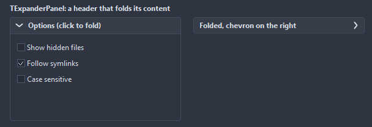
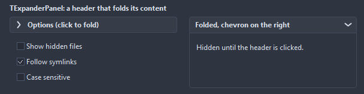
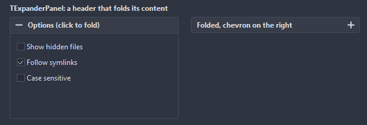
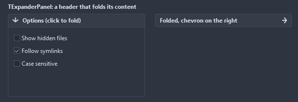
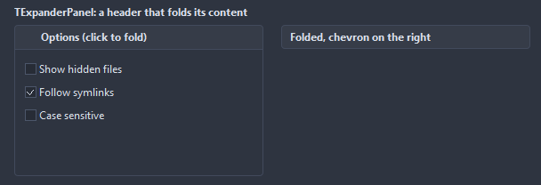

# TExpanderPanel

A container folding down to its header: a click on the header, Space or Enter shows or hides the children. ExpandedHeight remembers the open size while the panel is closed.

- Palette page: Unleashed: Layout
- Unit: `expanderpanel.pas`
- Ancestor: `TCustomControl`



## Usage

```pascal
procedure TForm1.FormCreate(Sender: TObject);
begin
  var advanced := TExpanderPanel.Create(Self);
  advanced.Parent := Self;
  advanced.SetBounds(8, 8, 300, 160);
  advanced.Caption := 'Advanced options';
  advanced.ExpandedHeight := 160;
  advanced.Expanded := false; // folds to its header
  advanced.OnChange := @advancedChange;
end;

procedure TForm1.advancedChange(Sender: TObject);
begin
  Caption := if TExpanderPanel(Sender).Expanded then 'open' else 'folded';
end;
```

## Properties

| Property | Type | Default | Notes |
|---|---|---|---|
| `Expanded` | `boolean` | `true` |  |
| `ExpandedHeight` | `integer` | `160` | the height while open; the panel keeps it up to date itself |
| `HeaderHeight` | `integer` | `0` | 0 takes it from the font |
| `CornerRadius` | `integer` | `4` | the rounding of the corners, in pixels |
| `AnimationTime` | `integer` | `150` | milliseconds of the animation |
| `Animated` | `boolean` | `true` | changes are animated |
| `ShowBorder` | `boolean` | `true` | a border is drawn |
| `ChevronSide` | `TChevronSide` | `csLeft` | the side the chevron sits on |
| `HeaderColor` | `TColor` | `clDefault` | clDefault takes the colors of the theme |
| `BorderColor` | `TColor` | `clDefault` | clDefault takes the color of the theme |
| `TitleColor` | `TColor` | `clDefault` | clDefault takes the color of the theme |
| `Antialiasing` | `TAntialiasSetting` | `asTheme` | asTheme follows the theme setting, asOn and asOff force it |
| `Glyph` | `TExpanderGlyph` | `egChevron` | the mark on the header that shows the state: a chevron, a plus and a minus, an arrow, a filled triangle, or nothing |

Also the standard properties of a control, re-published: `Caption`, `Align`, `Anchors`, `BorderSpacing`, `ChildSizing`, `ClientHeight`, `ClientWidth`, `Color`, `Constraints`, `Enabled`, `Font`, `Hint`, `ParentColor`, `ParentFont`, `ParentShowHint`, `PopupMenu`, `ShowHint`, `TabOrder`, `TabStop`, `Visible`, `OnClick`, `OnContextPopup`, `OnDblClick`, `OnEnter`, `OnExit`, `OnKeyDown`, `OnKeyPress`, `OnKeyUp`, `OnMouseDown`, `OnMouseEnter`, `OnMouseLeave`, `OnMouseMove`, `OnMouseUp`, `OnResize`.

## Events

| Event | Handler | Notes |
|---|---|---|
| `OnExpanded` | `procedure(Sender: TObject)` | after it opened |
| `OnCollapsed` | `procedure(Sender: TObject)` | after it folded |
| `OnChange` | `procedure(Sender: TObject)` | after the value changed |

## Runtime

Available in code, not in the Object Inspector.

| Method | Notes |
|---|---|
| `Toggle` | flips the state |

## Types

| Type | Values | Notes |
|---|---|---|
| `TChevronSide` | `csLeft`, `csRight` |  |
| `TExpanderGlyph` | `egChevron`, `egPlusMinus`, `egArrow`, `egTriangle`, `egNone` | the mark on the header that shows the state: a chevron, a plus and a minus, an arrow, a filled triangle, or nothing |

## In pictures

**Both toggled.**



### Every Glyph

The demo group with each value of `Glyph` in turn.

`Glyph = egChevron`


`Glyph = egPlusMinus`



`Glyph = egArrow`



`Glyph = egTriangle`


`Glyph = egNone`


