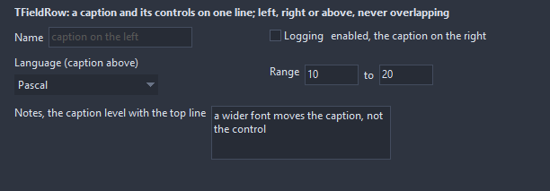

# TFieldRow

A caption and the controls it names in one row: the caption, measured with the real font, on the left, the right or above the controls, the controls side by side in the order of their position. The row sizes itself to its content, so the caption never runs into the controls on any widgetset. A click on the caption focuses the first control.

- Palette page: Unleashed: Layout
- Unit: `fieldrow.pas`
- Ancestor: `TCustomControl`



## Usage

```pascal
procedure TForm1.FormCreate(Sender: TObject);
begin
  var row := TFieldRow.Create(Self);
  row.Parent := Self;
  row.Left := 8;
  row.Top := 8;
  row.Caption := 'Name';
  var name := TEdit.Create(Self);
  name.Parent := row; // sits right after the caption, centered on it
  name.Width := 160;
  var note := TFieldRow.Create(Self);
  note.Parent := Self;
  note.Left := 8;
  note.Top := 40;
  note.CaptionPosition := fcRight; // the text follows the control
  note.Caption := 'enabled';
  var box := TCheckBox.Create(Self);
  box.Parent := note;
  box.Caption := 'Logging';
end;
```

## Properties

| Property | Type | Default | Notes |
|---|---|---|---|
| `CaptionPosition` | `TFieldCaptionPosition` | `fcLeft` | where the caption sits against the controls |
| `CaptionAlignment` | `TFieldCaptionAlignment` | `faCenter` | how the caption lines up with the controls beside it |
| `CaptionWidth` | `integer` | `0` | the caption column; 0 fits the text |
| `Spacing` | `integer` | `6` | between the caption and the controls |
| `ChildSpacing` | `integer` | `6` | between the controls |
| `Padding` | `integer` | `0` | the space between the border and the content |
| `CaptionColor` | `TColor` | `clDefault` | clDefault takes the color of the theme |

Also the standard properties of a control, re-published: `Caption`, `Align`, `Anchors`, `AutoSize`, `BorderSpacing`, `Color`, `Constraints`, `Enabled`, `Font`, `Hint`, `ParentColor`, `ParentFont`, `ParentShowHint`, `PopupMenu`, `ShowHint`, `Visible`, `OnClick`, `OnContextPopup`, `OnMouseDown`, `OnMouseEnter`, `OnMouseLeave`, `OnMouseMove`, `OnMouseUp`, `OnResize`.

## Runtime

Available in code, not in the Object Inspector.

| Property | Type | Notes |
|---|---|---|
| `CaptionRect` | `TRect` | the rectangle the caption takes, in client coordinates |

## Types

| Type | Values | Notes |
|---|---|---|
| `TFieldCaptionPosition` | `fcLeft`, `fcRight`, `fcTop` | where the caption sits against the controls |
| `TFieldCaptionAlignment` | `faTop`, `faCenter`, `faBottom` | how the caption lines up with the controls beside it |
