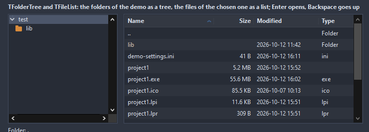

# TFolderTree

The folders under a root as a tree, read as they open. The root is a path given by the application, so the tree looks and behaves the same on every system; a selection names a path, a double click opens.

- Palette page: Unleashed: Views
- Unit: `foldertree.pas`
- Ancestor: `TCustomTreeView`



## Usage

```pascal
procedure TForm1.FormCreate(Sender: TObject);
begin
  var folders := TFolderTree.Create(Self);
  folders.Parent := Self;
  folders.SetBounds(8, 8, 240, 300);
  folders.Root := GetUserDir;
  folders.ShowHidden := false;
  folders.OnFolderChange := @folderChange;
end;

procedure TForm1.folderChange(Sender: TObject; const path: string);
begin
  Caption := path;
end;
```

## Properties

| Property | Type | Default | Notes |
|---|---|---|---|
| `Root` | `string` |  | the folder the tree starts at; empty takes the current directory |
| `ShowHidden` | `boolean` | `false` | hidden files and folders are listed |
| `ShowRoot` | `boolean` | `true` | the root as the top node, or its children at the top |
| `ShowFiles` | `boolean` | `false` | files under their folders, too |
| `FileMask` | `string` |  | the files shown, like *.pas;*.inc |
| `FolderColor` | `TColor` | `clDefault` | clDefault takes the colors of the theme |
| `FileColor` | `TColor` | `clDefault` |  |

Also the standard properties of a tree view, re-published: `Align`, `Anchors`, `BorderSpacing`, `BorderStyle`, `Color`, `Constraints`, `Enabled`, `Font`, `Hint`, `Indent`, `ParentFont`, `ParentShowHint`, `PopupMenu`, `ReadOnly`, `RowSelect`, `ScrollBars`, `ShowButtons`, `ShowHint`, `ShowLines`, `TabOrder`, `TabStop`, `Visible`, `OnClick`, `OnContextPopup`, `OnDblClick`, `OnEnter`, `OnExit`, `OnKeyDown`, `OnKeyPress`, `OnKeyUp`, `OnMouseDown`, `OnMouseEnter`, `OnMouseLeave`, `OnMouseMove`, `OnMouseUp`, `OnResize`, `OnSelectionChanged`.

## Events

| Event | Handler | Notes |
|---|---|---|
| `OnFolderChange` | `procedure(Sender: TObject; const path: string)` | the selection moved to another folder or file |
| `OnFilter` | `procedure(Sender: TObject; const path: string; var show: boolean)` | decides what is shown |

## Runtime

Available in code, not in the Object Inspector.

| Method | Notes |
|---|---|
| `Refresh` | reads the tree again from the root |
| `RefreshSelected` | reads the children of the selected folder again |
| `SelectPath(const path: string): boolean` | opens the tree down to a path and selects it |
| `SelectedPath: string` | the path of the selected node, or the root |
| `SelectedIsFolder: boolean` |  |
| `PathOf(node: TTreeNode): string` | the path of any node |
