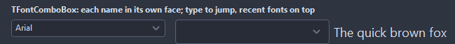
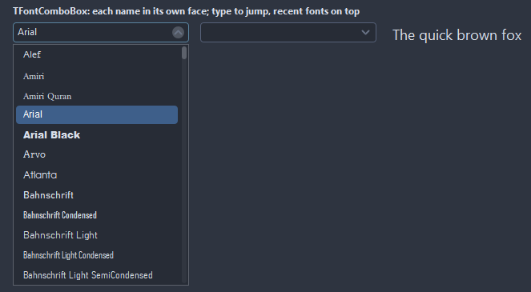

# TFontComboBox

A font picked from a list that shows every name in its own face, with the fonts used last on top. Typing jumps to the first name that starts with the letters typed; Up, Down, Page Up and Page Down walk the list.

- Palette page: Unleashed: Input
- Unit: `fontcombobox.pas`
- Ancestor: `TCustomControl`



## Usage

```pascal
procedure TForm1.FormCreate(Sender: TObject);
begin
  var face := TFontComboBox.Create(Self);
  face.Parent := Self;
  face.Width := 220;
  face.Filter := ffMonospace;
  face.ShowInField := true;
  face.OnChange := @faceChange;
end;

procedure TForm1.faceChange(Sender: TObject);
begin
  Font.Name := TFontComboBox(Sender).FontName;
end;
```

## Properties

| Property | Type | Default | Notes |
|---|---|---|---|
| `FontName` | `string` |  | the picked font; a name the system lacks shows in the field all the same |
| `PreviewText` | `string` |  | the text the list shows in each face; empty shows the names |
| `Filter` | `TFontFilter` | `ffAll` |  |
| `ShowPreview` | `boolean` | `true` | the names in their own faces in the list |
| `ShowInField` | `boolean` | `false` | the field shows the picked name in its face |
| `ShowRecent` | `boolean` | `true` |  |
| `RecentFonts` | `TStrings` |  | the fonts picked last, newest first; the list keeps MaxRecent of them |
| `MaxRecent` | `integer` | `5` |  |
| `DropDownCount` | `integer` | `12` | the rows the drop down shows before it scrolls |
| `CornerRadius` | `integer` | `4` | the rounding of the corners, in pixels |
| `Padding` | `integer` | `6` | the space between the border and the content |
| `BorderColor` | `TColor` | `clDefault` | clDefault takes the colors of the theme |
| `FocusBorderColor` | `TColor` | `clDefault` | the border while focused; clDefault takes the accent of the theme |
| `FieldColor` | `TColor` | `clDefault` | the fill of the field; clDefault takes the color of the theme |
| `Antialiasing` | `TAntialiasSetting` | `asTheme` | asTheme follows the theme setting, asOn and asOff force it |

Also the standard properties of a control, re-published: `Align`, `Anchors`, `AutoSize`, `BorderSpacing`, `Color`, `Constraints`, `Enabled`, `Font`, `Hint`, `ParentColor`, `ParentFont`, `ParentShowHint`, `PopupMenu`, `ShowHint`, `TabOrder`, `TabStop`, `Visible`, `OnClick`, `OnContextPopup`, `OnEnter`, `OnExit`, `OnKeyDown`, `OnKeyPress`, `OnKeyUp`, `OnMouseEnter`, `OnMouseLeave`, `OnResize`.

## Events

| Event | Handler | Notes |
|---|---|---|
| `OnChange` | `procedure(Sender: TObject)` | after the value changed |
| `OnDropDown` | `procedure(Sender: TObject)` | the drop-down opens |
| `OnCloseUp` | `procedure(Sender: TObject)` | the drop-down closes |

## Runtime

Available in code, not in the Object Inspector.

| Method | Notes |
|---|---|
| `DropDown` | opens the drop-down |
| `CloseUp` | closes the drop-down |
| `DroppedDown: boolean` | the drop-down is open |
| `FontCount: integer` | the fonts on offer now, after the filter |
| `Fonts(index: integer): string` |  |
| `RefreshFonts` | reads the fonts of the system again |

## Types

| Type | Values | Notes |
|---|---|---|
| `TFontFilter` | `ffAll`, `ffMonospace`, `ffProportional` |  |

## In pictures

**Open: every font in its own face, the fonts used last on top.**


