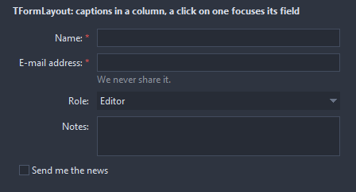

# TFormLayout

Fields of a form under each other, each with its caption in a column on the left or above it. Rows names the captions and the order; children without a row follow them, captionless, in the order of their position. A click on a caption focuses its field.

- Palette page: Unleashed: Layout
- Unit: `formlayout.pas`
- Ancestor: `TCustomControl`



## Usage

```pascal
procedure TForm1.FormCreate(Sender: TObject);
begin
  var form := TFormLayout.Create(Self);
  form.Parent := Self;
  form.SetBounds(8, 8, 360, 160);
  form.LabelWidth := 90;
  var name := TEdit.Create(Self);
  name.Parent := form;
  var mail := TEdit.Create(Self);
  mail.Parent := form;
  form.Rows.AddRow('Name', name, true); // required, marked in color
  form.Rows.AddRow('E-mail', mail).HelpText := 'never shared';
end;
```

## Properties

| Property | Type | Default | Notes |
|---|---|---|---|
| `Rows` | `TFormLayoutRows` |  |  |
| `LabelPosition` | `TFormLabelPosition` | `flpLeft` |  |
| `LabelAlignment` | `TAlignment` | `taLeftJustify` |  |
| `LabelWidth` | `integer` | `0` | the caption column; 0 fits the widest caption |
| `RowSpacing` | `integer` | `8` | the gap between the rows |
| `ColumnSpacing` | `integer` | `10` | the gap between the columns |
| `Padding` | `integer` | `8` | the space between the border and the content |
| `StretchFields` | `boolean` | `true` | the fields take the whole width of their column |
| `ShowColons` | `boolean` | `false` | a colon after each caption |
| `CaptionColor` | `TColor` | `clDefault` | clDefault takes the colors of the theme |
| `HelpColor` | `TColor` | `clDefault` |  |
| `RequiredColor` | `TColor` | `clDefault` |  |

Also the standard properties of a control, re-published: `Align`, `Anchors`, `AutoSize`, `BorderSpacing`, `ClientHeight`, `ClientWidth`, `Color`, `Constraints`, `Enabled`, `Font`, `Hint`, `ParentColor`, `ParentFont`, `ParentShowHint`, `PopupMenu`, `ShowHint`, `TabOrder`, `TabStop`, `Visible`, `OnClick`, `OnContextPopup`, `OnDblClick`, `OnMouseDown`, `OnMouseEnter`, `OnMouseLeave`, `OnMouseMove`, `OnMouseUp`, `OnResize`.

## Runtime

Available in code, not in the Object Inspector.

| Method | Notes |
|---|---|
| `rowsChanged` |  |

## Companion classes

### `TFormLayoutRow`

| Property | Type | Default | Notes |
|---|---|---|---|
| `Caption` | `string` |  | the text shown |
| `Control` | `TControl` |  | the child of the layout the row holds |
| `Required` | `boolean` | `false` | a mark after the caption |
| `HelpText` | `string` |  | a line under the field |

### `TFormLayoutRows`

| Method | Notes |
|---|---|
| `Add: TFormLayoutRow` | a new entry at the end |
| `AddRow(const caption: string; control: TControl; required: boolean = false): TFormLayoutRow` |  |
| `RowOf(control: TControl): TFormLayoutRow` | the row of a control, nil without one |

## Types

| Type | Values | Notes |
|---|---|---|
| `TFormLabelPosition` | `flpLeft`, `flpTop` |  |
