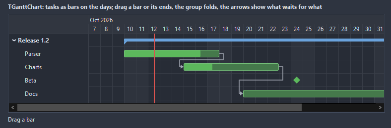

# TGanttChart

Tasks as bars on a time scale: a name column on the left, days, weeks or months across the top, progress inside the bars, arrows between a task and the one it waits for, a line for today. The mouse moves a bar or stretches its ends; a group folds its children.

- Palette page: Unleashed: Views
- Unit: `ganttchart.pas`
- Ancestor: `TScrollingWinControl`



## Usage

```pascal
procedure TForm1.FormCreate(Sender: TObject);
begin
  var plan := TGanttChart.Create(Self);
  plan.Parent := Self;
  plan.SetBounds(8, 8, 700, 240);
  var design := plan.AddTask('Design', Date, Date + 5);
  design.Progress := 80;
  var build := plan.AddTask('Build', Date + 5, Date + 15);
  build.DependsOn := design.Index;
  plan.AddMilestone('Release', Date + 16);
  plan.OnTaskChange := @planChange;
end;

procedure TForm1.planChange(Sender: TObject; task: TGanttTask; oldStart, oldFinish: TDateTime);
begin
  Caption := Format('%s now takes %d days', [task.Caption, task.Days]);
end;
```

## Properties

| Property | Type | Default | Notes |
|---|---|---|---|
| `Tasks` | `TGanttTasks` |  |  |
| `Scale` | `TGanttScale` | `gsDays` |  |
| `RangeStart` | `TDateTime` |  | the dates shown; AutoRange takes them from the tasks with a margin |
| `RangeEnd` | `TDateTime` |  | the end of the range |
| `AutoRange` | `boolean` | `true` | the range follows the data |
| `DayWidth` | `integer` | `24` |  |
| `RowHeight` | `integer` | `0` | 0 takes it from the font |
| `NameWidth` | `integer` | `160` |  |
| `BarRadius` | `integer` | `3` |  |
| `Padding` | `integer` | `4` | the space between the border and the content |
| `ShowToday` | `boolean` | `true` |  |
| `ShowGrid` | `boolean` | `true` | a grid behind the content |
| `ShowProgress` | `boolean` | `true` | the progress bar is shown |
| `ShowDependencies` | `boolean` | `true` |  |
| `ShowWeekends` | `boolean` | `true` | Saturday and Sunday are shown |
| `AllowDrag` | `boolean` | `true` | the mouse can drag |
| `AllowResize` | `boolean` | `true` | the mouse can resize |
| `ShowCaptions` | `boolean` | `false` | the caption inside the bar as well as in the name column |
| `BarColor` | `TColor` | `clDefault` | clDefault takes the colors of the theme |
| `ProgressColor` | `TColor` | `clDefault` |  |
| `GridColor` | `TColor` | `clDefault` | clDefault takes the color of the theme |
| `TextColor` | `TColor` | `clDefault` | clDefault takes the color of the theme |
| `BackColor` | `TColor` | `clDefault` | clDefault takes the color of the theme |
| `HeaderColor` | `TColor` | `clDefault` | clDefault takes the color of the theme |
| `TodayColor` | `TColor` | `clDefault` | clDefault takes the color of the theme |
| `WeekendColor` | `TColor` | `clDefault` | clDefault takes the color of the theme |
| `ArrowColor` | `TColor` | `clDefault` |  |
| `NameColor` | `TColor` | `clDefault` |  |
| `Antialiasing` | `TAntialiasSetting` | `asTheme` | asTheme follows the theme setting, asOn and asOff force it |
| `Language` | `TFormatLanguage` | `flSystem` | the names and separators of dates, times and numbers: those of the locale of the system, or English |

Also the standard properties of a scrolling control, re-published: `Align`, `Anchors`, `BorderSpacing`, `BorderStyle`, `Color`, `Constraints`, `Enabled`, `Font`, `Hint`, `ParentFont`, `ParentShowHint`, `PopupMenu`, `ShowHint`, `TabOrder`, `TabStop`, `Visible`, `OnClick`, `OnContextPopup`, `OnDblClick`, `OnEnter`, `OnExit`, `OnKeyDown`, `OnKeyPress`, `OnKeyUp`, `OnMouseDown`, `OnMouseEnter`, `OnMouseLeave`, `OnMouseMove`, `OnMouseUp`, `OnMouseWheel`, `OnResize`.

## Events

| Event | Handler | Notes |
|---|---|---|
| `OnTaskClick` | `procedure(Sender: TObject; task: TGanttTask)` |  |
| `OnTaskDblClick` | `procedure(Sender: TObject; task: TGanttTask)` |  |
| `OnSelect` | `procedure(Sender: TObject; task: TGanttTask)` | the selection changed |
| `OnTaskChange` | `procedure(Sender: TObject; task: TGanttTask; oldStart, oldFinish: TDateTime)` | a bar was dragged or stretched; the dates are already set |

## Runtime

Available in code, not in the Object Inspector.

| Property | Type | Notes |
|---|---|---|
| `Selected` | `TGanttTask` |  |

| Method | Notes |
|---|---|
| `AddTask(const caption: string; start, finish: TDateTime; level: integer = 0): TGanttTask` |  |
| `AddMilestone(const caption: string; date: TDateTime; level: integer = 0): TGanttTask` |  |
| `ScrollToDate(date: TDateTime)` | the view scrolled so a date shows |
| `ScrollToToday` |  |
| `TaskSpan(out first, last: TDateTime)` | the first start and the last finish of the tasks |

## Companion classes

### `TGanttTask`

| Property | Type | Default | Notes |
|---|---|---|---|
| `Caption` | `string` |  | the text shown |
| `Start` | `TDateTime` |  | when it begins |
| `Finish` | `TDateTime` |  | when it ends |
| `Progress` | `integer` | `0` |  |
| `Color` | `TColor` | `clDefault` | clDefault takes a color from the palette of the chart |
| `DependsOn` | `integer` | `-1` |  |
| `Milestone` | `boolean` | `false` | a diamond on one day instead of a bar |
| `Collapsed` | `boolean` | `false` | a group whose children are folded |
| `Level` | `integer` | `0` | the depth under a group, which is the task above with a lower level |
| `Tag` | `PtrInt` | `0` | free for the application |

| Method | Notes |
|---|---|
| `Days: integer` | the days the task takes, a milestone counts one |

### `TGanttTasks`

| Method | Notes |
|---|---|
| `Add: TGanttTask` | a new entry at the end |

## Types

| Type | Values | Notes |
|---|---|---|
| `TGanttScale` | `gsDays`, `gsWeeks`, `gsMonths` |  |
