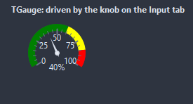
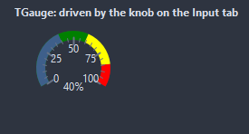
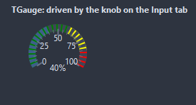

# TGauge

A dial: an arc scale from StartAngle through SweepAngle, colored zones on it, a needle at the value and the number below. The needle glides to a new value when Animated.

- Palette page: Unleashed: Display
- Unit: `gauge.pas`
- Ancestor: `TGraphicControl`


## Usage

```pascal
procedure TForm1.FormCreate(Sender: TObject);
begin
  var speed := TGauge.Create(Self);
  speed.Parent := Self;
  speed.SetBounds(8, 8, 160, 160);
  speed.Min := 0;
  speed.Max := 240;
  speed.Zones.AddZone(0, 120, clGreen);
  speed.Zones.AddZone(120, 180, clYellow);
  speed.Zones.AddZone(180, 240, clRed);
  speed.ValueFormat := '%.0f km/h';
  speed.Value := 95;
end;
```

## Properties

| Property | Type | Default | Notes |
|---|---|---|---|
| `Min` | `double` |  | the lower limit |
| `Max` | `double` |  | the upper limit |
| `Value` | `double` |  | the value shown |
| `StartAngle` | `integer` | `-120` | degrees clockwise from the top where Min sits |
| `SweepAngle` | `integer` | `240` |  |
| `ArcWidth` | `integer` | `10` | the stroke of the arc, in pixels |
| `MajorTicks` | `integer` | `5` | ticks with labels along the scale; 0 for none |
| `MinorTicks` | `integer` | `4` | ticks between two major ones |
| `Zones` | `TGaugeZones` |  |  |
| `ShowArc` | `boolean` | `true` |  |
| `ShowNeedle` | `boolean` | `true` |  |
| `ShowValue` | `boolean` | `true` | the value is shown as text |
| `ShowLabels` | `boolean` | `true` | the labels are shown |
| `Animated` | `boolean` | `true` | changes are animated |
| `ValueFormat` | `string` |  | Format patterns with the value as a float argument |
| `LabelFormat` | `string` |  |  |
| `ArcColor` | `TColor` | `clDefault` | clDefault takes the colors of the theme |
| `NeedleColor` | `TColor` | `clDefault` |  |
| `TickColor` | `TColor` | `clDefault` | clDefault takes the color of the theme |
| `TextColor` | `TColor` | `clDefault` | clDefault takes the color of the theme |
| `Antialiasing` | `TAntialiasSetting` | `asTheme` | asTheme follows the theme setting, asOn and asOff force it |
| `Style` | `TGaugeStyle` | `gsDial` | the dial: a needle over the arc, the arc filled up to the value, or an arc of segments lit up to the value |
| `Language` | `TFormatLanguage` | `flSystem` | the names and separators of dates, times and numbers: those of the locale of the system, or English |

Also the standard properties of a control, re-published: `Align`, `Anchors`, `BorderSpacing`, `Color`, `Constraints`, `Enabled`, `Font`, `Hint`, `ParentColor`, `ParentFont`, `ParentShowHint`, `PopupMenu`, `ShowHint`, `Visible`, `OnClick`, `OnContextPopup`, `OnDblClick`, `OnMouseDown`, `OnMouseEnter`, `OnMouseLeave`, `OnMouseMove`, `OnMouseUp`, `OnResize`.

## Events

| Event | Handler | Notes |
|---|---|---|
| `OnGetText` | `procedure(Sender: TObject; value: double; var text: string)` | the text to show, before it is painted |

## Companion classes

### `TGaugeZone`

A colored stretch of the scale, from one value to another.

| Property | Type | Default | Notes |
|---|---|---|---|
| `FromValue` | `double` |  |  |
| `ToValue` | `double` |  |  |
| `Color` | `TColor` | `clRed` | clDefault takes the color of the theme |

### `TGaugeZones`

| Method | Notes |
|---|---|
| `Add: TGaugeZone` | a new entry at the end |
| `AddZone(fromValue, toValue: double; color: TColor): TGaugeZone` |  |

## Types

| Type | Values | Notes |
|---|---|---|
| `TGaugeStyle` | `gsDial`, `gsFilled`, `gsSegments` | the dial: a needle over the arc, the arc filled up to the value, or an arc of segments lit up to the value |

## In pictures

### Every Style

The demo group with each value of `Style` in turn.

`Style = gsDial`



`Style = gsFilled`



`Style = gsSegments`


