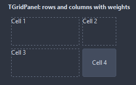

# TGridPanel

Lays its children out on a grid of Columns by Rows, left to right and top to bottom in the order of their position. A column or row takes a share of the space after its weight, or a fixed size with a px suffix.

- Palette page: Unleashed: Layout
- Unit: `gridpanel.pas`
- Ancestor: `TCustomControl`



## Usage

```pascal
procedure TForm1.FormCreate(Sender: TObject);
begin
  var grid := TGridPanel.Create(Self);
  grid.Parent := Self;
  grid.SetBounds(8, 8, 400, 200);
  grid.Columns := 3;
  grid.ColumnWeights := '1 2 1'; // the middle column is twice as wide
  grid.RowSpacing := 4;
  for var i := 1 to 6 do begin
    var cell := TButton.Create(Self);
    cell.Caption := IntToStr(i);
    cell.Parent := grid; // left to right, top to bottom
  end;
end;
```

## Properties

| Property | Type | Default | Notes |
|---|---|---|---|
| `Columns` | `integer` | `2` | the columns |
| `Rows` | `integer` | `0` | 0 takes as many as the children need |
| `ColumnSpacing` | `integer` | `6` | the gap between the columns |
| `RowSpacing` | `integer` | `6` | the gap between the rows |
| `Padding` | `integer` | `6` | the space between the border and the content |
| `ColumnWeights` | `string` |  | comma separated, one per column: a weight like 2, or a size like 120px; missing entries weigh 1 |
| `RowWeights` | `string` |  |  |
| `HorizontalAlign` | `TGridCellAlign` | `gaStretch` | how a child sits in its cell |
| `VerticalAlign` | `TGridCellAlign` | `gaStretch` | how a child sits in its cell |
| `ShowGrid` | `boolean` | `false` | the lines of the grid, at design time or always |

Also the standard properties of a control, re-published: `Align`, `Anchors`, `BorderSpacing`, `ClientHeight`, `ClientWidth`, `Color`, `Constraints`, `Enabled`, `Font`, `Hint`, `ParentColor`, `ParentFont`, `ParentShowHint`, `PopupMenu`, `ShowHint`, `TabOrder`, `TabStop`, `Visible`, `OnClick`, `OnContextPopup`, `OnDblClick`, `OnMouseDown`, `OnMouseEnter`, `OnMouseLeave`, `OnMouseMove`, `OnMouseUp`, `OnResize`.

## Runtime

Available in code, not in the Object Inspector.

| Method | Notes |
|---|---|
| `CellOf(child: TControl; out column, row: integer): boolean` | the cell a child sits in |

## Types

| Type | Values | Notes |
|---|---|---|
| `TGridCellAlign` | `gaStretch`, `gaStart`, `gaCenter`, `gaEnd` | how a child sits in its cell |
