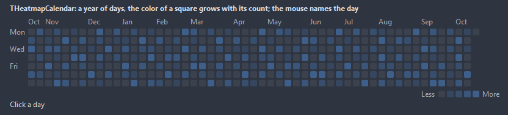
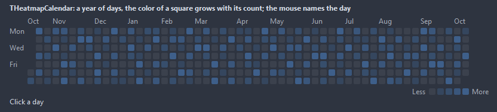
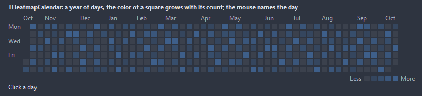
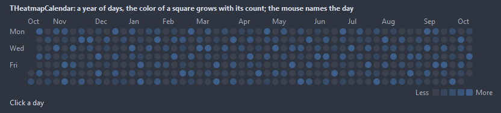

# THeatmapCalendar

A year of days as a grid of squares, one column per week, the color of a square growing with its value: commits, steps, sales, anything counted per day. The mouse names the day and its value in a hint.

- Palette page: Unleashed: Display
- Unit: `heatmapcalendar.pas`
- Ancestor: `TGraphicControl`



## Usage

```pascal
procedure TForm1.FormCreate(Sender: TObject);
begin
  var activity := THeatmapCalendar.Create(Self);
  activity.Parent := Self;
  activity.ShowLastYear;
  for var i := 0 to 364 do
    if i mod 3 = 0 then activity.Add(Date - i, 1 + i mod 5);
  activity.OnHint := @activityHint;
  activity.OnCellClick := @activityClick;
end;

procedure TForm1.activityHint(Sender: TObject; date: TDateTime; value: double; var text: string);
begin
  text := Format('%s: %.0f commits', [FormatDateTime('yyyy-mm-dd', date), value]);
end;

procedure TForm1.activityClick(Sender: TObject; date: TDateTime; value: double);
begin
  Caption := FormatDateTime('yyyy-mm-dd', date);
end;
```

## Properties

| Property | Type | Default | Notes |
|---|---|---|---|
| `StartDate` | `TDateTime` |  | the first and the last day shown; 0 for the last twelve months |
| `EndDate` | `TDateTime` |  | the last date |
| `Levels` | `integer` | `4` | the number of color steps between empty and the strongest |
| `CellSize` | `integer` | `11` |  |
| `CellGap` | `integer` | `3` |  |
| `CornerRadius` | `integer` | `2` | the rounding of the corners, in pixels |
| `MaxValue` | `double` |  | the value of the strongest color; AutoRange takes the highest value shown |
| `AutoRange` | `boolean` | `true` | the range follows the data |
| `ShowMonths` | `boolean` | `true` |  |
| `ShowWeekdays` | `boolean` | `true` |  |
| `ShowLegend` | `boolean` | `true` | the legend is shown |
| `MondayFirst` | `boolean` | `true` | the week starts on Monday, else on Sunday |
| `ShowEmptyOutline` | `boolean` | `false` | a faint frame around days without a value |
| `EmptyColor` | `TColor` | `clDefault` | clDefault takes the colors of the theme; the levels run from Low to High |
| `LowColor` | `TColor` | `clDefault` |  |
| `HighColor` | `TColor` | `clDefault` |  |
| `TextColor` | `TColor` | `clDefault` | clDefault takes the color of the theme |
| `OutlineColor` | `TColor` | `clDefault` |  |
| `Antialiasing` | `TAntialiasSetting` | `asTheme` | asTheme follows the theme setting, asOn and asOff force it |
| `CellShape` | `THeatmapCellShape` | `hcRounded` | the outline of a day: a box rounded by CornerRadius, a square, or a circle |
| `Language` | `TFormatLanguage` | `flSystem` | the names and separators of dates, times and numbers: those of the locale of the system, or English |

Also the standard properties of a control, re-published: `Align`, `Anchors`, `AutoSize`, `BorderSpacing`, `Color`, `Constraints`, `Enabled`, `Font`, `ParentColor`, `ParentFont`, `ParentShowHint`, `PopupMenu`, `ShowHint`, `Visible`, `OnClick`, `OnDblClick`, `OnMouseDown`, `OnMouseEnter`, `OnMouseLeave`, `OnMouseMove`, `OnMouseUp`, `OnResize`.

## Events

| Event | Handler | Notes |
|---|---|---|
| `OnCellClick` | `procedure(Sender: TObject; date: TDateTime; value: double)` | a click on a cell |
| `OnCellHover` | `procedure(Sender: TObject; date: TDateTime; value: double)` | the mouse came over a day; date 0 once it left |
| `OnHint` | `procedure(Sender: TObject; date: TDateTime; value: double; var text: string)` | the text of the hint over a cell; text comes in as "date: value" |
| `OnDrawCell` | `TCustomDrawEvent` | paints over the square of a day: index counts the days from the first one shown; dsHover under the mouse |

## Runtime

Available in code, not in the Object Inspector.

| Property | Type | Notes |
|---|---|---|
| `HotDate` | `TDateTime` |  |

| Method | Notes |
|---|---|
| `SetValue(date: TDateTime; value: double)` | the value of a day; a day without one counts as zero |
| `GetValue(date: TDateTime): double` |  |
| `Add(date: TDateTime; delta: double = 1)` | adds to the value of a day |
| `Clear` | removes everything |
| `LoadFromStrings(lines: TStrings)` | lines of yyyy-mm-dd=value |
| `SaveToStrings(lines: TStrings)` | writes the content as lines of text |
| `ShowYear(year: integer)` | the range set to one calendar year |
| `ShowLastYear` | the last twelve months up to today |
| `Total: double` |  |
| `MaxOf: double` |  |

## Types

| Type | Values | Notes |
|---|---|---|
| `THeatmapCellShape` | `hcRounded`, `hcSquare`, `hcCircle` | the outline of a day: a box rounded by CornerRadius, a square, or a circle |

## Custom drawing

The component paints its parts by itself, through the shapes of `ControlPaint`. A handler on the event below takes over a part: it gets the canvas of the control, the rectangle of the part, which part it is and a `TDrawState` set telling what the part is in: `dsHover`, `dsActive`, `dsSelected`, `dsPressed`, `dsDisabled`, `dsFocused`, `dsChecked`.

- `OnDrawCell`: paints over the square of a day: index counts the days from the first one shown; dsHover under the mouse. Handler: `TCustomDrawEvent`.

A handler may paint with the plain canvas, or through `beginShapes()` from `ControlPaint` for the same smoothed shapes the components use: `paintRoundRect()`, `paintCircle()`, `paintCheck()`, `FillPolygon()` and the rest, then `Flush` once. Colors of the theme come from `pick()`, `blend()` and `contrastText()`.

## In pictures

### Every CellShape

The demo group with each value of `CellShape` in turn.

`CellShape = hcRounded`



`CellShape = hcSquare`



`CellShape = hcCircle`


