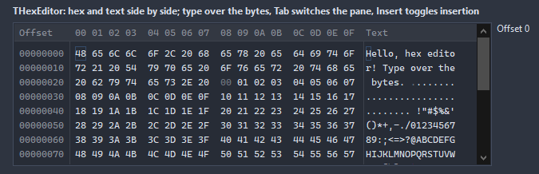

# THexEditor

Bytes in hex and as text side by side: an offset column, a cursor that types nibbles or characters over the bytes, a selection, insert and delete, a search. The data lives in a stream of its own; load a file or hand it bytes, then save what came out.

- Palette page: Unleashed: Views
- Unit: `hexeditor.pas`
- Ancestor: `TScrollingWinControl`



## Usage

```pascal
procedure TForm1.FormCreate(Sender: TObject);
begin
  var hex := THexEditor.Create(Self);
  hex.Parent := Self;
  hex.SetBounds(8, 8, 620, 240);
  hex.LoadFromFile('firmware.bin');
  hex.BytesPerRow := 16;
  var at := hex.Find(#$4D#$5A); // the first MZ
  if at >= 0 then hex.SelectRange(at, 2);
  hex.OnChange := @hexChange;
end;

procedure TForm1.hexChange(Sender: TObject);
begin
  Caption := Format('%d bytes, modified', [THexEditor(Sender).Size]);
end;
```

## Properties

| Property | Type | Default | Notes |
|---|---|---|---|
| `BytesPerRow` | `integer` | `16` |  |
| `GroupSize` | `integer` | `4` | a wider gap after every this many bytes, 0 for none |
| `AddressDigits` | `integer` | `8` |  |
| `ReadOnly` | `boolean` | `false` | the mouse and the keyboard change nothing |
| `ShowAddress` | `boolean` | `true` |  |
| `ShowText` | `boolean` | `true` | the text part is shown |
| `UpperCase` | `boolean` | `true` |  |
| `InsertMode` | `boolean` | `false` | typing puts bytes in instead of over; Insert toggles it too |
| `ShowHeader` | `boolean` | `true` | the column numbers above the bytes |
| `AddressColor` | `TColor` | `clDefault` | clDefault takes the colors of the theme |
| `HexColor` | `TColor` | `clDefault` |  |
| `TextColor` | `TColor` | `clDefault` | clDefault takes the color of the theme |
| `SelectionColor` | `TColor` | `clDefault` |  |
| `CursorColor` | `TColor` | `clDefault` |  |
| `ZeroColor` | `TColor` | `clDefault` | zero bytes shown dimmer |
| `BackColor` | `TColor` | `clDefault` | clDefault takes the color of the theme |
| `GridColor` | `TColor` | `clDefault` | clDefault takes the color of the theme |
| `Antialiasing` | `TAntialiasSetting` | `asTheme` | asTheme follows the theme setting, asOn and asOff force it |

Also the standard properties of a scrolling control, re-published: `Align`, `Anchors`, `BorderSpacing`, `BorderStyle`, `Color`, `Constraints`, `Enabled`, `Font`, `Hint`, `ParentFont`, `ParentShowHint`, `PopupMenu`, `ShowHint`, `TabOrder`, `TabStop`, `Visible`, `OnClick`, `OnContextPopup`, `OnDblClick`, `OnEnter`, `OnExit`, `OnKeyDown`, `OnKeyPress`, `OnKeyUp`, `OnMouseDown`, `OnMouseEnter`, `OnMouseLeave`, `OnMouseMove`, `OnMouseUp`, `OnMouseWheel`, `OnResize`.

## Events

| Event | Handler | Notes |
|---|---|---|
| `OnChange` | `procedure(Sender: TObject)` | after the value changed |
| `OnCursorMove` | `procedure(Sender: TObject)` |  |
| `OnSelect` | `procedure(Sender: TObject; start, count: int64)` | the selection changed |

## Runtime

Available in code, not in the Object Inspector.

| Property | Type | Notes |
|---|---|---|
| `Data` | `TMemoryStream` |  |
| `Bytes[index: int64]` | `byte` |  |
| `Size` | `int64` |  |
| `Caret` | `int64` |  |
| `Modified` | `boolean` |  |
| `Pane` | `THexPane` | the pane the cursor is in: hex or text |

| Method | Notes |
|---|---|
| `LoadFromFile(const fileName: string)` | loads the content from a file |
| `SaveToFile(const fileName: string)` | writes the content to a file |
| `LoadFromStream(stream: TStream)` | loads the content from a stream |
| `SaveToStream(stream: TStream)` | writes the content to a stream |
| `SetBytes(const bytes: string)` | the bytes of a string, as they are |
| `GetBytes: string` |  |
| `Clear` | removes everything |
| `SelectRange(start, count: int64)` | the selection as a range; none when count is 0 |
| `SelectAll` | selects everything |
| `SelectionStart: int64` |  |
| `SelectionLength: int64` |  |
| `SelectedBytes: string` | the selected bytes as text |
| `DeleteSelection` |  |
| `InsertBytes(const bytes: string)` | bytes put in at the cursor |
| `Find(const bytes: string; fromStart: boolean = false): int64` | the next place the bytes occur after the cursor, -1 for none; found bytes get selected |
| `FindText(const text: string; fromStart: boolean = false): int64` | the next place the text occurs after the cursor |

## Types

| Type | Values | Notes |
|---|---|---|
| `THexPane` | `hpHex`, `hpText` |  |
