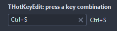

# THotKeyEdit

A field that takes a keyboard shortcut: press the keys and they show as text. Backspace, Delete or Escape clear it, Tab moves on.

- Palette page: Unleashed: Input
- Unit: `hotkeyedit.pas`
- Ancestor: `TCustomControl`



## Usage

```pascal
procedure TForm1.FormCreate(Sender: TObject);
begin
  var key := THotKeyEdit.Create(Self);
  key.Parent := Self;
  key.Width := 180;
  key.RequireModifier := true;
  key.HotKey := ShortCut(VK_S, [ssCtrl]);
  key.OnHotKey := @keyHotKey;
end;

procedure TForm1.keyHotKey(Sender: TObject; var hotKey: TShortCut; var accept: boolean);
begin
  // F1 stays with the help
  accept := hotKey <> VK_F1;
end;
```

## Properties

| Property | Type | Default | Notes |
|---|---|---|---|
| `HotKey` | `TShortCut` | `0` |  |
| `RequireModifier` | `boolean` | `false` | a plain key without Ctrl, Alt or Shift is refused; function keys pass |
| `AllowEmpty` | `boolean` | `true` | the field may hold no value |
| `ReadOnly` | `boolean` | `false` | the mouse and the keyboard change nothing |
| `ShowClearButton` | `boolean` | `true` | a cross that clears the shortcut |
| `EmptyText` | `string` |  | shown while no shortcut is set |
| `CornerRadius` | `integer` | `4` | the rounding of the corners, in pixels |
| `Padding` | `integer` | `6` | the space between the border and the content |
| `BorderColor` | `TColor` | `clDefault` | clDefault takes the colors of the theme |
| `FocusBorderColor` | `TColor` | `clDefault` | the border while focused; clDefault takes the accent of the theme |
| `FieldColor` | `TColor` | `clDefault` | the fill of the field; clDefault takes the color of the theme |
| `Antialiasing` | `TAntialiasSetting` | `asTheme` | asTheme follows the theme setting, asOn and asOff force it |

Also the standard properties of a control, re-published: `Align`, `Anchors`, `AutoSize`, `BorderSpacing`, `Color`, `Constraints`, `Enabled`, `Font`, `Hint`, `ParentColor`, `ParentFont`, `ParentShowHint`, `PopupMenu`, `ShowHint`, `TabOrder`, `TabStop`, `Visible`, `OnClick`, `OnContextPopup`, `OnEnter`, `OnExit`, `OnKeyDown`, `OnKeyUp`, `OnMouseDown`, `OnMouseEnter`, `OnMouseLeave`, `OnMouseMove`, `OnMouseUp`, `OnResize`.

## Events

| Event | Handler | Notes |
|---|---|---|
| `OnChange` | `procedure(Sender: TObject)` | after the value changed |
| `OnHotKey` | `procedure(Sender: TObject; var hotKey: TShortCut; var accept: boolean)` | a shortcut was pressed; accept = false keeps the old one |

## Runtime

Available in code, not in the Object Inspector.

| Method | Notes |
|---|---|
| `Text: string` | the shortcut as text, empty for none |
| `Clear` | removes everything |
