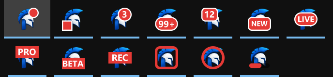

# TIconBadge

Paints a badge over the icon of the application, so it shows on the taskbar button, and over a tray icon when one is linked: a dot, a counter, a short text, a frame or a progress bar, still or animated. The icons get their own pictures back when Visible goes off.

- Palette page: Unleashed: Feedback
- Unit: `iconbadge.pas`
- Ancestor: `TComponent`



The badge is drawn into the picture of the icon itself, so it works the same way on every system: the component builds a new icon from the base picture and hands it to `Application.Icon`, to the form when the form has an icon of its own, and to the linked `TTrayIcon`. Nothing changes at design time.

On Windows the taskbar shows the icon of the shortcut for a pinned application, and the icon of the program file for some grouped ones, whatever icon the window has. With `OwnButton` the window takes a taskbar button of its own, and that button shows the icon of the window. It keeps that button for as long as `Visible` and `Taskbar` are on, also while there is nothing to show (a counter at zero), so the button does not jump between two places.

A tray icon is the standard `TTrayIcon` of the LCL: drop one on the form, make it visible and pick it in `TrayIcon`.

## Usage

```pascal
procedure TForm1.FormCreate(Sender: TObject);
begin
  var unread := TIconBadge.Create(Self);
  unread.Name := 'unread';
  unread.Style := ibsNumber;
  unread.Value := 3;
  unread.Effect := ibePulse;
end;

procedure TForm1.mailArrived(Sender: TObject);
begin
  var unread := TIconBadge(FindComponent('unread'));
  unread.Value := unread.Value+1;
end;

procedure TForm1.FormActivate(Sender: TObject);
begin
  TIconBadge(FindComponent('unread')).Value := 0;
end;
```

## Styles

| Style | What it paints | Uses |
|---|---|---|
| `ibsDot` | a plain dot: something is waiting | `Position`, `Shape`, `Size` |
| `ibsNumber` | `Value` in a pill, `Max+` past `Max`; no badge at zero unless `ShowZero` | `Value`, `Max`, `ShowZero`, `Position`, `Shape`, `Size` |
| `ibsText` | `Text` in a pill; the pill grows with the text up to the width of the icon, then the letters shrink | `Text`, `Position`, `Shape`, `Size` |
| `ibsBanner` | `Text` on a strip across the whole icon, at the top, in the middle or at the bottom | `Text`, the row of `Position`, `Size` |
| `ibsFrame` | a frame around the icon: a ring with `ibhRound`, a rounded or a square frame otherwise | `Shape`, `Size` |
| `ibsProgress` | a bar filled up to `Progress` percent, at the bottom, or at the top with a `Position` of the top row | `Progress`, `Position`, `Shape`, `Size` |

Every style takes `BadgeColor`, and every style can move: `Effect` blinks, pulses or fades the badge, one round every `Period` milliseconds.

## Properties

| Property | Type | Default | Notes |
|---|---|---|---|
| `Icon` | `TIcon` |  | the picture under the badge; empty takes the icon of the form, or of the application when the form has none |
| `TrayIcon` | `TCustomTrayIcon` |  | a tray icon that gets the same badge |
| `Style` | `TIconBadgeStyle` | `ibsDot` | what is painted over the icon |
| `Position` | `TIconBadgePosition` | `ibpTopRight` | where the badge sits; a banner takes the row only, a progress bar goes to the top or the bottom, a frame ignores it |
| `Shape` | `TIconBadgeShape` | `ibhRound` | the outline of the badge |
| `Effect` | `TIconBadgeEffect` | `ibeNone` | how the badge moves |
| `Value` | `integer` | `0` | the number of ibsNumber |
| `Max` | `integer` | `99` | values past this show as "Max+" |
| `Progress` | `integer` | `0` | percent done, the bar of ibsProgress |
| `Size` | `integer` | `50` | the height of the badge in percent of the icon, 10 to 100; a dot takes seven tenths of it |
| `Period` | `integer` | `1000` | one round of the effect, in milliseconds |
| `Text` | `string` |  | the words of ibsText and ibsBanner; a few letters fit |
| `FontName` | `string` |  | empty takes the default font |
| `Bold` | `boolean` | `true` | the text is bold |
| `OwnButton` | `boolean` | `true` | Windows: the window takes a taskbar button of its own while Visible and Taskbar are on; off, it stays with a pinned button, which shows the icon of the shortcut and no badge |
| `Visible` | `boolean` | `true` | off, the icons show their own pictures |
| `Taskbar` | `boolean` | `true` | the icon of the application and of the form carries the badge; off, only the tray icon does |
| `ShowZero` | `boolean` | `false` | a zero shows; off, ibsNumber has no badge at zero |
| `Grayscale` | `boolean` | `false` | the picture under the badge loses its colors |
| `BadgeColor` | `TColor` | `BADGE_RED` | the fill of the badge |
| `TextColor` | `TColor` | `clWhite` | the number or the text |
| `BorderColor` | `TColor` | `clWhite` | the rim that keeps the badge apart from the picture; clNone for none |

## Runtime

Available in code, not in the Object Inspector.

| Method | Notes |
|---|---|
| `MakeIcon(side: integer): TIcon` | the icon with the badge as it is right now, side pixels wide and high; the caller frees it |
| `Restart` | starts the effect over from its first frame |
| `BeginUpdate` / `EndUpdate` | several properties set between the two repaint the icons once |

## Types

| Type | Values | Notes |
|---|---|---|
| `TIconBadgeStyle` | `ibsDot`, `ibsNumber`, `ibsText`, `ibsBanner`, `ibsFrame`, `ibsProgress` | a plain dot, Value as a number, Text in a pill, Text on a strip across the icon, a frame around the icon, a bar showing Progress |
| `TIconBadgePosition` | `ibpTopLeft`, `ibpTop`, `ibpTopRight`, `ibpLeft`, `ibpCenter`, `ibpRight`, `ibpBottomLeft`, `ibpBottom`, `ibpBottomRight` | where the badge sits on the icon |
| `TIconBadgeShape` | `ibhRound`, `ibhRounded`, `ibhSquare` | fully round ends, corners rounded by a quarter, square |
| `TIconBadgeEffect` | `ibeNone`, `ibeBlink`, `ibePulse`, `ibeFade` | still; shown and hidden in turns; shrinking and growing; fading out and in |
