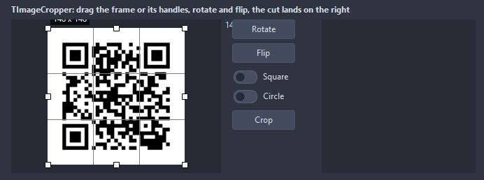

# TImageCropper

A picture with a crop frame over it: the frame moves and resizes by its edges and corners, keeps a ratio when asked, the rest is dimmed. Rotate and flip turn the picture itself; Crop hands back the cut.

- Palette page: Unleashed: Views
- Unit: `imagecropper.pas`
- Ancestor: `TCustomControl`



## Usage

```pascal
procedure TForm1.FormCreate(Sender: TObject);
begin
  var crop := TImageCropper.Create(Self);
  crop.Parent := Self;
  crop.SetBounds(8, 8, 400, 300);
  crop.LoadFromFile('portrait.jpg');
  crop.Ratio := 1; // a square frame; 0 frees it
  crop.Shape := csEllipse;
  crop.OnChange := @cropChange;
  // later, the frame as a picture of a fixed size
  var avatar := autofree TBitmap.Create;
  crop.CropTo(avatar, 128, 128);
  avatar.SaveToFile('avatar.bmp');
end;

procedure TForm1.cropChange(Sender: TObject; const cropRect: TRect);
begin
  Caption := Format('%d x %d', [cropRect.Width, cropRect.Height]);
end;
```

## Properties

| Property | Type | Default | Notes |
|---|---|---|---|
| `Picture` | `TPicture` |  | the picture shown |
| `Ratio` | `double` |  | width to height of the frame, 0 for free; 1 is a square |
| `Shape` | `TCropShape` | `csRectangle` | the frame: a rectangle or an ellipse |
| `HandleSize` | `integer` | `8` |  |
| `MinCrop` | `integer` | `16` |  |
| `Padding` | `integer` | `12` | the space between the border and the content |
| `GridLines` | `integer` | `2` | the thirds inside the frame; 0 for none |
| `BorderWidth` | `integer` | `1` | the border, 0 for none |
| `ShowGrid` | `boolean` | `true` | a grid behind the content |
| `ShowSize` | `boolean` | `true` | the size of the crop in a corner of the frame |
| `DimOutside` | `boolean` | `true` |  |
| `FrameColor` | `TColor` | `clDefault` | clDefault takes the colors of the theme |
| `DimColor` | `TColor` | `clDefault` |  |
| `HandleColor` | `TColor` | `clDefault` |  |
| `BackColor` | `TColor` | `clDefault` | clDefault takes the color of the theme |
| `TextColor` | `TColor` | `clDefault` | clDefault takes the color of the theme |
| `Antialiasing` | `TAntialiasSetting` | `asTheme` | asTheme follows the theme setting, asOn and asOff force it |
| `CropSmoothing` | `TShapeAntialiasing` | `aaHigh` | how the edge of an elliptic cut blends into transparency: not at all, or by the share of each pixel inside the ellipse in 4, 9 or 64 steps |

Also the standard properties of a control, re-published: `Align`, `Anchors`, `BorderSpacing`, `Constraints`, `Enabled`, `Font`, `Hint`, `ParentFont`, `ParentShowHint`, `PopupMenu`, `ShowHint`, `TabOrder`, `TabStop`, `Visible`, `OnClick`, `OnContextPopup`, `OnDblClick`, `OnEnter`, `OnExit`, `OnKeyDown`, `OnKeyPress`, `OnKeyUp`, `OnMouseDown`, `OnMouseEnter`, `OnMouseLeave`, `OnMouseMove`, `OnMouseUp`, `OnResize`.

## Events

| Event | Handler | Notes |
|---|---|---|
| `OnChange` | `procedure(Sender: TObject; const cropRect: TRect)` | after the value changed |

## Runtime

Available in code, not in the Object Inspector.

| Property | Type | Notes |
|---|---|---|
| `CropRect` | `TRect` | the crop in picture pixels |
| `Bitmap` | `TBitmap` |  |

| Method | Notes |
|---|---|
| `LoadFromFile(const fileName: string)` | loads the content from a file |
| `Crop: TBitmap` | the cut as a new bitmap the caller owns |
| `CropTo(target: TBitmap; width, height: integer)` | the cut drawn into a bitmap of a size, scaled to fill it |
| `RotateRight` |  |
| `RotateLeft` |  |
| `FlipHorizontal` |  |
| `FlipVertical` |  |
| `Reset` | the frame back to the whole picture |
| `SetCropSize(width, height: integer)` | the frame centered at a size |

## Types

| Type | Values | Notes |
|---|---|---|
| `TCropShape` | `csRectangle`, `csEllipse` | the frame: a rectangle or an ellipse |
