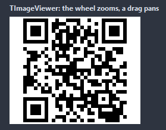

# TImageViewer

A picture with zoom and pan: the wheel zooms around the mouse, a drag moves the picture, a double click fits it again. The picture may be loaded from a file, a stream or assigned.

- Palette page: Unleashed: Views
- Unit: `imageviewer.pas`
- Ancestor: `TCustomControl`



## Usage

```pascal
procedure TForm1.FormCreate(Sender: TObject);
begin
  var viewer := TImageViewer.Create(Self);
  viewer.Parent := Self;
  viewer.Align := alClient;
  viewer.LoadFromFile('photo.jpg');
  viewer.FitMode := fmFit; // the wheel zooms, a drag pans
  viewer.OnZoomChanged := @viewerZoom;
end;

procedure TForm1.viewerZoom(Sender: TObject; zoom: double);
begin
  Caption := Format('%.0f%%', [zoom * 100]);
end;
```

## Properties

| Property | Type | Default | Notes |
|---|---|---|---|
| `Picture` | `TPicture` |  | the picture shown |
| `Zoom` | `double` |  | the zoom with FitMode fmNone; 1 is the natural size |
| `FitMode` | `TImageFitMode` | `fmFit` | fmNone shows the picture at Zoom; the others pick the zoom from the box |
| `MinZoom` | `double` |  |  |
| `MaxZoom` | `double` |  |  |
| `ZoomStep` | `double` |  | the factor of a zoom step |
| `Checkerboard` | `boolean` | `true` | a checkerboard behind a picture with transparency |
| `WheelZooms` | `boolean` | `true` |  |
| `DragPans` | `boolean` | `true` |  |
| `Smooth` | `boolean` | `true` | the picture resamples when scaled; off, the pixels stay sharp |
| `ShowBorder` | `boolean` | `true` | a border is drawn |
| `BackColor` | `TColor` | `clDefault` | clDefault takes the colors of the theme |
| `BorderColor` | `TColor` | `clDefault` | clDefault takes the color of the theme |

Also the standard properties of a control, re-published: `Align`, `Anchors`, `BorderSpacing`, `Color`, `Constraints`, `Enabled`, `Hint`, `ParentShowHint`, `PopupMenu`, `ShowHint`, `TabOrder`, `TabStop`, `Visible`, `OnClick`, `OnContextPopup`, `OnDblClick`, `OnEnter`, `OnExit`, `OnKeyDown`, `OnKeyPress`, `OnKeyUp`, `OnMouseDown`, `OnMouseEnter`, `OnMouseLeave`, `OnMouseMove`, `OnMouseUp`, `OnMouseWheel`, `OnResize`.

## Events

| Event | Handler | Notes |
|---|---|---|
| `OnZoomChanged` | `procedure(Sender: TObject; zoom: double)` |  |
| `OnPictureChanged` | `procedure(Sender: TObject)` |  |

## Runtime

Available in code, not in the Object Inspector.

| Property | Type | Notes |
|---|---|---|
| `CurrentZoom` | `double` | the zoom on screen, the fit included |

| Method | Notes |
|---|---|
| `LoadFromFile(const fileName: string)` | loads the content from a file |
| `LoadFromStream(stream: TStream)` | loads the content from a stream |
| `Clear` | removes everything |
| `ZoomIn` |  |
| `ZoomOut` |  |
| `ActualSize` | the natural size, centered |
| `FitToWindow` | the whole picture in the box |
| `ZoomAt(factor: double; const at: TPoint)` | zooms around a client point |
| `PicturePointAt(const client: TPoint): TPoint` | the picture point under a client point, or (-1,-1) outside the picture |

## Types

| Type | Values | Notes |
|---|---|---|
| `TImageFitMode` | `fmNone`, `fmFit`, `fmFitWidth`, `fmFitHeight`, `fmFill` | fmNone shows the picture at Zoom; the others pick the zoom from the box |
