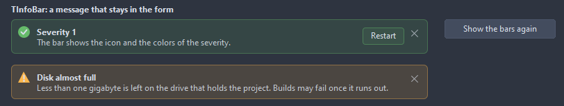
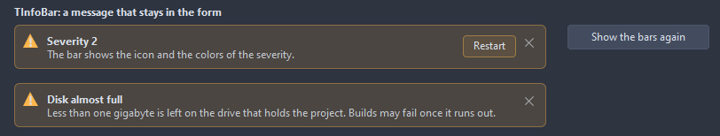
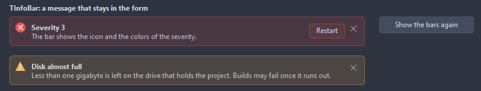
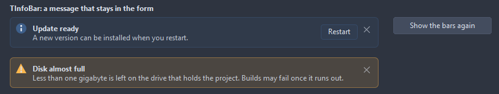
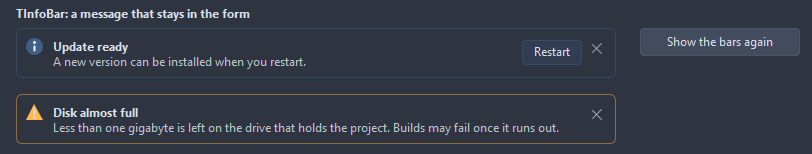
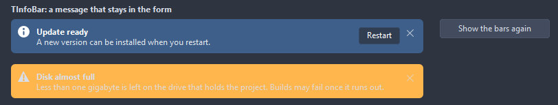
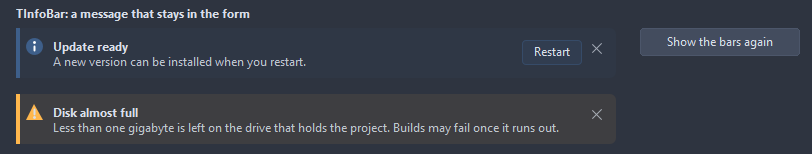

# TInfoBar

A message that stays in the form, unlike a toast: a tinted bar with the icon of its severity, a bold title, the text wrapped under it, a button that does something about it and a close button. Show opens it, the close button hides it.

- Palette page: Unleashed: Feedback
- Unit: `infobar.pas`
- Ancestor: `TCustomControl`


## Usage

```pascal
procedure TForm1.FormCreate(Sender: TObject);
begin
  var bar := TInfoBar.Create(Self);
  bar.Parent := Self;
  bar.Align := alTop;
  bar.ActionCaption := 'Reload';
  bar.OnAction := @barAction;
  bar.Notify('File changed', 'Another program changed main.pas', isWarning);
end;

procedure TForm1.barAction(Sender: TObject);
begin
  TInfoBar(Sender).CloseBar;
end;
```

## Properties

| Property | Type | Default | Notes |
|---|---|---|---|
| `Title` | `string` |  | the heading |
| `Message` | `string` |  | the text |
| `ActionCaption` | `string` |  | the button; empty shows none |
| `Severity` | `TInfoSeverity` | `isInfo` |  |
| `Closable` | `boolean` | `true` | the entry has a close button |
| `ShowIcon` | `boolean` | `true` | the icon is shown |
| `CornerRadius` | `integer` | `6` | the rounding of the corners, in pixels |
| `Padding` | `integer` | `10` | the space between the border and the content |
| `InfoColor` | `TColor` | `clDefault` | clDefault takes colors that suit the background |
| `SuccessColor` | `TColor` | `clDefault` | clDefault takes the color of the theme |
| `WarningColor` | `TColor` | `clDefault` | clDefault takes the color of the theme |
| `ErrorColor` | `TColor` | `clDefault` | clDefault takes the color of the theme |
| `Antialiasing` | `TAntialiasSetting` | `asTheme` | asTheme follows the theme setting, asOn and asOff force it |
| `Style` | `TInfoBarStyle` | `ibTinted` | the look of the bar: a tint of the severity, a frame only, the severity color as the fill, or a strip of it along the left edge |

Also the standard properties of a control, re-published: `Align`, `Anchors`, `AutoSize`, `BorderSpacing`, `Color`, `Constraints`, `Enabled`, `Font`, `Hint`, `ParentColor`, `ParentFont`, `ParentShowHint`, `PopupMenu`, `ShowHint`, `TabOrder`, `TabStop`, `Visible`, `OnClick`, `OnContextPopup`, `OnDblClick`, `OnEnter`, `OnExit`, `OnMouseDown`, `OnMouseEnter`, `OnMouseLeave`, `OnMouseMove`, `OnMouseUp`, `OnResize`.

## Events

| Event | Handler | Notes |
|---|---|---|
| `OnAction` | `procedure(Sender: TObject)` |  |
| `OnClose` | `procedure(Sender: TObject; var canClose: boolean)` | before the bar hides; canClose false keeps it |

## Runtime

Available in code, not in the Object Inspector.

| Method | Notes |
|---|---|
| `Notify(const title, message: string; severity: TInfoSeverity = isInfo)` | sets the message and shows the bar |
| `CloseBar: boolean` | hides the bar the way its close button does, OnClose included |

## Types

| Type | Values | Notes |
|---|---|---|
| `TInfoSeverity` | `isInfo`, `isSuccess`, `isWarning`, `isError` |  |
| `TInfoBarStyle` | `ibTinted`, `ibOutline`, `ibSolid`, `ibStrip` | the look of the bar: a tint of the severity, a frame only, the severity color as the fill, or a strip of it along the left edge |

## In pictures

**Success; the second bar comes up after the first click.**



**Warning.**



**Error.**



### Every Style

The demo group with each value of `Style` in turn.

`Style = ibTinted`



`Style = ibOutline`



`Style = ibSolid`



`Style = ibStrip`


